## ✏️ Tujuan

Praktikum ini bertujuan agar mahasiswa memahami proses dan cara proses saling berkomunikasi, baik pada satu node maupun pada sistem terdistribusi. Selain itu, praktikum ini bertujuan untuk:

1. Memahami konsep proses dan pengelolaannya pada sistem operasi.
2. Mengetahui cara melihat, menghentikan, dan menjalankan kembali suatu proses.
3. Memahami komunikasi antarproses pada sistem terdistribusi.
4. Membuat dan menguji komunikasi antara GraphQL server dan client Python.

## 📚 Dasar Teori

### Proses pada Sistem Operasi

Proses adalah program yang sedang dieksekusi oleh sistem operasi. Setiap proses memiliki identitas berupa **Process ID (PID)**. Sistem operasi bertugas mengatur siklus hidup proses, penggunaan CPU, memori, serta sumber daya lain yang dibutuhkan. Proses dapat berada dalam beberapa keadaan, seperti dibuat, sedang berjalan, menunggu, atau dihentikan.

Pengelolaan proses dapat dilakukan melalui **Task Manager** atau perintah pada PowerShell. Perintah `Get-Process` digunakan untuk melihat proses yang sedang berjalan, `Stop-Process` digunakan untuk menghentikan proses, sedangkan `Start-Process` digunakan untuk menjalankan aplikasi atau proses baru. Ketika sebuah proses dihentikan kemudian dijalankan kembali, proses baru biasanya memperoleh PID yang berbeda.

### Komunikasi Antarproses

Komunikasi antarproses atau **Inter-Process Communication (IPC)** adalah mekanisme yang memungkinkan proses bertukar data dan berkoordinasi. Pada satu node, IPC dapat menggunakan media seperti shared memory, pipe, signal, atau socket. Pemilihan mekanisme IPC bergantung pada kebutuhan aplikasi, seperti kecepatan, jarak komunikasi, dan tingkat keamanan.

### Komunikasi pada Sistem Terdistribusi

Sistem terdistribusi terdiri atas beberapa komputer atau node yang bekerja sama melalui jaringan. Antar-node tidak memiliki shared memory dan tidak menggunakan clock global yang sama. Oleh karena itu, komunikasi dilakukan melalui pertukaran pesan menggunakan jaringan. Komunikasi tersebut harus memperhatikan alamat tujuan, format data, waktu respons, serta kemungkinan terjadinya gangguan jaringan.

### GraphQL

**GraphQL** adalah bahasa query dan runtime untuk API yang memungkinkan client meminta data sesuai field yang dibutuhkan. Berbeda dengan API yang menyediakan respons tetap, GraphQL memungkinkan client menentukan struktur data pada query. Server kemudian memproses query tersebut melalui schema dan resolver, lalu mengirimkan respons dalam format JSON.

Pada praktikum ini, Strawberry digunakan sebagai library GraphQL untuk Python. Strawberry menyediakan schema, server pengembangan, dan CLI melalui perintah `strawberry dev schema`. Client Python menggunakan library `requests` untuk mengirim query dengan metode HTTP POST ke endpoint GraphQL. Status HTTP `200` menunjukkan bahwa permintaan berhasil diproses oleh server.

## 📖 Pembahasan

## Foto 1 — Membuka task manager 

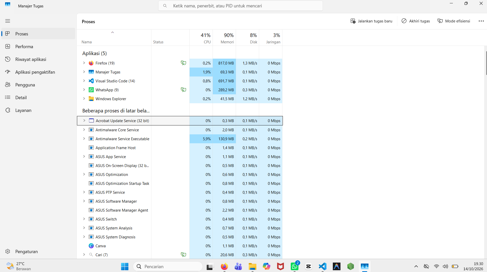

Foto pertama menampilkan Task Manager dengan beberapa aplikasi yang sedang aktif, seperti Firefox, Visual Studio Code, WhatsApp, dan Windows Explorer juga terlihat pada daftar aplikasi. Task Manager digunakan untuk memantau aplikasi yang sedang berjalan serta melihat pemakaian sumber daya komputer.

## Foto 2 —  Word Microsoft Word berhasil dibuka

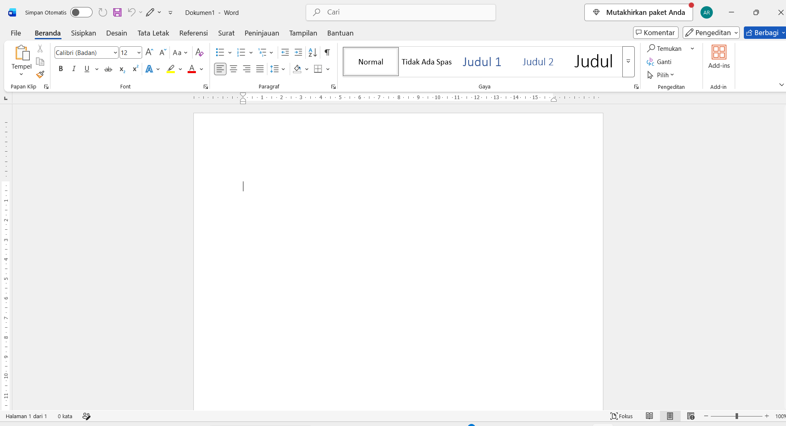

Foto kedua memperlihatkan aplikasi Microsoft Word yang terbuka dengan dokumen kosong bernama **Dokumen1**. Kursor terlihat berada di halaman dokumen, sehingga pengguna dapat mulai mengetik atau mengedit dokumen. Foto ini membuktikan bahwa aplikasi Word berhasil dijalankan pada komputer.

## Foto 3 — Melihat aplikasi yang sedang berjalan 

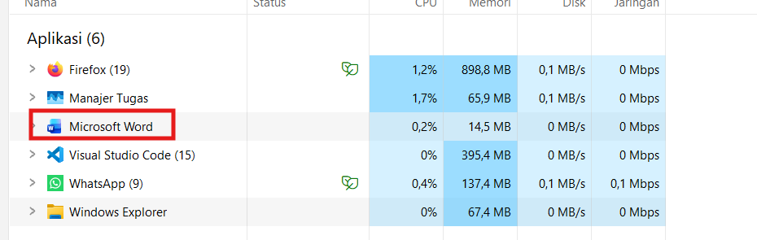

Foto ketiga menampilkan **Task Manager Windows** pada bagian *Processes*. Proses **Microsoft Word** diberi tanda kotak merah. Hal ini menunjukkan bahwa aplikasi Word sedang berjalan dan dapat dipantau melalui Task Manager, termasuk penggunaan CPU, memori, disk, dan jaringan.

## Foto 4 — Menu pengelolaan proses Microsoft

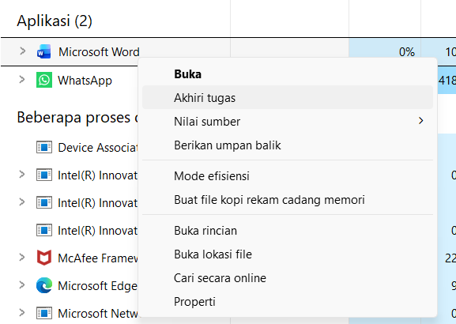

Foto keempat menampilkan menu ketika proses Microsoft Word diklik kanan di Task Manager. Terdapat beberapa pilihan seperti **Buka**, **Akhiri tugas**, **Buka lokasi file**, **Buka rincian**, dan **Properti**. Pilihan **Akhiri tugas** digunakan untuk menutup Word secara paksa apabila aplikasi mengalami hang atau tidak merespons.

## Foto 5 —  proses menggunakan PowerShell

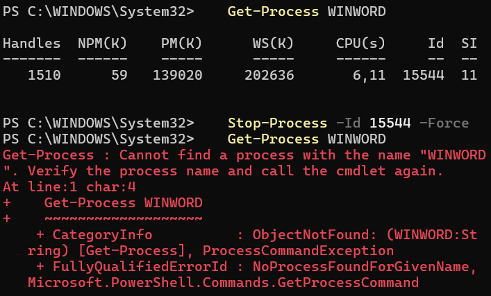

Foto kelima menampilkan perintah berikut:

```powershell
Get-Process WINWORD
```

Perintah tersebut digunakan untuk mencari proses Microsoft Word berdasarkan nama proses **WINWORD**. Setelah proses sebelumnya dihentikan, PowerShell menampilkan pesan kesalahan bahwa proses **WINWORD** tidak ditemukan. Artinya, Microsoft Word sudah tidak sedang berjalan pada saat perintah dijalankan.

## Foto 6 — Menghentikan dan menjalankan kembali Microsoft Word

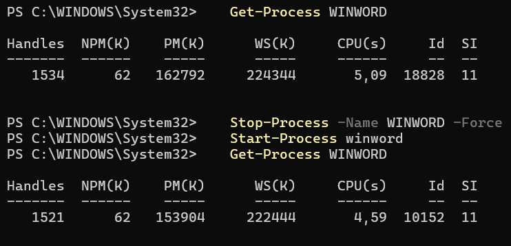

Foto keenam menunjukkan beberapa perintah PowerShell:

```powershell
Stop-Process -Name WINWORD -Force
Start-Process winword
Get-Process WINWORD
```

Perintah `Stop-Process` digunakan untuk menghentikan Microsoft Word secara paksa. Selanjutnya, `Start-Process winword` digunakan untuk menjalankan kembali aplikasi Word. Perintah terakhir memastikan bahwa proses Word sudah aktif kembali dan menampilkan informasi proses seperti penggunaan memori, CPU, serta nomor ID proses.

## penjelasan dari foto di atas ##

Keenam foto tersebut menunjukkan proses pengelolaan aplikasi Microsoft Word, mulai dari melihat proses yang sedang berjalan melalui **Task Manager**, membuka menu pengelolaan proses, menjalankan Word, menghentikan proses Word, hingga menjalankannya kembali menggunakan **PowerShell**.

## Foto 7 — Instalasi uv

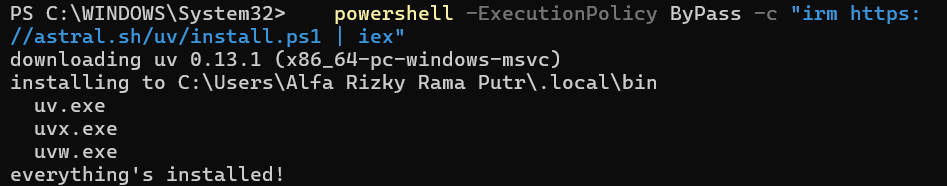

Foto ketujuh menunjukkan proses instalasi **uv** menggunakan PowerShell. Perintah instalasi mengambil skrip dari situs Astral dan menjalankannya dengan PowerShell. Berdasarkan keluaran terminal, uv berhasil dipasang pada direktori `C:\Users\Alfa Rizky Rama Putr\.local\bin`. File seperti `uv.exe`, `uvx.exe`, dan `uvw.exe` juga berhasil dibuat. Pesan *everything's installed!* menandakan bahwa proses instalasi telah selesai tanpa kesalahan.

## Foto 8 — Instalasi dan pemeriksaan Python

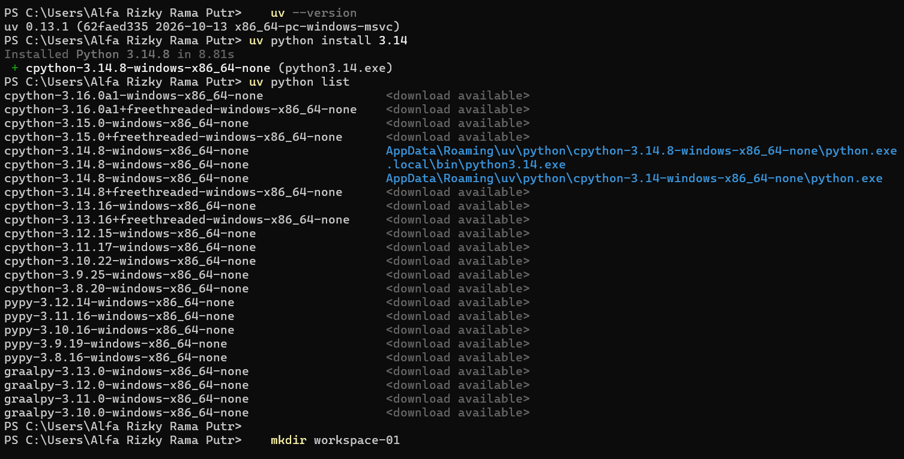

Foto kedelapan memperlihatkan pemeriksaan versi uv melalui `uv --version`, pemasangan Python 3.14 dengan `uv python install 3.14`, dan pemeriksaan interpreter yang tersedia menggunakan `uv python list`. Keluaran menunjukkan Python 3.14.8 telah berhasil dipasang. Perintah `mkdir workspace-01` kemudian digunakan untuk membuat direktori workspace proyek.

## Foto 9 — Pemeriksaan isi workspace

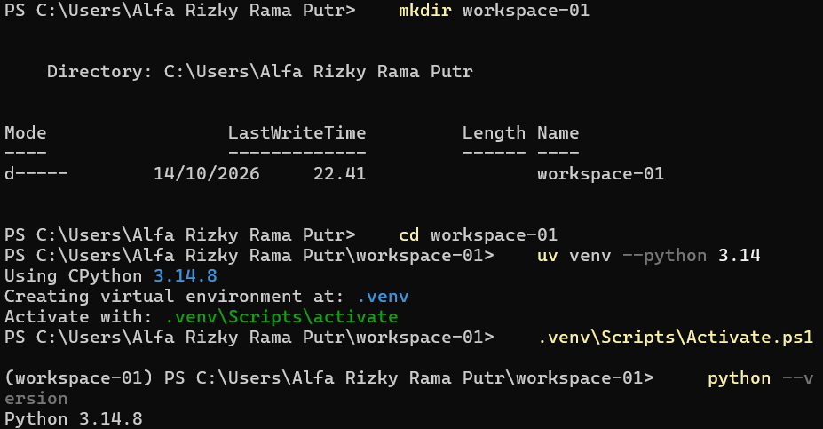

Foto kesembilan menampilkan isi direktori `workspace-01` menggunakan perintah `dir`. Di dalam workspace terdapat folder `.venv` dan berkas `schema.py`. Folder `.venv` digunakan sebagai virtual environment agar dependensi proyek terisolasi dari instalasi Python global, sedangkan `schema.py` berisi definisi schema GraphQL yang akan dijalankan oleh server Strawberry.

## Foto 10 — Instalasi Strawberry GraphQL

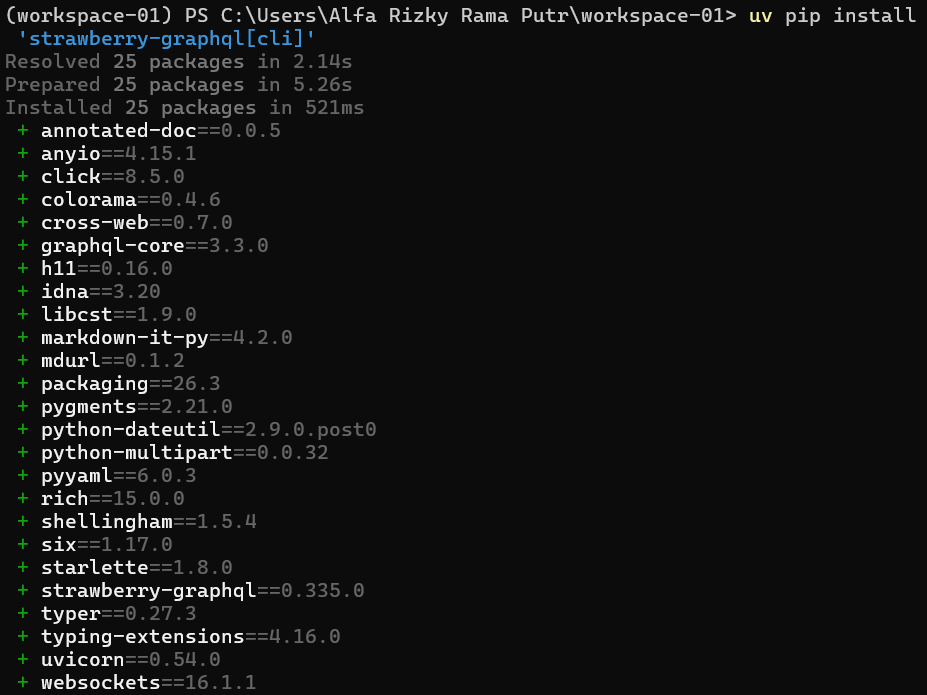

Foto kesepuluh memperlihatkan pemasangan paket **strawberry-graphql[cli]** dengan perintah `uv pip install`. Paket utama Strawberry GraphQL beserta dependensinya berhasil diselesaikan dan dipasang. Beberapa dependensi yang terlihat antara lain `graphql-core`, `click`, `pydantic`, `typing-extensions`, dan `websockets`. Keberhasilan instalasi ini menyediakan library dan perintah CLI yang diperlukan untuk membuat serta menjalankan server GraphQL menggunakan Python.

## Foto 11 — Menjalankan server Strawberry GraphQL

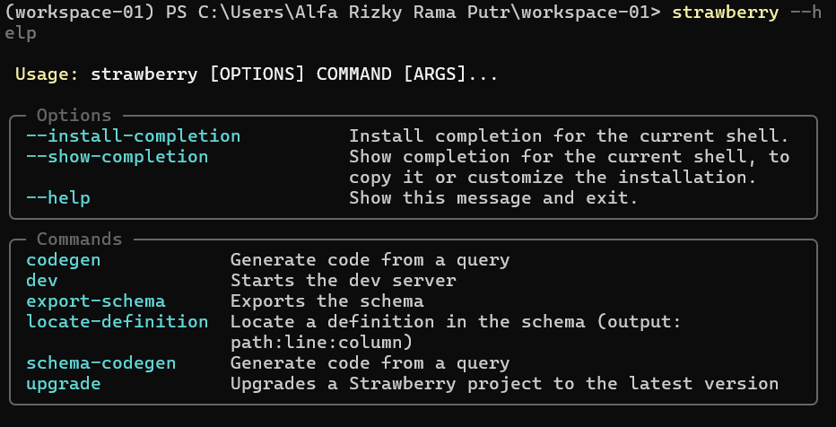

Foto kesebelas menunjukkan server Strawberry GraphQL dijalankan menggunakan perintah `strawberry dev schema`. Server berhasil berjalan dan menyediakan endpoint GraphQL pada alamat `http://0.0.0.0:8000/graphql`. Perintah tersebut membaca schema dari file `schema.py`, lalu menjalankan server pengembangan yang dapat diakses oleh client GraphQL.

## Foto 12 — Pengujian query melalui GraphiQL

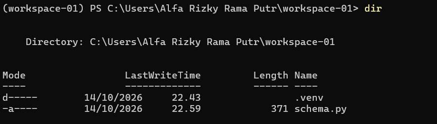

Foto kedua belas memperlihatkan aplikasi GraphiQL yang digunakan untuk menguji query ke server GraphQL. Query meminta field `title` dan `author` dari objek `books`. Respons yang diterima berisi data buku **The Great Gatsby** dan penulis **F. Scott Fitzgerald**. Hasil ini menunjukkan bahwa schema dan server GraphQL dapat memproses query dengan benar.

## Foto 13 — Pemeriksaan isi workspace

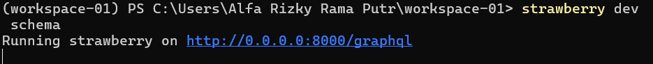

Foto ketiga belas menampilkan isi direktori `workspace-01` menggunakan perintah `dir`. Di dalam direktori tersebut terdapat folder `.venv` dan berkas `schema.py`. Folder `.venv` digunakan untuk menyimpan lingkungan Python proyek, sedangkan `schema.py` berisi definisi schema GraphQL.

## Foto 14 — Melihat bantuan Strawberry CLI

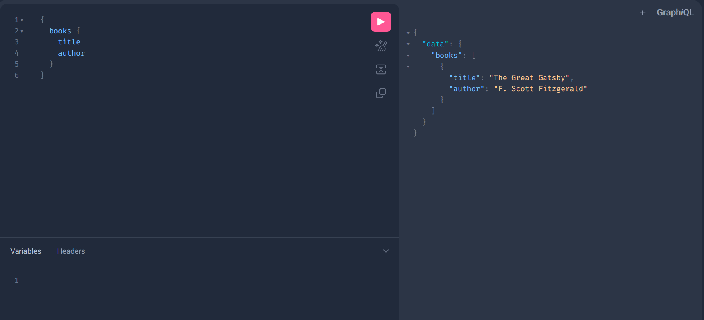

Foto keempat belas menampilkan keluaran perintah `strawberry --help`. Informasi tersebut menjelaskan penggunaan Strawberry CLI dengan format `strawberry [OPTIONS] COMMAND [ARGS]...`. Beberapa perintah yang tersedia adalah `codegen`, `dev`, `export-schema`, `locate-definition`, `schema-codegen`, dan `upgrade`.

## Foto 15 — Membuat program client GraphQL

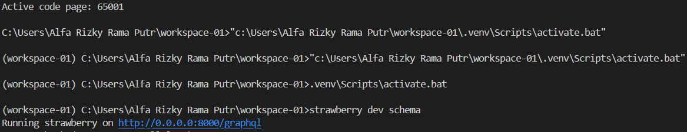

Foto kelima belas memperlihatkan berkas `client.py` yang digunakan sebagai client untuk mengakses server GraphQL. Program mengimpor library `requests`, kemudian menentukan URL endpoint `http://localhost:8000/graphql`. Query GraphQL meminta data `title` dan `author` dari objek `books`. Setelah itu, query dikirim menggunakan metode `POST` dengan format JSON. Respons dari server diubah menjadi data JSON dan ditampilkan dengan perulangan `for`, sehingga setiap judul buku dan penulisnya dapat dicetak ke terminal.

## Foto 16 — Instalasi requests dan pengujian client

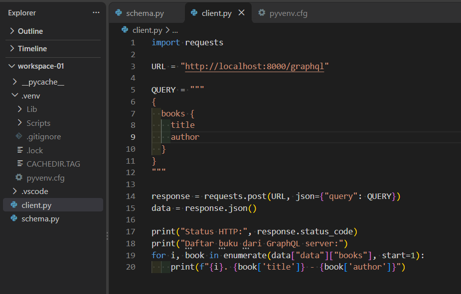

Foto keenam belas menunjukkan pemasangan library **requests** menggunakan perintah `uv.exe pip install requests`. Library ini diperlukan agar program Python dapat mengirim HTTP request ke endpoint GraphQL. Setelah instalasi selesai, perintah `python client.py` digunakan untuk menjalankan client. Hasil `Status HTTP: 200` menandakan bahwa permintaan berhasil diproses oleh server GraphQL.

## Foto 17 — Menjalankan virtual environment dan server

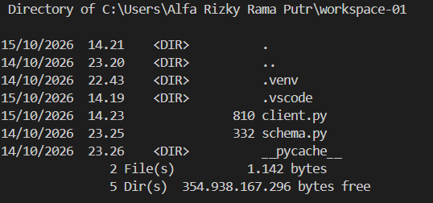

Foto ketujuh belas memperlihatkan proses aktivasi virtual environment melalui file `.venv\Scripts\activate.bat`. Setelah environment aktif, perintah `strawberry dev schema` dijalankan untuk memulai server Strawberry. Server berhasil berjalan pada alamat `http://0.0.0.0:8000/graphql`, sehingga client dapat mengirimkan query ke endpoint tersebut.

## Foto 18 — Pemeriksaan berkas proyek

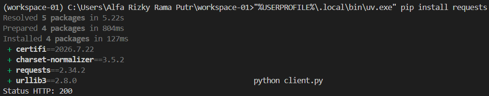

Foto kedelapan belas menampilkan isi direktori `workspace-01`. Terlihat folder `.venv` untuk lingkungan virtual, folder `.vscode` untuk konfigurasi Visual Studio Code, serta berkas `client.py` dan `schema.py`. Berkas `schema.py` berisi definisi schema dan data GraphQL, sedangkan `client.py` berfungsi sebagai program yang meminta data dari server. Keberadaan kedua berkas tersebut menunjukkan bahwa komponen server dan client telah disiapkan dalam satu workspace.

## Foto 19 — Hasil pengambilan data dari GraphQL

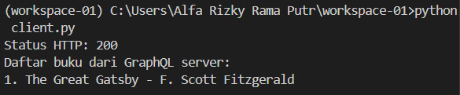

Foto kesembilan belas menunjukkan hasil eksekusi `client.py`. Program menampilkan `Status HTTP: 200`, yang berarti komunikasi antara client dan server berhasil. Selanjutnya, data buku ditampilkan dengan judul **The Great Gatsby** dan penulis **F. Scott Fitzgerald**. Hasil ini membuktikan bahwa client berhasil mengirim query, server berhasil memprosesnya, dan data GraphQL berhasil diterima serta ditampilkan di terminal.

## ✏️ Kesimpulan

Praktikum ini menunjukkan bahwa proses dapat ditampilkan, dimatikan, dan di-restart melalui sistem operasi, serta proses pada sistem terdistribusi dapat berkomunikasi melalui jaringan.

1. Proses adalah hasil eksekusi program yang dikelola sistem operasi dan dikenali melalui PID.
2. Mematikan proses menghentikan proses tanpa menghapus aplikasi, sedangkan me-restart berarti mematikan lalu menjalankan ulang aplikasi sehingga PID dapat berubah.
3. Antar-node tidak memiliki shared memory dan clock bersama, sehingga diperlukan mekanisme komunikasi khusus melalui jaringan, salah satunya GraphQL.
4. GraphQL server dengan Strawberry dan client Python berhasil dibuat. Client berhasil menerima data buku dengan status HTTP `200`.

## 📚 Daftar Pustaka

- Purnomosidi, D. P., B. *Modul 2 - Praktikum Sistem Terdistribusi dan Terdesentralisasi: Komunikasi Antar Proses pada Sistem Terdistribusi*. Program Studi Informatika, Universitas Teknologi Digital Indonesia.
- Strawberry GraphQL. [strawberry.rocks](https://strawberry.rocks/)
- Catatan uv. [github.com/NEO-X-School/notes](https://github.com/NEO-X-School/notes/blob/main/uv/00.md)
