# Dasar Teori 📚 

## 1. Sistem Terdistribusi

Sistem terdistribusi adalah sekumpulan komputer atau proses yang bekerja sama melalui jaringan dan terlihat sebagai satu sistem. Setiap node dapat menjalankan tugas secara bersamaan, bertukar pesan, dan menyimpan sebagian informasi. Karena node tidak berbagi satu memori dan tidak selalu memiliki waktu yang sama, diperlukan mekanisme untuk menjaga urutan kejadian, konsistensi data, dan koordinasi antar-node.

## 2. Sinkronisasi Waktu

Sinkronisasi waktu adalah proses menyamakan waktu pada komputer atau node dengan sumber waktu referensi. Network Time Protocol (NTP) digunakan untuk membandingkan waktu lokal dengan server waktu dan mengoreksi selisihnya. Sinkronisasi ini berguna untuk pencatatan log, penentuan waktu transaksi, pemantauan sistem, dan analisis urutan kejadian.

Namun, waktu fisik tidak selalu cukup untuk menentukan hubungan sebab-akibat pada sistem terdistribusi. Perbedaan delay jaringan dapat membuat pesan tiba tidak berurutan. Karena itu, diperlukan logical clock seperti vector clock.

## 3. Vector Clock

Vector clock adalah algoritma untuk melacak hubungan kausal antar-kejadian pada beberapa proses. Setiap proses memiliki vector dengan jumlah komponen yang sama dengan jumlah proses. Setiap komponen menunjukkan jumlah kejadian dari proses tertentu yang sudah diketahui.

Aturan dasarnya adalah:

- kejadian lokal menambah komponen milik proses tersebut;
- sebelum mengirim pesan, proses menambah clock lokal dan mengirim salinan vector;
- saat menerima pesan, proses mengambil nilai maksimum setiap komponen antara vector lokal dan vector pesan, kemudian menambah komponen lokal;
- vector A terjadi sebelum vector B jika semua komponen A lebih kecil atau sama dengan B dan setidaknya satu komponen A lebih kecil;
- dua kejadian disebut concurrent jika tidak ada vector yang terjadi sebelum vector lainnya.

Vector clock tidak mengukur waktu nyata. Fungsinya adalah menunjukkan urutan kausal berdasarkan kejadian lokal dan pertukaran pesan.

## 4. Multithreading

Multithreading adalah teknik menjalankan beberapa thread dalam satu program secara konkuren. Thread dapat mengerjakan tugas secara bersamaan sehingga program lebih responsif dan pekerjaan input/output dapat berlangsung lebih efisien. Akan tetapi, urutan eksekusi thread tidak selalu sama karena ditentukan oleh scheduler sistem operasi.

Oleh sebab itu, output program multithreading dapat berbeda urutannya pada setiap eksekusi meskipun input dan durasi tugas sama. Fungsi `join()` digunakan agar thread utama menunggu seluruh thread selesai, tetapi `join()` tidak menentukan urutan thread selesai.

## 5. Race Condition dan Data Race

Race condition terjadi ketika hasil program bergantung pada urutan eksekusi beberapa thread yang mengakses data atau sumber daya bersama. Data race merupakan salah satu bentuknya, yaitu ketika beberapa thread membaca atau mengubah data yang sama tanpa sinkronisasi yang tepat.

Operasi yang terdiri dari beberapa langkah, seperti memeriksa saldo lalu menguranginya, harus dianggap sebagai satu operasi atomik. Jika tidak, dua thread dapat membaca nilai lama yang sama dan sama-sama menganggap operasi tersebut valid. Akibatnya, data dapat menjadi tidak konsisten, seperti saldo yang menjadi negatif.

`threading.Lock` digunakan untuk menerapkan **mutual exclusion**. Hanya satu thread yang boleh memasuki bagian kritis pada satu waktu. Dengan demikian, thread berikutnya akan membaca data yang sudah diperbarui, bukan data lama.

## 6. Deadlock

Deadlock adalah keadaan ketika dua atau lebih thread saling menunggu sumber daya yang tidak pernah dilepaskan. Salah satu bentuknya adalah **circular wait**: Thread 1 memegang Lock A dan menunggu Lock B, sedangkan Thread 2 memegang Lock B dan menunggu Lock A.

Lock dapat mencegah race condition, tetapi penggunaan lock yang tidak tepat dapat menyebabkan deadlock. Deadlock dapat dikurangi dengan:

- mengambil lock dalam urutan yang konsisten;
- melepaskan lock sesegera mungkin;
- menggunakan `try/finally` agar lock selalu dilepaskan;
- menggunakan timeout saat memperoleh lock;
- menghindari memegang satu lock ketika meminta lock lain jika tidak diperlukan.

## 7. Algoritma Raft

Raft adalah algoritma konsensus yang digunakan untuk mengoordinasikan beberapa node dan memilih satu node sebagai leader. Node Raft memiliki tiga keadaan utama: **follower**, **candidate**, dan **leader**.

Jika follower tidak menerima heartbeat dalam waktu tertentu, follower mengalami timeout dan berubah menjadi candidate. Candidate menaikkan term, memilih dirinya sendiri, lalu meminta suara dari node lain. Candidate yang memperoleh suara mayoritas menjadi leader. Setelah terpilih, leader mengirim heartbeat secara berkala agar follower mengetahui bahwa leader masih aktif.

Leader bertugas menerima perintah, mengelola log, dan pada implementasi lengkap mereplikasi log kepada follower. Mayoritas suara penting agar hanya satu leader yang dianggap sah dalam satu term dan agar keputusan tetap dapat dibuat meskipun sebagian node mengalami gangguan.
# Sinkronisasi Waktu dengan NetTime

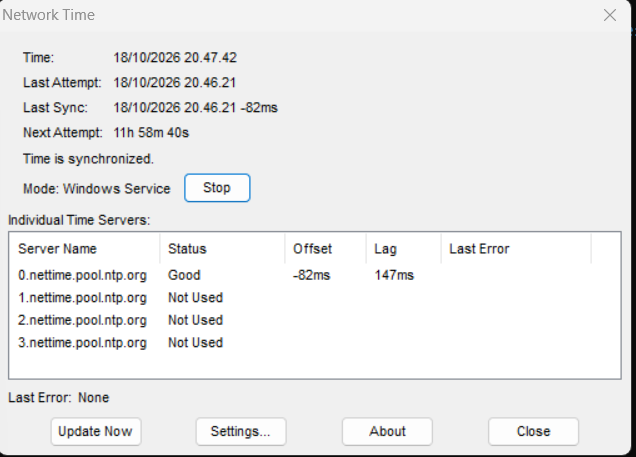

Proses sinkronisasi waktu dilakukan menggunakan aplikasi **NetTime** dengan mode **Windows Service**. Aplikasi ini menyamakan waktu komputer dengan server waktu di internet menggunakan protokol **NTP (Network Time Protocol)**.

Proses sinkronisasinya adalah sebagai berikut:

1. Komputer menghubungi server waktu `0.nettime.pool.ntp.org`.
2. Server membandingkan waktu yang dikirim komputer dengan waktu referensi yang akurat.
3. Selisih waktu komputer dikoreksi berdasarkan hasil perbandingan tersebut.
4. Nilai **Offset = -82 ms** menunjukkan bahwa waktu komputer berbeda sekitar 82 milidetik dari waktu server.
5. Nilai **Lag = 147 ms** menunjukkan waktu yang dibutuhkan data untuk melakukan perjalanan antara komputer dan server.
6. Status server **Good** menunjukkan bahwa sinkronisasi berhasil.
7. Bagian **Last Sync: 18/10/2026 20.46.21 -82 ms** menunjukkan waktu terakhir sinkronisasi dan besar koreksi yang diterapkan.
8. Sinkronisasi berikutnya dijadwalkan sekitar **11 jam 58 menit 40 detik** kemudian.

Dengan demikian, NetTime menjaga agar jam komputer tetap sama atau mendekati waktu standar internet. Sinkronisasi waktu penting dalam sistem terdistribusi karena setiap komputer atau node perlu memiliki waktu yang relatif sama untuk mencatat urutan kejadian, log, transaksi, dan komunikasi antarproses.

# Vector Clock - Foto2,3,4


Foto 4 menampilkan keluaran simulasi **vector clock** untuk tiga proses, yaitu P0, P1, dan P2. Setiap proses memiliki vector dengan tiga komponen `[P0, P1, P2]`. Komponen tersebut menyimpan jumlah kejadian yang telah diketahui oleh masing-masing proses.

## Penjelasan keluaran

1. Pada kondisi awal, semua proses bernilai `[0, 0, 0]` karena belum ada kejadian.
2. P0 melakukan kejadian lokal sehingga clock P0 menjadi `[1, 0, 0]`.
3. P0 mengirim pesan ke P1. Sebelum mengirim, clock P0 bertambah menjadi `[2, 0, 0]`. Vector tersebut ikut dikirim bersama pesan.
4. P1 menerima pesan dari P0. P1 mengambil nilai maksimum dari clock lokal dan clock pesan, kemudian menambah komponen lokalnya. Hasilnya adalah `[2, 1, 0]`.
5. P2 melakukan kejadian lokal sehingga clock P2 menjadi `[0, 0, 1]`.
6. P1 mengirim pesan ke P2. Clock P1 bertambah menjadi `[2, 2, 0]`.
7. P2 menerima pesan dari P1, menggabungkan nilai maksimum `[0, 0, 1]` dan `[2, 2, 0]`, lalu menambah clock lokalnya. Hasil akhirnya adalah `[2, 2, 2]`.

Dengan demikian, keluaran akhir yang relevan adalah:

| Proses | Vector clock |
|---|---|
| P0 | `[2, 0, 0]` |
| P1 | `[2, 2, 0]` |
| P2 | `[2, 2, 2]` |

Program kemudian memeriksa hubungan kausalitas:

- **P0 happens before P1: `True`** karena semua komponen clock P0 tidak lebih besar daripada P1 dan setidaknya satu komponen lebih kecil. Artinya, kejadian P0 terjadi sebelum kejadian P1.
- **P1 happens before P0: `False`** karena P1 memiliki informasi kejadian yang tidak dimiliki P0.
- **P0 is concurrent with P2: `False`** karena P0 menjadi bagian dari rantai kejadian yang akhirnya diteruskan ke P2 melalui pesan P0 → P1 → P2. Jadi, P0 terjadi sebelum P2.

## Perbandingan dengan pelaksanaan manual

Algoritma yang dijalankan program sama dengan vector clock manual. Perbedaannya hanya pada cara pencatatan dan perhitungan. Jika dilakukan manual, tabel prosesnya adalah:

| Langkah | Kejadian | P0 | P1 | P2 |
|---|---|---|---|---|
| 0 | Kondisi awal | `[0,0,0]` | `[0,0,0]` | `[0,0,0]` |
| 1 | P0 melakukan kejadian lokal | `[1,0,0]` | `[0,0,0]` | `[0,0,0]` |
| 2 | P0 mengirim pesan ke P1 | `[2,0,0]` | `[0,0,0]` | `[0,0,0]` |
| 3 | P1 menerima pesan | `[2,0,0]` | `[2,1,0]` | `[0,0,0]` |
| 4 | P2 melakukan kejadian lokal | `[2,0,0]` | `[2,1,0]` | `[0,0,1]` |
| 5 | P1 mengirim pesan ke P2 | `[2,0,0]` | `[2,2,0]` | `[0,0,1]` |
| 6 | P2 menerima pesan | `[2,0,0]` | `[2,2,0]` | `[2,2,2]` |

Pada cara manual, setiap proses harus menaikkan komponen miliknya sendiri pada kejadian lokal atau pengiriman pesan. Saat menerima pesan, proses mengambil nilai maksimum setiap komponen antara vector lokal dan vector yang diterima, kemudian menaikkan komponen lokalnya. Jika aturan ini diterapkan dengan benar, hasil manual akan sama dengan keluaran program.

Kelebihan program adalah perhitungan lebih cepat, konsisten, dan mengurangi kesalahan pencatatan. Sebaliknya, cara manual lebih mudah digunakan untuk memahami konsep dan memeriksa hubungan sebab-akibat, tetapi menjadi rawan kesalahan ketika jumlah proses dan pesan bertambah. Baik program maupun cara manual tidak menggunakan waktu nyata; keduanya menentukan urutan kejadian berdasarkan hubungan kausal antarproses.

# Contoh Penggunaan Modul VectorClock - Foto 5

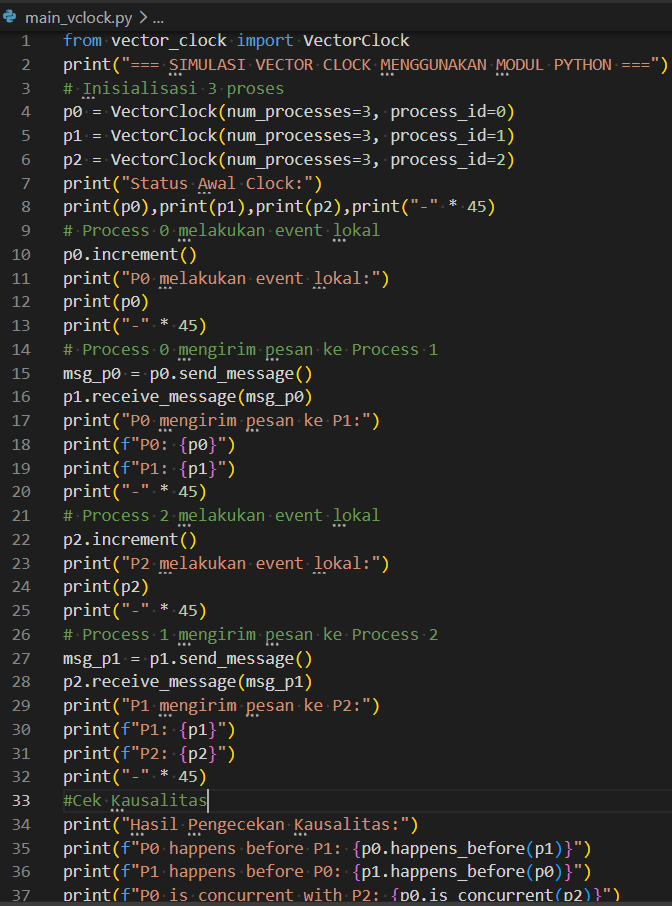

Foto 5 menunjukkan program utama yang menggunakan modul `VectorClock`. Modul diimpor dengan perintah:

```python
from vector_clock import VectorClock
```

Selanjutnya dibuat tiga objek untuk tiga proses:

```python
p0 = VectorClock(num_processes=3, process_id=0)
p1 = VectorClock(num_processes=3, process_id=1)
p2 = VectorClock(num_processes=3, process_id=2)
```

Parameter `num_processes=3` berarti setiap vector memiliki tiga komponen, sedangkan `process_id` menentukan proses yang mengelola objek tersebut. Urutan simulasi pada program adalah:

1. Menampilkan kondisi awal clock P0, P1, dan P2.
2. Menjalankan kejadian lokal pada P0 dengan `p0.increment()`.
3. Mengirim pesan dari P0 ke P1 menggunakan `p0.send_message()`, lalu menerimanya dengan `p1.receive_message(msg_p0)`.
4. Menjalankan kejadian lokal pada P2 dengan `p2.increment()`.
5. Mengirim pesan dari P1 ke P2 menggunakan `p1.send_message()`, lalu menerimanya dengan `p2.receive_message(msg_p1)`.
6. Memeriksa urutan kejadian menggunakan `happens_before()` dan `is_concurrent()`.

# Isi Modul VectorClock - Foto 6

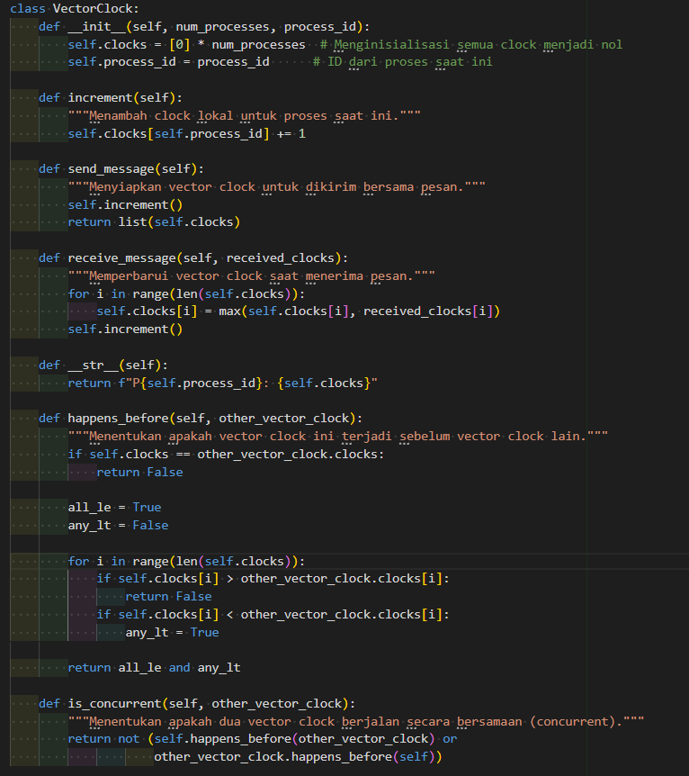

Foto 6 menunjukkan isi modul yang digunakan oleh program utama. Modul ini menyediakan beberapa fungsi penting:

- `increment()` menambah komponen clock milik proses saat ini.
- `send_message()` menaikkan clock sebelum pengiriman dan mengembalikan salinan vector.
- `receive_message()` menggabungkan vector lokal dengan vector pesan menggunakan nilai maksimum setiap komponen, kemudian menaikkan clock penerima.
- `happens_before()` menentukan apakah satu vector terjadi sebelum vector lain.
- `is_concurrent()` menentukan apakah dua vector tidak memiliki hubungan kausal langsung.

Dengan memisahkan fungsi tersebut ke dalam modul, program utama menjadi lebih ringkas dan aturan vector clock dapat digunakan kembali oleh beberapa proses.

# Hasil Penggunaan Modul VectorClock - Foto 7

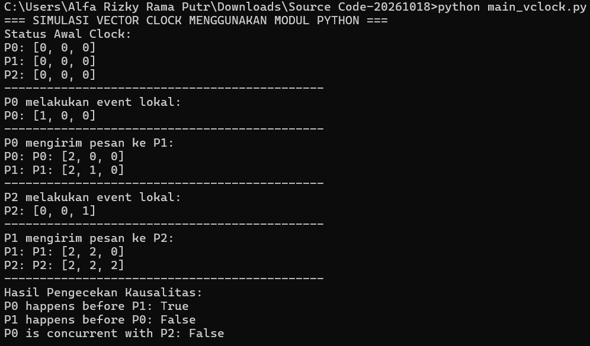

Foto 7 adalah hasil ketika program pada foto 5 dijalankan. Nilai vector berubah sesuai urutan kejadian dan pengiriman pesan:

| Tahap | Hasil |
|---|---|
| Kondisi awal | P0, P1, dan P2 bernilai `[0, 0, 0]` |
| P0 melakukan event lokal | P0 menjadi `[1, 0, 0]` |
| P0 mengirim ke P1 | P0 menjadi `[2, 0, 0]`, P1 menjadi `[2, 1, 0]` |
| P2 melakukan event lokal | P2 menjadi `[0, 0, 1]` |
| P1 mengirim ke P2 | P1 menjadi `[2, 2, 0]`, P2 menjadi `[2, 2, 2]` |

Pada bagian akhir, program menghasilkan:

```text
P0 happens before P1: True
P1 happens before P0: False
P0 is concurrent with P2: False
```

Artinya, P0 terjadi sebelum P1 karena vector P0 dapat dibandingkan secara kausal dengan vector P1. P1 tidak terjadi sebelum P0. P0 juga tidak concurrent dengan P2 karena informasi kejadian P0 diteruskan melalui pesan P0 → P1 → P2.

# Perbedaan Output Multithreading - Foto 9
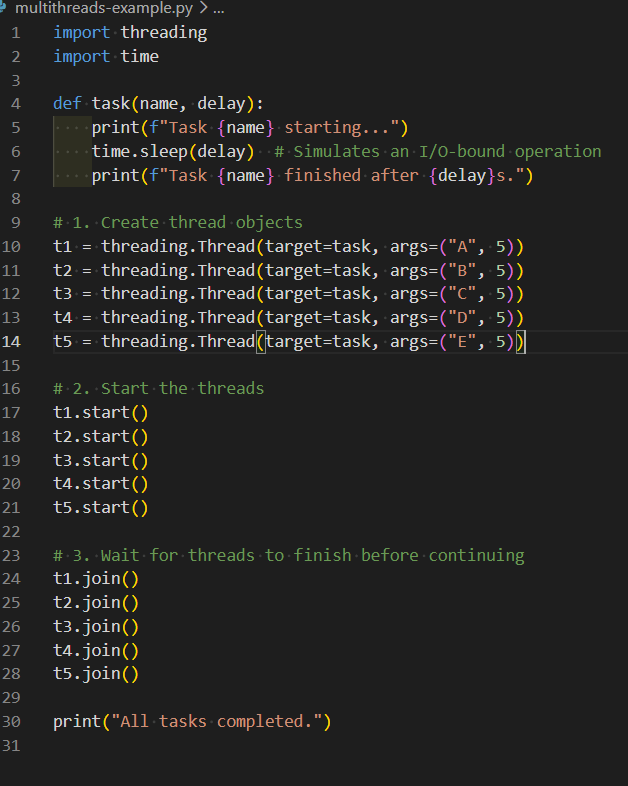
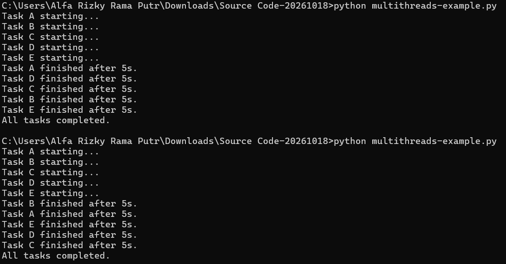

Pada foto 9 terlihat dua output dari program `multithreads-example.py`. Kedua output memiliki hasil yang sama, yaitu semua task dimulai, masing-masing berjalan selama 5 detik, dan akhirnya menampilkan `All tasks completed.` Namun, urutan task yang selesai berbeda:

- Pada eksekusi pertama, urutannya adalah **A, D, C, B, E**.
- Pada eksekusi kedua, urutannya adalah **B, A, E, D, C**.

Perbedaan tersebut terjadi karena program menjalankan task menggunakan lima thread secara bersamaan. Setelah setiap thread dimulai, sistem operasi dan Python menentukan thread mana yang memperoleh kesempatan berjalan terlebih dahulu. Penentuan ini dipengaruhi oleh beberapa hal, seperti:

- scheduler sistem operasi;
- beban dan aktivitas komputer saat program dijalankan;
- waktu pembuatan serta pergantian antar-thread;
- ketersediaan CPU dan kondisi operasi input/output.

Walaupun semua task menggunakan `time.sleep(5)`, waktu tidur setiap thread dihitung secara terpisah sejak thread tersebut mulai menjalankan fungsi `task()`. Karena thread tidak benar-benar mulai pada waktu yang persis sama, task yang selesai lebih dahulu dapat berubah pada setiap eksekusi.

Urutan tulisan `Task A starting...` sampai `Task E starting...` tetap terlihat berurutan karena perintah `start()` dipanggil secara berurutan oleh thread utama. Sebaliknya, urutan tulisan `finished` tidak dijamin karena masing-masing thread berjalan secara konkuren.

Pemanggilan `join()` tidak mengatur urutan selesai task. `join()` hanya membuat thread utama menunggu sampai semua thread selesai sebelum mencetak `All tasks completed.` Oleh karena itu, perbedaan output tersebut bukan kesalahan program, melainkan perilaku normal pada pemrograman multithreading. Hasil akhirnya tetap benar karena semua task selesai, tetapi urutan penyelesaiannya tidak deterministik.

# Data Race / Race Condition - Foto 11
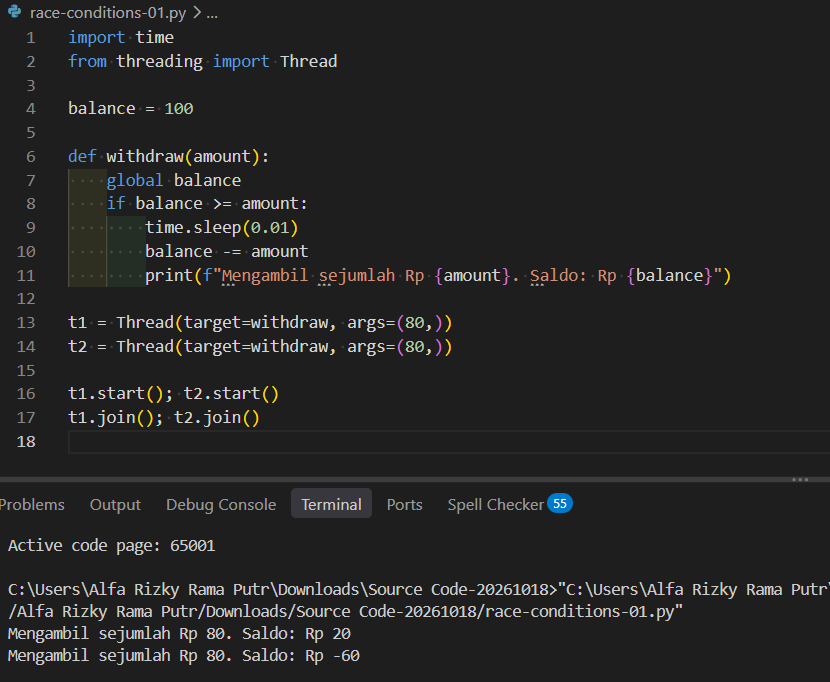
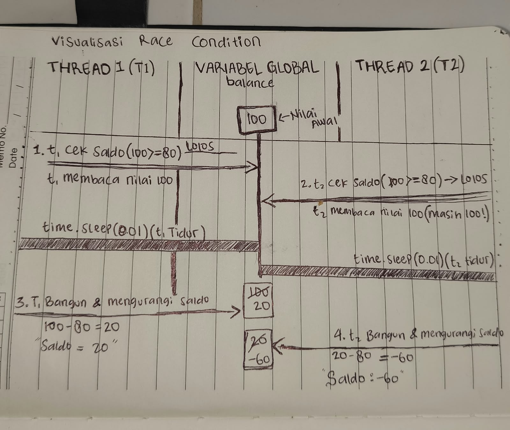

Foto 11 mengilustrasikan terjadinya **data race** atau **race condition** pada variabel global `balance`. Nilai saldo awal adalah Rp100 dan terdapat dua thread, yaitu T1 dan T2, yang masing-masing mencoba mengambil Rp80.

Masalah terjadi karena operasi pengecekan dan pengurangan saldo tidak dilindungi oleh mekanisme sinkronisasi. Urutan kejadiannya dapat berlangsung seperti berikut:

1. T1 membaca saldo Rp100 dan memeriksa bahwa `100 >= 80`, sehingga T1 menganggap transaksi dapat dilakukan.
2. Sebelum T1 mengurangi saldo, thread dihentikan sementara oleh `time.sleep(0.01)`.
3. T2 membaca saldo yang masih Rp100 karena T1 belum menulis perubahan. T2 juga mendapatkan hasil pengecekan `100 >= 80`.
4. T1 melanjutkan eksekusi dan mengurangi saldo menjadi Rp20.
5. T2 kemudian melanjutkan eksekusi berdasarkan hasil pengecekan sebelumnya, lalu mengurangi saldo lagi menjadi Rp-60.

Akibatnya, dua transaksi sama-sama dianggap valid, padahal saldo Rp100 hanya cukup untuk satu kali penarikan Rp80. Saldo akhir menjadi negatif dan hasilnya bergantung pada urutan eksekusi thread. Inilah yang disebut race condition: beberapa thread mengakses dan mengubah data bersama pada waktu yang saling tumpang tindih tanpa aturan penguncian.

Pada kode tanpa pengunci, bagian bermasalah adalah:

```python
if balance >= amount:
    time.sleep(0.01)
    balance -= amount
```

Pengecekan saldo dan pengurangan saldo seharusnya diperlakukan sebagai satu operasi yang tidak boleh disela thread lain. `time.sleep()` memperbesar kemungkinan race condition terlihat karena thread lain mendapat kesempatan membaca saldo sebelum perubahan pertama disimpan.

Perbaikannya adalah menggunakan `threading.Lock`, seperti pada kode:

```python
counter_lock = threading.Lock()

with counter_lock:
    if balance >= amount:
        time.sleep(0.01)
        balance -= amount
```

Blok `with counter_lock` memastikan hanya satu thread yang dapat menjalankan pengecekan dan pengurangan saldo pada satu waktu. Thread kedua harus menunggu sampai thread pertama keluar dari blok tersebut. Setelah itu, thread kedua membaca saldo terbaru, yaitu Rp20, sehingga kondisi `20 >= 80` bernilai salah dan penarikan kedua tidak dilakukan. Dengan demikian, saldo tetap konsisten sebesar Rp20 dan tidak menjadi negatif.

# Tidak Terjadi Race Condition - Foto 12

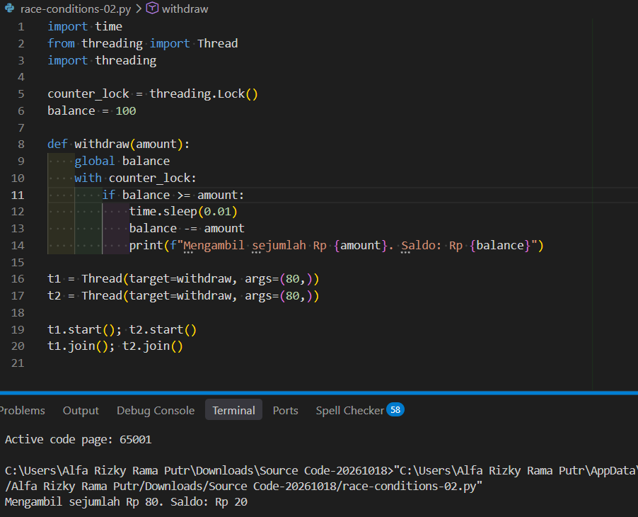

Pada foto 12, race condition tidak terjadi karena program menggunakan `threading.Lock()` melalui variabel `counter_lock`. Lock tersebut melindungi bagian kritis, yaitu proses pengecekan saldo dan pengurangan saldo:

```python
with counter_lock:
    if balance >= amount:
        time.sleep(0.01)
        balance -= amount
```

Alur eksekusinya adalah sebagai berikut:

1. T1 memperoleh lock dan membaca saldo Rp100.
2. T1 memeriksa bahwa saldo cukup untuk penarikan Rp80.
3. Walaupun T1 menjalankan `time.sleep(0.01)`, lock tetap dimiliki oleh T1 sehingga T2 tidak dapat masuk ke blok tersebut.
4. T1 mengurangi saldo menjadi Rp20, mencetak hasil penarikan, lalu keluar dari blok `with`. Setelah keluar, lock dilepas secara otomatis.
5. T2 baru memperoleh lock dan membaca saldo terbaru, yaitu Rp20.
6. Karena `20 >= 80` bernilai salah, T2 tidak melakukan penarikan.

Lock menerapkan prinsip **mutual exclusion**, yaitu hanya satu thread yang boleh mengakses bagian kritis pada satu waktu. Dengan demikian, operasi *check-then-withdraw* berjalan sebagai satu rangkaian yang tidak dapat disela thread lain. Tidak ada thread yang membaca saldo lama setelah thread lain melakukan perubahan.

Hasilnya, hanya satu penarikan Rp80 yang berhasil dan saldo akhir tetap Rp20. Pemanggilan `join()` tetap digunakan untuk menunggu kedua thread selesai, tetapi pencegahan race condition dilakukan oleh `counter_lock`, bukan oleh `join()`.

# Race Condition

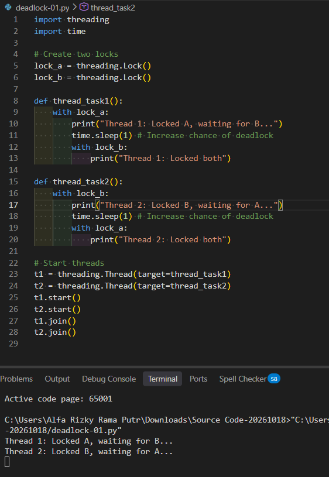
## Foto 14: Lock mencegah race condition, tetapi dapat menyebabkan deadlock
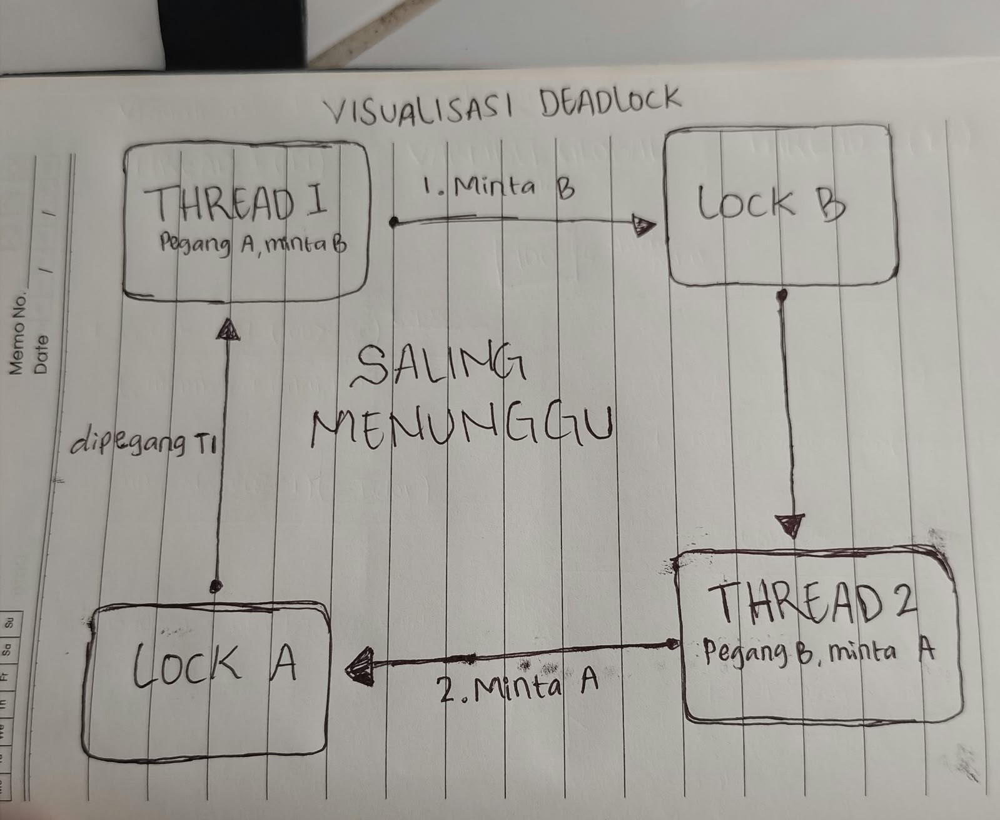


Race condition tidak terjadi karena setiap thread harus memperoleh lock sebelum melanjutkan proses. `lock_a` dan `lock_b` memberikan **mutual exclusion**, sehingga pada satu waktu hanya thread yang memegang lock tertentu yang dapat mengakses bagian yang dilindungi. Data atau sumber daya yang dilindungi tidak dapat diubah secara bersamaan oleh dua thread.

Namun, program mengalami masalah lain, yaitu **deadlock**:

1. Thread 1 memperoleh `lock_a`, kemudian menunggu `lock_b`.
2. Thread 2 memperoleh `lock_b`, kemudian menunggu `lock_a`.
3. Thread 1 tidak dapat melanjutkan sebelum Thread 2 melepaskan `lock_b`.
4. Thread 2 tidak dapat melanjutkan sebelum Thread 1 melepaskan `lock_a`.

Kondisi ini disebut **circular wait** atau saling menunggu. Jadi, tidak adanya race condition bukan berarti program bebas dari masalah konkurensi. Lock berhasil mencegah akses bersamaan, tetapi urutan pengambilan lock yang berbeda dapat membuat kedua thread berhenti selamanya.

Pada foto 14, pola masalahnya divisualisasikan: Thread 1 memegang Lock A dan meminta Lock B, sedangkan Thread 2 memegang Lock B dan meminta Lock A. Karena setiap thread hanya memegang lock yang sedang diperolehnya, akses bersamaan terhadap sumber daya tetap dicegah sehingga race condition tidak terjadi.

Versi perbaikan menggunakan `acquire(timeout=5)` dan `finally` untuk melepaskan lock:

```python
if lock_a.acquire(timeout=5):
    try:
        # pekerjaan Thread 1
        pass
    finally:
        lock_a.release()
```

Timeout mencegah thread menunggu tanpa batas. Selain itu, lock pertama dilepaskan sebelum thread mencoba memperoleh lock kedua. Dengan cara ini, thread lain memperoleh kesempatan untuk melanjutkan dan tidak terjadi circular wait permanen. Blok `finally` memastikan lock dilepaskan meskipun terjadi kondisi lain saat pekerjaan berlangsung.

Kesimpulannya, pada foto 13 dan 14 race condition tidak terjadi karena akses ke lock dibatasi secara eksklusif. Perbedaannya adalah foto 13 masih dapat mengalami deadlock karena kedua thread memegang lock pertama sambil menunggu lock kedua, sedangkan foto 14 mengurangi masalah tersebut dengan timeout dan pelepasan lock secara teratur.

# Deadlock Tidak Terjadi - Foto 15

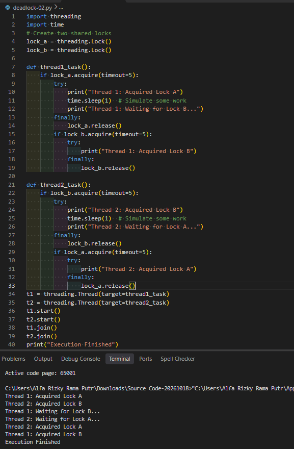

Pada foto 15, deadlock tidak terjadi karena thread tidak memegang lock pertama ketika mencoba memperoleh lock kedua. Pola programnya adalah:

1. Thread 1 memperoleh `lock_a`, melakukan pekerjaan, lalu melepaskan `lock_a`.
2. Setelah `lock_a` dilepaskan, Thread 1 mencoba memperoleh `lock_b`.
3. Thread 2 memperoleh `lock_b`, melakukan pekerjaan, lalu melepaskan `lock_b`.
4. Setelah `lock_b` dilepaskan, Thread 2 mencoba memperoleh `lock_a`.

Hal pentingnya adalah lock pertama selalu dilepaskan pada blok `finally` sebelum lock kedua diminta. Dengan demikian, tidak ada kondisi ketika Thread 1 memegang `lock_a` sambil menunggu `lock_b`, sementara Thread 2 memegang `lock_b` sambil menunggu `lock_a`. Siklus saling menunggu atau **circular wait** berhasil diputus.

Kode juga menggunakan `acquire(timeout=5)`. Artinya, jika lock yang diminta belum tersedia, thread hanya menunggu paling lama lima detik. Setelah batas waktu tercapai, `acquire()` mengembalikan nilai `False` dan thread dapat keluar tanpa menunggu selamanya.

Blok `finally` memastikan setiap lock yang berhasil diperoleh selalu dilepaskan, termasuk ketika terjadi kondisi tidak terduga selama pekerjaan berlangsung. Pemanggilan `join()` kemudian memastikan thread utama menunggu kedua thread selesai sebelum mencetak `Execution Finished`.

Jadi, deadlock tidak terjadi karena dua alasan utama: lock pertama dilepaskan sebelum lock kedua diminta, dan waktu tunggu untuk memperoleh lock dibatasi dengan `timeout`. Output dapat menunjukkan kedua thread berhasil memperoleh Lock A dan Lock B secara bergantian, kemudian program selesai dengan normal.

# Algoritma Raft untuk Memilih Koordinator
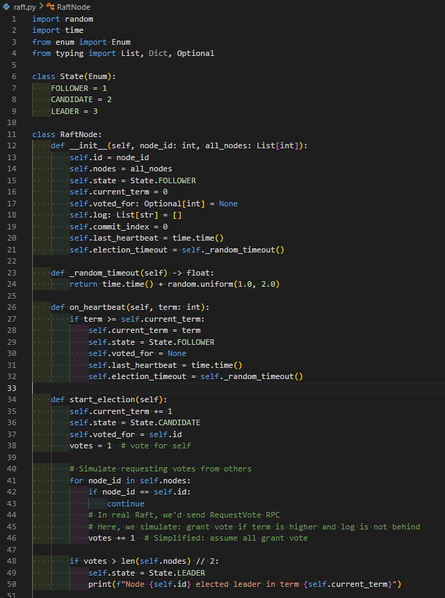
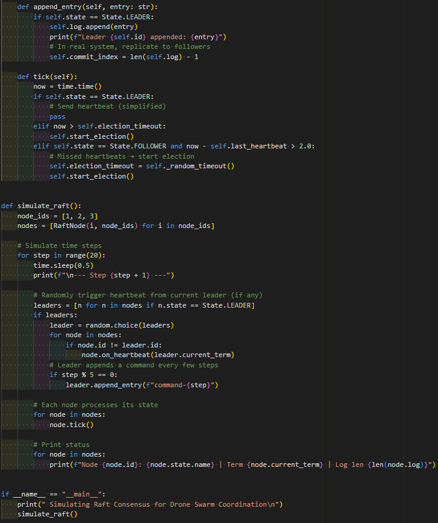
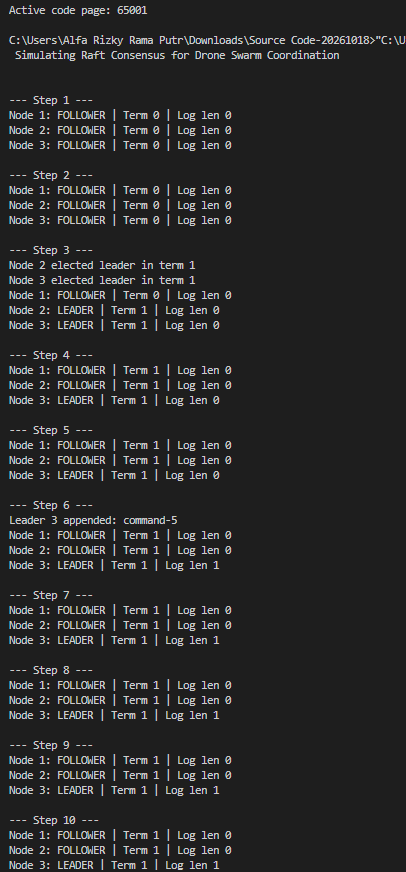
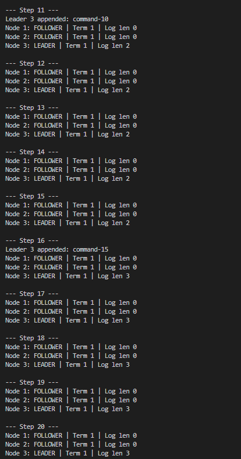
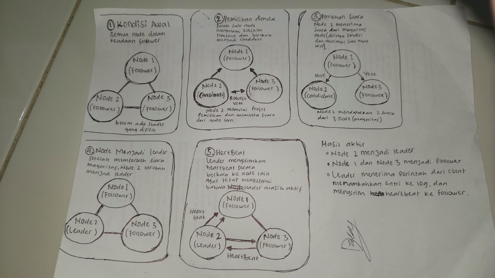

Foto 20 menjelaskan cara algoritma **Raft** memilih satu node sebagai koordinator atau **leader** dalam sebuah kelompok node. Contohnya menggunakan tiga node, yaitu Node 1, Node 2, dan Node 3.

Prosesnya secara sederhana adalah:

1. **Kondisi awal**
   Semua node berada dalam keadaan **follower** dan belum memiliki leader.

2. **Memulai pemilihan**
   Jika follower tidak menerima heartbeat dari leader dalam waktu tertentu, salah satu node mengalami *timeout*. Node tersebut berubah menjadi **candidate** dan memulai pemilihan pada term baru.

3. **Meminta suara**
   Candidate memilih dirinya sendiri, kemudian meminta suara dari node lain. Pada foto 20, Node 2 menjadi candidate dan meminta suara kepada Node 1 serta Node 3.

4. **Menghitung suara**
   Node yang menerima permintaan memberikan satu suara kepada candidate yang memenuhi aturan pemilihan. Dengan tiga node, mayoritas yang diperlukan adalah dua suara.

5. **Menetapkan leader**
   Node 2 memperoleh suara mayoritas, yaitu dua dari tiga suara, sehingga Node 2 ditetapkan sebagai **leader**. Node 1 dan Node 3 kembali atau tetap berada dalam keadaan follower.

6. **Mengirim heartbeat**
   Setelah menjadi leader, Node 2 mengirim pesan **heartbeat** secara berkala kepada follower. Heartbeat memberi tahu bahwa leader masih aktif dan mencegah follower memulai pemilihan baru.

7. **Menerima perintah**
   Perintah dari client diterima oleh leader. Leader kemudian mencatatnya pada log dan meneruskannya kepada follower agar data antar-node tetap konsisten.

Jadi, Raft memilih koordinator berdasarkan suara mayoritas, bukan berdasarkan node yang paling cepat atau nomor node terkecil. Dalam contoh foto 20, Node 2 menjadi koordinator karena berhasil mendapatkan minimal dua suara dari tiga node. Jika leader gagal dan heartbeat tidak lagi diterima, follower akan memulai election baru untuk memilih leader pengganti.

# Contoh Simulasi Raft - Foto 21, 22, dan 23

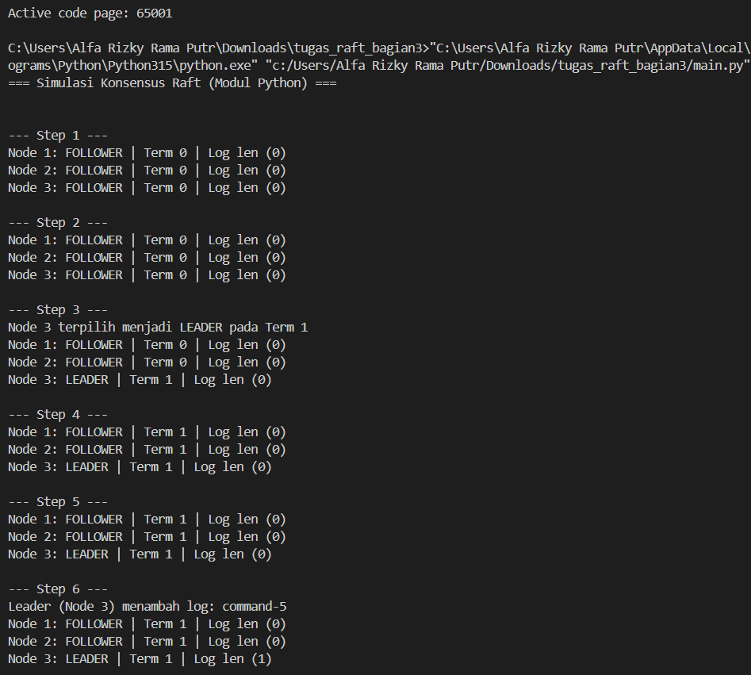
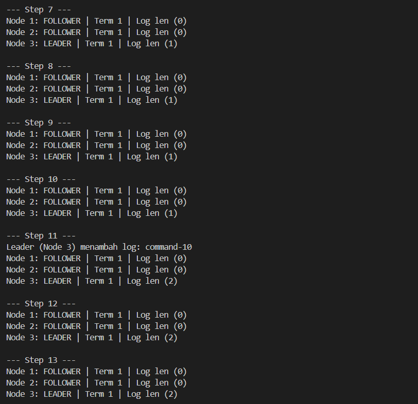
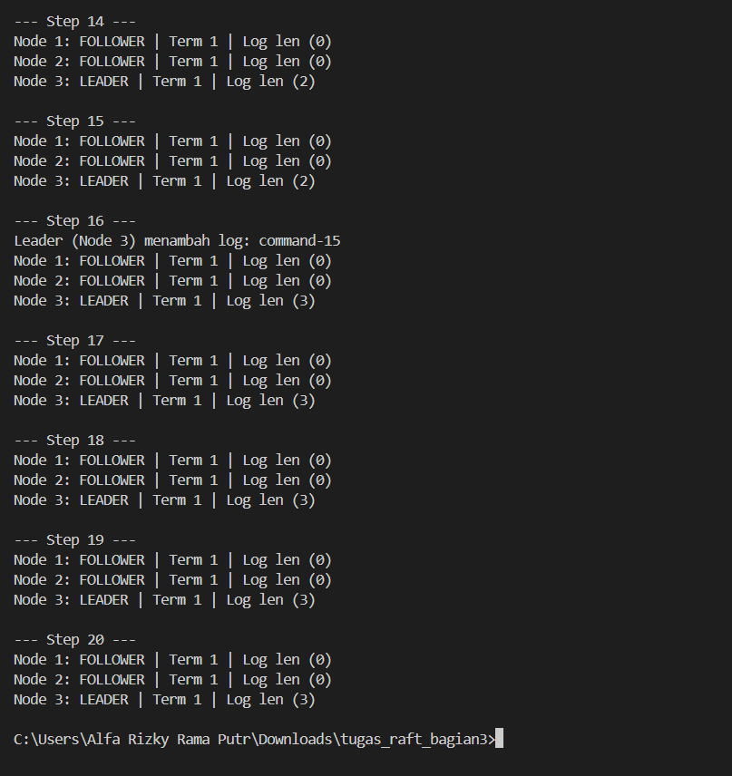

Foto 21, 22, dan 23 menunjukkan contoh simulasi algoritma Raft dalam 20 langkah. Program menggunakan tiga node, yaitu Node 1, Node 2, dan Node 3. Setiap node memiliki status, term, dan panjang log.

## Urutan simulasi

1. **Langkah 1 dan 2: kondisi awal**
   Ketiga node masih berstatus `FOLLOWER`, berada pada `Term 0`, dan belum memiliki log:

   ```text
   Node 1: FOLLOWER | Term 0 | Log len (0)
   Node 2: FOLLOWER | Term 0 | Log len (0)
   Node 3: FOLLOWER | Term 0 | Log len (0)
   ```

2. **Langkah 3: pemilihan leader**
   Node 3 mengalami timeout lebih dahulu sehingga memulai pemilihan. Node 3 berubah menjadi `LEADER` pada `Term 1`, sedangkan Node 1 dan Node 2 tetap menjadi follower.

3. **Langkah 4 dan 5: leader mempertahankan statusnya**
   Node 3 tetap menjadi leader pada Term 1. Node lain menerima informasi dari leader dan tetap berada dalam status follower.

4. **Langkah 6: leader menambahkan perintah pertama**
   Node 3 menambahkan `command-5` ke log. Panjang log Node 3 berubah dari 0 menjadi 1.

5. **Langkah 7 sampai 10: kondisi stabil**
   Node 3 tetap menjadi leader. Node 1 dan Node 2 tetap follower, sedangkan panjang log Node 3 masih 1.

6. **Langkah 11: perintah kedua**
   Node 3 menambahkan `command-10`, sehingga panjang log-nya menjadi 2.

7. **Langkah 12 sampai 15: leader tetap aktif**
   Tidak ada perubahan status. Node 3 tetap leader pada Term 1 dan follower tetap mengikuti leader.

8. **Langkah 16: perintah ketiga**
   Node 3 menambahkan `command-15`, sehingga panjang log menjadi 3.

9. **Langkah 17 sampai 20: akhir simulasi**
   Sampai simulasi selesai, Node 3 tetap menjadi leader pada Term 1. Node 1 dan Node 2 tetap follower.

## Hasil akhir

```text
Node 1: FOLLOWER | Term 1 | Log len (0)
Node 2: FOLLOWER | Term 1 | Log len (0)
Node 3: LEADER   | Term 1 | Log len (3)
```

Simulasi ini menunjukkan bahwa Node 3 berhasil menjadi koordinator dan mempertahankan perannya karena node lain menerima heartbeat. Selama leader aktif, tidak ada pemilihan baru. Setiap lima langkah, leader juga menambahkan perintah baru ke log, yaitu `command-5`, `command-10`, dan `command-15`.

Perlu diperhatikan bahwa keluaran ini merupakan simulasi sederhana. Pada implementasi Raft yang lengkap, entry log akan direplikasi ke follower dan baru dianggap aman setelah mendapatkan konfirmasi mayoritas. Pada program simulasi ini, penambahan log hanya dicatat pada leader sehingga `Log len` follower tetap 0.

# Kesimpulan 📖 

Berdasarkan seluruh simulasi, sistem terdistribusi membutuhkan mekanisme khusus untuk mengatur waktu, urutan kejadian, akses data, dan koordinasi node. Sinkronisasi NTP membantu menyamakan waktu fisik antar-komputer, sedangkan vector clock membantu menentukan hubungan kausal tanpa bergantung pada waktu fisik.

Multithreading memungkinkan beberapa pekerjaan berjalan secara konkuren, tetapi urutan eksekusinya tidak deterministik. Akses terhadap data bersama tanpa pengamanan dapat menimbulkan race condition dan menghasilkan data yang salah. Penggunaan `Lock` dapat membuat operasi kritis berjalan secara aman, tetapi lock harus dikelola dengan benar agar tidak menimbulkan deadlock. Pelepasan lock menggunakan `finally`, urutan lock yang konsisten, dan timeout merupakan cara untuk mengurangi risiko tersebut.

Algoritma Raft menunjukkan bagaimana beberapa node dapat memilih koordinator menggunakan suara mayoritas. Node yang terpilih sebagai leader mempertahankan koordinasi melalui heartbeat dan mengelola perintah yang masuk. Dari keseluruhan praktikum dapat disimpulkan bahwa konkurensi dan sistem terdistribusi tidak cukup hanya mengandalkan eksekusi paralel. Diperlukan aturan sinkronisasi, pencatatan hubungan kausal, mekanisme perlindungan data, serta protokol konsensus agar sistem tetap konsisten, terkoordinasi, dan dapat bekerja ketika terjadi keterlambatan atau kegagalan pada sebagian node.
