# Praktikum Streaming Replication PostgreSQL

## Dasar Teori 📚 

### 1. Sistem Basis Data Terdistribusi

Sistem basis data terdistribusi adalah sistem yang menyimpan dan mengelola data
pada lebih dari satu komputer atau node yang saling terhubung melalui jaringan.
Setiap node dapat memiliki peran tertentu, tetapi seluruh node tetap bekerja
sebagai satu kesatuan sistem. Penerapan sistem ini bertujuan untuk meningkatkan
ketersediaan data, mendukung pembagian beban kerja, dan mengurangi risiko
terhentinya layanan ketika salah satu node mengalami gangguan.

### 2. Docker dan Container

Docker adalah platform yang digunakan untuk membuat, menjalankan, dan mengelola
container. Container merupakan lingkungan terisolasi yang berisi aplikasi
beserta dependensi yang dibutuhkan. Dengan container, aplikasi dapat dijalankan
secara konsisten pada lingkungan yang berbeda tanpa harus memasang seluruh
perangkat lunak secara langsung pada sistem operasi utama.

Docker Compose digunakan untuk mendefinisikan dan menjalankan beberapa
container dalam satu project. Melalui file Compose, konfigurasi service,
network, port, image, dan environment dapat diatur secara terpusat. Pada
praktikum ini Docker Compose digunakan untuk menjalankan PostgreSQL primary,
PostgreSQL replica, dan tiga node Apache Ignite.

### 3. PostgreSQL Streaming Replication

Streaming replication adalah mekanisme replikasi PostgreSQL yang mengirimkan
perubahan database dari server primary ke server replica secara terus-menerus.
Perubahan tersebut dikirim dalam bentuk WAL atau **Write-Ahead Log**. WAL
merupakan catatan perubahan yang ditulis PostgreSQL sebelum perubahan diterapkan
ke data utama, sehingga dapat digunakan untuk pemulihan dan replikasi.

Dalam arsitektur ini, primary berfungsi menerima operasi baca dan tulis,
sedangkan replica menerima perubahan dari primary dan umumnya digunakan untuk
operasi baca. Pada mode asynchronous, primary tidak perlu menunggu konfirmasi
replica untuk menyelesaikan setiap transaksi. Keuntungan mode ini adalah
performa penulisan yang lebih baik, tetapi terdapat kemungkinan jeda antara data
pada primary dan replica.

Replica dapat diperiksa menggunakan fungsi `pg_is_in_recovery()`. Nilai `true`
menunjukkan bahwa server masih berada dalam mode recovery sebagai standby.
Apabila primary mengalami gangguan, replica dapat dipromosikan menjadi primary
menggunakan `pg_promote()`. Proses ini disebut failover dan bertujuan menjaga
ketersediaan layanan database.

### 4. Apache Ignite

Apache Ignite adalah platform komputasi dan penyimpanan data terdistribusi yang
dapat digunakan untuk mengelola data pada beberapa node. Node-node tersebut
berkomunikasi melalui jaringan dan membentuk sebuah cluster. Cluster yang
terdiri dari beberapa node memungkinkan data serta layanan dikelola secara
terdistribusi.

Pada Apache Ignite, cluster perlu diinisialisasi sebelum digunakan. Proses
inisialisasi menentukan nama cluster dan node yang menjadi bagian dari
metastorage group. Metastorage menyimpan metadata penting yang digunakan untuk
mengelola konfigurasi serta keadaan cluster. Status dan topologi cluster dapat
diperiksa melalui Apache Ignite CLI.

Apache Ignite juga menyediakan SQL untuk membuat schema, membuat tabel,
memasukkan data, dan melakukan analisis. Dengan demikian, data yang tersimpan
di dalam cluster dapat diolah menggunakan query seperti `SELECT`, `COUNT`,
`SUM`, `AVG`, dan `GROUP BY`.

### 5. Keterkaitan Teori dengan Praktikum

Dasar teori tersebut diterapkan dalam praktikum melalui beberapa tahap.
Docker digunakan sebagai lingkungan untuk menjalankan service, PostgreSQL
digunakan untuk menguji streaming replication dan failover, sedangkan Apache
Ignite digunakan untuk membangun cluster tiga node, memuat data, serta
melakukan analisis invoice. Seluruh tahap tersebut menunjukkan penerapan
konsep ketersediaan data, komunikasi antar-node, replikasi, dan pengolahan data
pada sistem terdistribusi.

Dokumentasi berikut menjelaskan tahapan konfigurasi dan pengujian
**streaming replication** PostgreSQL menggunakan Docker. Pada konfigurasi ini
terdapat dua container, yaitu **primary** sebagai sumber perubahan data dan
**replica** sebagai penerima WAL (Write-Ahead Log) dari primary.
#
# PRAKTEK  📚 

## Foto 1 - Instalasi Docker Desktop

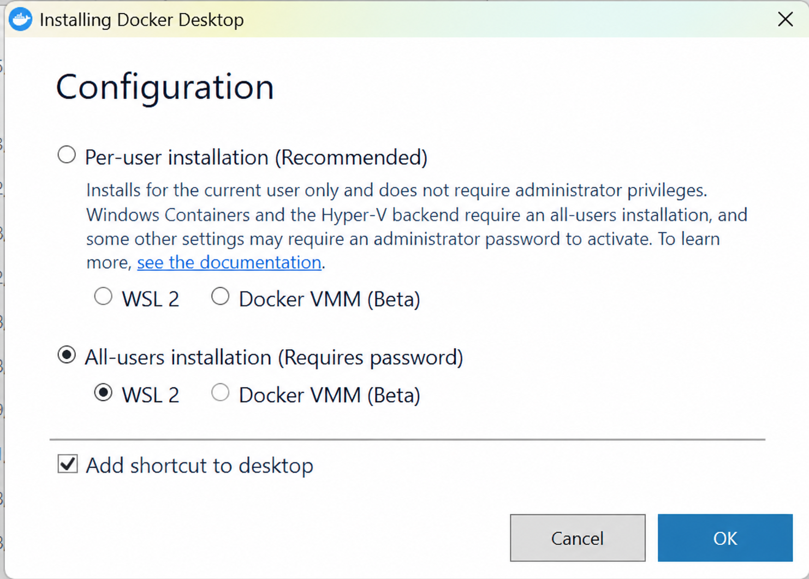

Foto pertama menunjukkan halaman konfigurasi instalasi Docker Desktop pada
Windows. Pada gambar, opsi **All-users installation** dipilih. Pilihan ini
memasang Docker Desktop agar dapat digunakan oleh seluruh pengguna komputer,
sehingga proses instalasinya memerlukan kata sandi atau hak administrator.

Untuk backend virtualisasi, **WSL 2** dipilih, sedangkan opsi **Docker VMM
(Beta)** tidak digunakan. WSL 2 menyediakan lingkungan Linux yang ringan dan
kompatibel dengan container PostgreSQL. Opsi **Add shortcut to desktop** juga
dicentang agar Docker Desktop dapat dibuka dengan mudah setelah instalasi
selesai.

Konfigurasi ini menjadi tahap persiapan sebelum menjalankan project. Docker
Desktop diperlukan untuk membuat dan menjalankan container primary serta
replica secara terisolasi tanpa memasang PostgreSQL secara langsung pada sistem
operasi host.

## Foto 2 - Menjalankan Container Primary dan Replica

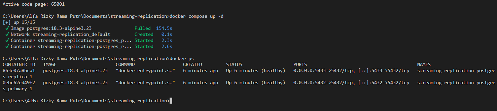

Pada foto kedua dijalankan perintah `docker compose up -d`. Perintah tersebut
menjalankan seluruh service yang didefinisikan di Docker Compose dalam mode
detached, sehingga proses container tetap berjalan di latar belakang.

Output menunjukkan bahwa image PostgreSQL berhasil diambil, network Docker
berhasil dibuat, dan dua container berhasil dijalankan:

- `streaming-replication-postgres_primary-1` sebagai server primary.
- `streaming-replication-postgres_replica-1` sebagai server replica.

Kedua container berstatus **Up** dan **healthy**. Port `5432` pada host
digunakan untuk primary, sedangkan port `5433` digunakan untuk mengakses
replica. Pemisahan port ini memungkinkan kedua database diakses secara
bersamaan dari komputer host.

## Foto 3 - Memeriksa Status Replikasi pada Primary

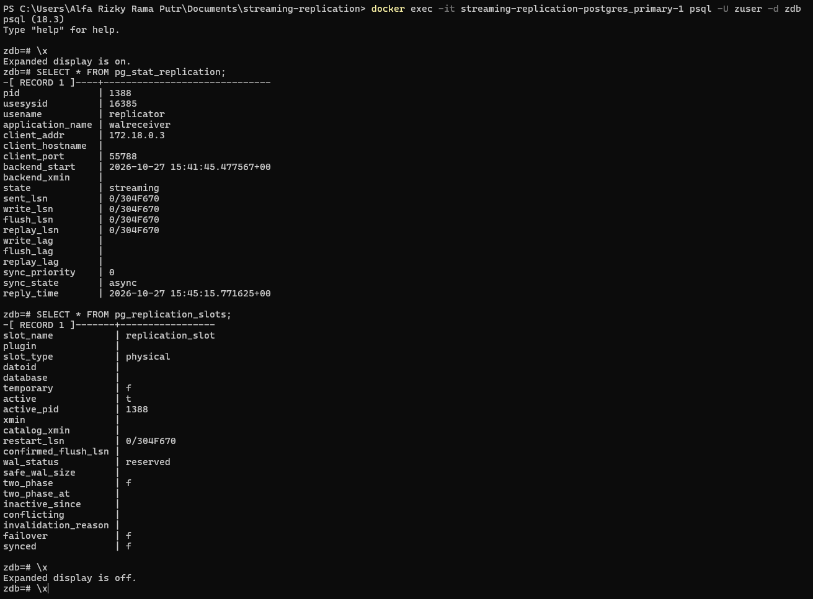

Foto ketiga memperlihatkan pemeriksaan status replikasi melalui PostgreSQL
dengan query `pg_stat_replication` dan `pg_replication_slots`. Hasilnya
menunjukkan adanya koneksi dari proses replicator dengan beberapa informasi
penting:

- `application_name` bernilai `walreceiver`, yang menunjukkan proses penerima
  WAL pada replica sedang terhubung.
- `client_addr` menunjukkan alamat jaringan replica.
- `state` bernilai `streaming`, sehingga perubahan WAL sedang dikirim secara
  aktif dari primary ke replica.
- `sync_state` bernilai `async`, yang berarti replikasi berjalan secara
  asynchronous. Primary tidak harus menunggu replica mengonfirmasi setiap
  transaksi sebelum transaksi dianggap selesai.
- Replication slot bertipe `physical` berstatus aktif dan digunakan oleh proses
  replicator.

Dengan demikian, konfigurasi koneksi dan pengiriman WAL telah berhasil
dijalankan. Mode asynchronous memberikan performa transaksi yang lebih baik,
meskipun terdapat kemungkinan jeda kecil antara data pada primary dan replica.

## Foto 4 - Memastikan Replica dalam Mode Read-Only

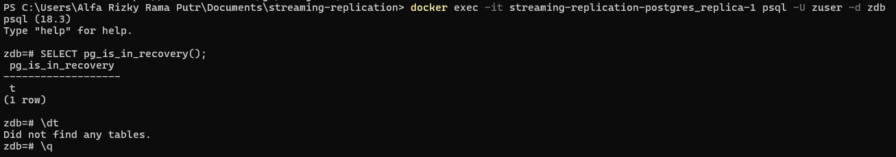

Pada foto keempat, koneksi dilakukan ke container replica menggunakan `psql`.
Query `SELECT pg_is_in_recovery();` menghasilkan nilai `t` atau `true`. Nilai
tersebut menandakan bahwa server masih berada dalam mode recovery dan berperan
sebagai standby/replica, bukan sebagai primary.

Perintah `\dt` menghasilkan pesan **Did not find any tables**. Hal ini
menunjukkan bahwa pada saat pemeriksaan belum terdapat tabel pengguna pada
database replica. Kondisi tersebut juga menegaskan bahwa replica tidak
digunakan untuk membuat struktur data secara mandiri; struktur dan data
diharapkan berasal dari primary melalui proses replikasi.

Pengecekan ini penting karena memastikan container yang dituju benar-benar
berfungsi sebagai replica dan tidak salah dikonfigurasi sebagai database
primary kedua.

## Foto 5 - Manipulasi Data pada Primary

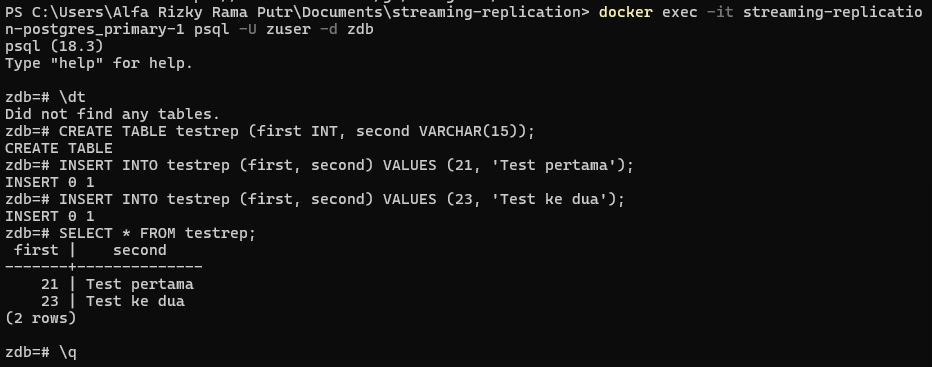

Pada foto kelima, manipulasi data dilakukan pada container primary. Langkah
yang dijalankan adalah:

1. Membuat tabel `testrep` dengan kolom `first` bertipe integer dan `second`
   bertipe `VARCHAR(15)`.
2. Menambahkan dua baris data menggunakan perintah `INSERT`.
3. Menampilkan isi tabel menggunakan `SELECT * FROM testrep`.

Hasil query menampilkan dua data, yaitu `21 | Test pertama` dan
`23 | Test ke dua`. Operasi ini menjadi sumber perubahan yang akan ditulis ke
WAL oleh PostgreSQL. Selanjutnya, WAL dikirim ke replica melalui koneksi
streaming replication sehingga perubahan struktur tabel dan isi data dapat
diterapkan pada replica.

Pengujian manipulasi data sebaiknya dilakukan pada primary. Replica dirancang
untuk menerima dan menyediakan salinan data, sehingga operasi tulis langsung
pada replica tidak diperbolehkan. Dengan pola ini, primary menjadi satu-satunya
sumber penulisan dan replica menjaga salinan data untuk kebutuhan pembacaan,
ketersediaan, atau pemulihan ketika primary mengalami gangguan.

## Foto 6 - Memastikan Data Berhasil Direplikasi

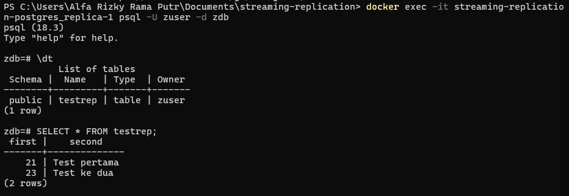

Foto keenam memperlihatkan pemeriksaan ulang pada container replica setelah
data dibuat di primary. Perintah `\dt` sekarang menampilkan tabel `testrep`,
sedangkan perintah `SELECT * FROM testrep;` menampilkan dua baris data yang
sama dengan data pada primary, yaitu `21 | Test pertama` dan
`23 | Test ke dua`.

Hasil ini membuktikan bahwa perubahan struktur tabel dan data telah diterima
oleh replica melalui streaming replication. Data yang ditulis pada primary
berhasil dikirim dalam bentuk WAL dan diterapkan pada standby.

## Foto 7 - Replica Menolak Operasi Tulis

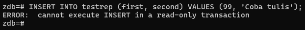

Pada foto ketujuh dicoba penambahan data baru dengan perintah `INSERT` pada
replica. PostgreSQL mengembalikan pesan **cannot execute INSERT in a read-only
transaction**. Pesan tersebut menunjukkan bahwa transaksi pada replica bersifat
read-only sehingga perintah penulisan tidak dapat dijalankan.

Penolakan ini merupakan perilaku yang diharapkan pada arsitektur
primary-replica. Operasi `INSERT`, `UPDATE`, dan `DELETE` harus diarahkan ke
primary agar tidak terjadi konflik atau perbedaan data antara kedua server.

## Foto 8 - Promosi Replica Menjadi Primary

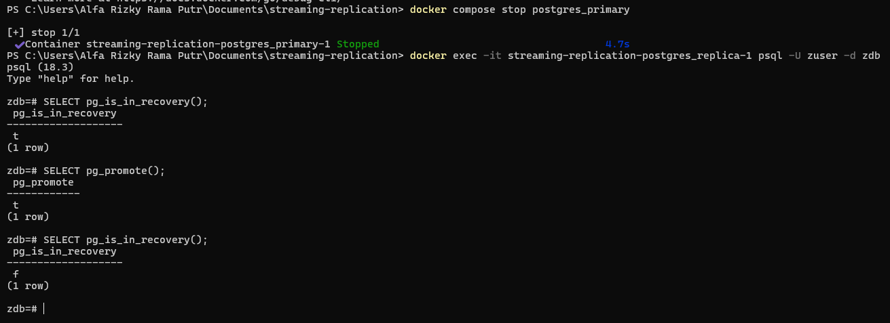

Foto kedelapan menunjukkan simulasi kegagalan primary. Container
`postgres_primary` dihentikan menggunakan perintah `docker compose stop
postgres_primary`. Setelah itu, status replica diperiksa dengan
`SELECT pg_is_in_recovery();`.

Nilai awal `pg_is_in_recovery()` adalah `t`, yang berarti server masih
berstatus standby. Perintah `SELECT pg_promote();` kemudian dijalankan untuk
mempromosikan replica menjadi primary. Pemeriksaan berikutnya menghasilkan
nilai `f`, yang berarti server sudah keluar dari mode recovery dan dapat
menerima operasi tulis sebagai primary baru.

Proses ini menunjukkan mekanisme failover manual. Ketika primary tidak
tersedia, replica dapat dipromosikan agar layanan database kembali berjalan.

## Foto 9 - Menghentikan Seluruh Container

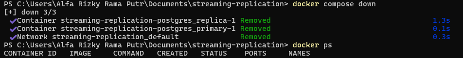

Pada foto kesembilan dijalankan perintah `docker compose down`. Perintah ini
menghentikan sekaligus menghapus container `postgres_primary` dan
`postgres_replica`, kemudian menghapus network Docker yang dibuat oleh project.

Output `docker ps` yang tidak menampilkan container menunjukkan bahwa seluruh
service telah berhenti. Langkah ini digunakan untuk membersihkan resource
setelah pengujian selesai.

## Foto 10 - Menjalankan Cluster Apache Ignite

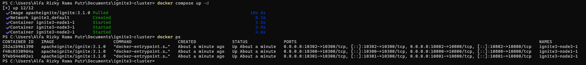

Foto kesepuluh memperlihatkan project Apache Ignite dijalankan dengan perintah
`docker compose up -d`. Image `apacheignite/ignite:3.1.0` berhasil digunakan,
network `ignite3_default` dibuat, dan tiga container berhasil berjalan:
`ignite3-node1-1`, `ignite3-node2-1`, serta `ignite3-node3-1`.

Perintah `docker ps` menunjukkan ketiga node berada dalam status **Up**.
Pemetaan port memperlihatkan bahwa setiap node memiliki port client dan port
network masing-masing. Tiga node ini menjadi dasar pembentukan cluster
terdistribusi Apache Ignite, sehingga data dan layanan dapat dikelola oleh
lebih dari satu node.

Tahap ini menunjukkan peralihan dari pengujian PostgreSQL streaming
replication ke pengujian cluster Apache Ignite. Docker Compose memudahkan
seluruh node dijalankan secara serentak dengan konfigurasi jaringan yang sama.

## Foto 11 - Memeriksa Alamat IP Setiap Node

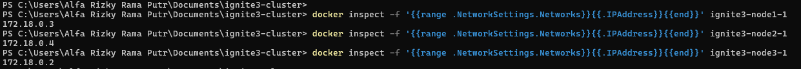

Foto kesebelas menunjukkan pemeriksaan alamat IP internal container Apache
Ignite menggunakan perintah `docker inspect`. Hasilnya menunjukkan alamat
masing-masing node pada network Docker:

- `ignite3-node1-1` memiliki IP `172.18.0.3`.
- `ignite3-node2-1` memiliki IP `172.18.0.4`.
- `ignite3-node3-1` memiliki IP `172.18.0.2`.

Informasi alamat IP ini digunakan untuk memastikan setiap container terhubung
ke network `ignite3_default`. Alamat tersebut juga membantu proses
identifikasi dan troubleshooting komunikasi antar-node. Meskipun konfigurasi
cluster menggunakan nama host node, pemeriksaan IP dapat digunakan untuk
memastikan resolusi jaringan Docker berjalan dengan benar.

## Foto 12 - Menghubungkan Apache Ignite CLI ke Node

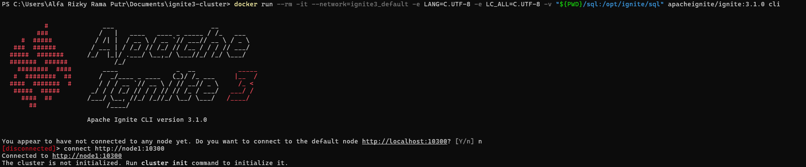

Pada foto kedua belas, Apache Ignite CLI versi `3.1.0` dijalankan dari
container menggunakan perintah `docker run`. CLI kemudian mencoba terhubung ke
node melalui alamat `http://node1:10300`.

Pesan awal menunjukkan CLI belum terhubung ke node mana pun. Setelah perintah
`connect http://node1:10300` dijalankan, koneksi berhasil dibuat ke node1.
Namun, CLI juga memberikan informasi bahwa cluster belum diinisialisasi dan
meminta pengguna menjalankan perintah `cluster init`.

Tahap ini memastikan endpoint REST/client node1 dapat diakses dan menjadi
langkah awal sebelum konfigurasi cluster dilakukan.

## Foto 13 - Inisialisasi dan Pemeriksaan Status Cluster

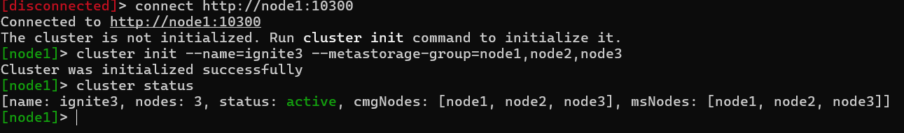

Foto ketiga belas memperlihatkan proses inisialisasi cluster dengan perintah:
`cluster init --name=ignite3 --metastorage-group=node1,node2,node3`.

Perintah tersebut menetapkan nama cluster menjadi `ignite3` dan menentukan
node1, node2, serta node3 sebagai anggota **metastorage group**. Metastore
digunakan untuk menyimpan metadata penting cluster dan perlu tersedia pada node
yang telah ditentukan.

Output **Cluster was initialized successfully** menunjukkan inisialisasi
berhasil. Perintah `cluster status` kemudian menampilkan bahwa cluster bernama
`ignite3` memiliki tiga node dan berstatus **active**. Daftar `cmgNodes` dan
`msNodes` juga memuat node1, node2, dan node3, sehingga ketiga node telah
terdaftar sebagai bagian dari konfigurasi cluster.

## Foto 14 - Memeriksa Topologi Logis Cluster

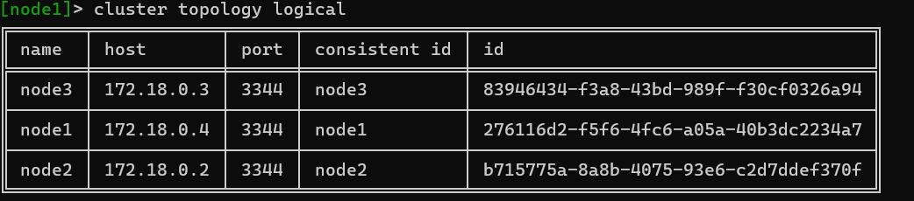

Pada foto keempat belas dijalankan perintah `cluster topology logical` untuk
menampilkan topologi logis cluster. Hasilnya menampilkan tiga node, yaitu
`node1`, `node2`, dan `node3`, yang masing-masing menggunakan port komunikasi
`3344`.

Tabel tersebut juga menampilkan host atau alamat IP, `consistent id`, dan
identifier unik setiap node. Informasi ini membuktikan bahwa ketiga node telah
dikenali oleh cluster dan memiliki identitas masing-masing. Dengan demikian,
cluster Apache Ignite telah aktif dan seluruh node dapat berpartisipasi dalam
komunikasi serta pengelolaan data terdistribusi.

## Foto 15 - Menjalankan Skema Database

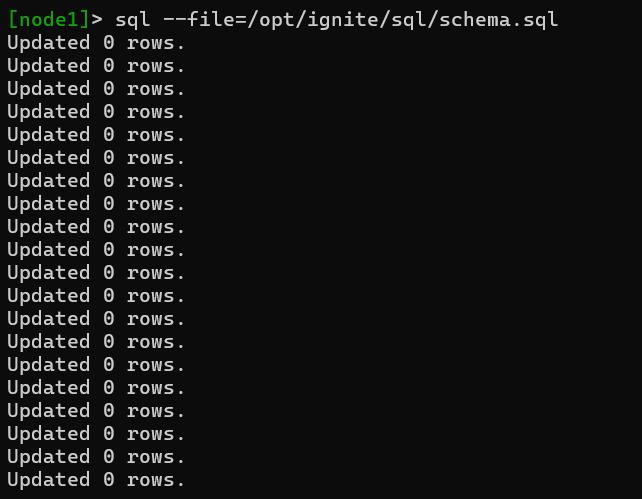

Pada foto kelima belas dijalankan perintah `sql --file=/opt/ignite/sql/schema.sql`
melalui Apache Ignite CLI. File tersebut berisi perintah SQL untuk membuat
struktur awal database, seperti tabel, kolom, dan kemungkinan relasi yang
diperlukan oleh aplikasi.

Output menampilkan beberapa pesan **Updated 0 rows**. Hasil tersebut tidak
menunjukkan kegagalan, karena perintah pada file skema berfokus pada pembuatan
atau perubahan struktur database, bukan memasukkan baris data. Tahap ini
menyiapkan schema sebelum data-data aplikasi dimuat ke dalam cluster.

## Foto 16 - Memeriksa Tabel pada Schema PUBLIC

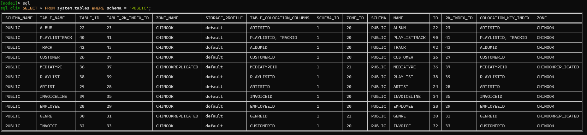

Foto keenam belas menampilkan query:
`SELECT * FROM system.tables WHERE schema = 'PUBLIC';`.

Query tersebut digunakan untuk melihat daftar tabel yang tersedia pada schema
`PUBLIC`. Hasilnya menunjukkan beberapa tabel, antara lain `ALBUM`,
`PLAYLISTTRACK`, `TRACK`, `CUSTOMER`, `MEDIATYPE`, `PLAYLIST`, `ARTIST`,
`INVOICELINE`, `EMPLOYEE`, `GENRE`, dan `INVOICE`.

Selain nama tabel, hasil query juga menampilkan informasi teknis seperti
`TABLE_ID`, indeks primary key, zona penyimpanan, dan kolom colocation.
Informasi ini membuktikan bahwa schema berhasil dibuat dan tabel telah
terdaftar pada cluster Apache Ignite.

## Foto 17 - Memasukkan Data ke dalam Tabel

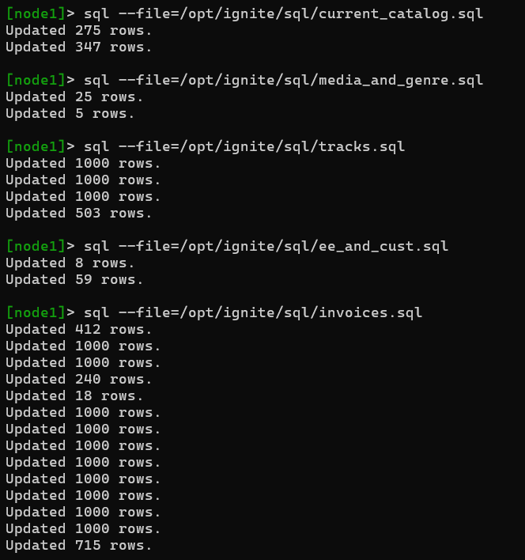

Pada foto ketujuh belas dijalankan beberapa file SQL untuk mengisi tabel
dengan data. File yang digunakan meliputi `current_catalog.sql`,
`media_and_genre.sql`, `tracks.sql`, `ee_and_cust.sql`, dan `invoices.sql`.

Setiap file menghasilkan jumlah baris yang berbeda, misalnya 275 dan 347 baris
dari `current_catalog.sql`, 25 dan 5 baris dari `media_and_genre.sql`, serta
berbagai batch data dari file `tracks.sql` dan `invoices.sql`. Pesan **Updated
N rows** menunjukkan jumlah baris yang berhasil diproses oleh setiap perintah
SQL.

Tahap ini mengisi cluster dengan data katalog, media, genre, track, karyawan,
customer, dan invoice. Pemisahan data ke dalam beberapa file membuat proses
import lebih terstruktur dan memudahkan pengelolaan dataset berukuran besar.

## Foto 18 - Verifikasi Tabel dari Node Lain

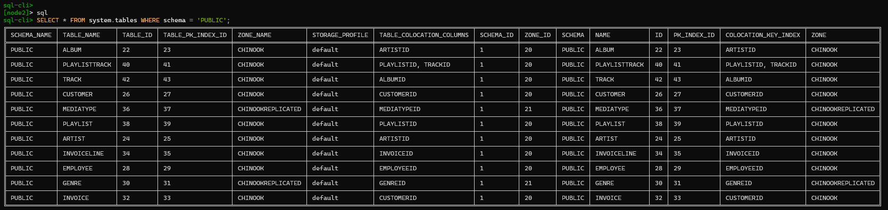

Foto kedelapan belas menunjukkan koneksi ke `node2` melalui Apache Ignite SQL
CLI. Setelah terhubung, query yang sama terhadap `system.tables` dijalankan
untuk menampilkan tabel pada schema `PUBLIC`.

Daftar tabel yang terlihat pada node2 sama dengan daftar tabel yang sebelumnya
diperiksa dari node1, seperti `ALBUM`, `TRACK`, `CUSTOMER`, `INVOICE`, dan
tabel lainnya. Kesamaan hasil ini menunjukkan bahwa metadata schema tersedia
secara konsisten di seluruh cluster, bukan hanya pada satu node.

Verifikasi dari node2 penting untuk memastikan cluster dapat diakses melalui
lebih dari satu node dan konfigurasi database telah terdistribusi dengan baik.

## Foto 19–21 - Query dan Hasil Analitik Invoice

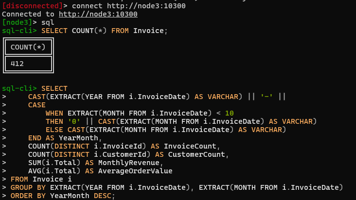

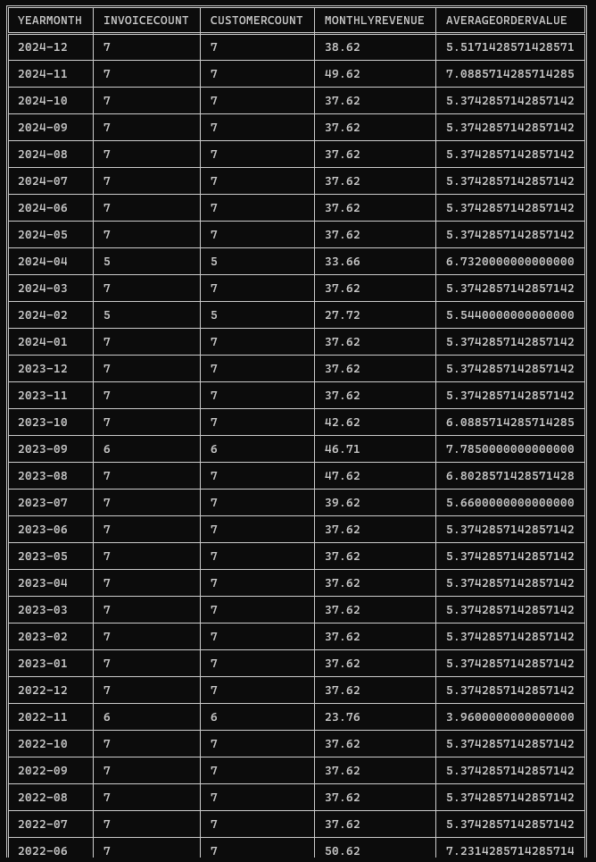

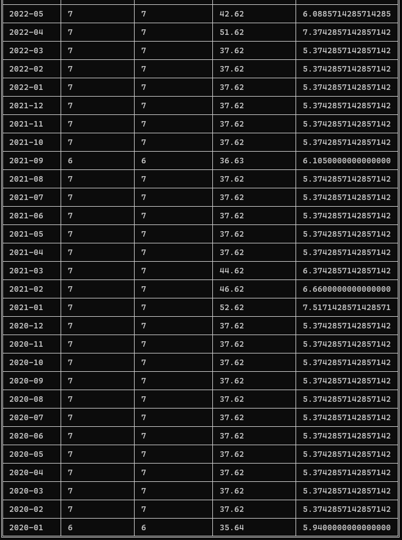

Foto 19 sampai Foto 21 merupakan satu rangkaian output analitik yang
dijalankan melalui node3. Foto 19 menampilkan query, sedangkan Foto 20 dan
Foto 21 menampilkan hasil query yang sama dalam dua bagian karena outputnya
panjang.

Sebelum query analitik dijalankan, perintah
`SELECT COUNT(*) FROM Invoice;` menghasilkan jumlah **412 invoice**.

Query berikutnya mengelompokkan data invoice berdasarkan tahun dan bulan.
Kolom `YearMonth` dibentuk dari `InvoiceDate`, kemudian dihitung beberapa
metrik:

- `InvoiceCount` menghitung jumlah invoice pada setiap bulan.
- `CustomerCount` menghitung jumlah customer yang berbeda.
- `MonthlyRevenue` menghitung total nilai transaksi melalui `SUM(i.Total)`.
- `AverageOrderValue` menghitung rata-rata nilai order melalui `AVG(i.Total)`.

Hasil diurutkan berdasarkan periode terbaru dengan `ORDER BY YearMonth DESC`.
Query ini menunjukkan pemanfaatan Apache Ignite SQL untuk analisis agregat
langsung pada data yang telah dimuat ke dalam cluster.

Hasil query menampilkan kolom `YEARMONTH`, `INVOICECOUNT`, `CUSTOMERCOUNT`,
`MONTHLYREVENUE`, dan `AVERAGEORDERVALUE`.

Data pada Foto 20 ditampilkan mulai dari periode terbaru, yaitu `2024-12`,
kemudian berurutan mundur hingga `2022-06`. Foto 21 melanjutkan tabel yang
sama mulai dari periode `2022-05` hingga `2020-01`.

Sebagian besar bulan memiliki 7 invoice dan 7 customer. Namun, terdapat juga
periode dengan 6 invoice dan 6 customer. Nilai pendapatan tertinggi yang
terlihat adalah `52.62` pada `2021-01`, dengan rata-rata nilai order sekitar
`7.51`. Data tersebut dapat digunakan untuk membandingkan performa penjualan
antarbulan dan mengidentifikasi periode dengan pendapatan atau nilai order yang
lebih tinggi.

Secara keseluruhan, rangkaian Foto 19 sampai Foto 21 membuktikan bahwa data
invoice berhasil dianalisis melalui query SQL pada cluster Apache Ignite.

## Foto 22 - Menghentikan Cluster Apache Ignite

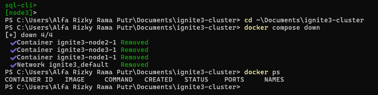

Foto kedua puluh dua menunjukkan proses penghentian dan pembersihan cluster
Apache Ignite menggunakan perintah `docker compose down`. Perintah tersebut
menghentikan sekaligus menghapus container node serta network Docker yang
dibuat oleh project `ignite3`.

Output menunjukkan container `ignite3-node2-1` dan `ignite3-node3-1` berhasil
dihapus, kemudian network `ignite3_default` juga dihapus. Setelah itu,
perintah `docker ps` tidak menampilkan container yang sedang berjalan. Hal
ini menandakan seluruh node cluster telah berhasil dihentikan.

Tahap ini dilakukan setelah seluruh proses konfigurasi, pemuatan data, dan
analisis selesai. Menghentikan cluster dengan Docker Compose membantu
membersihkan resource yang tidak lagi digunakan, seperti container dan
network, sehingga lingkungan Docker tetap tertata.

## Kesimpulan 📚 

Berdasarkan hasil praktikum, dapat disimpulkan bahwa Docker dapat digunakan untuk menjalankan dan mengelola sistem database terdistribusi. Praktikum diawali dengan instalasi Docker Desktop menggunakan WSL 2, kemudian dilanjutkan dengan menjalankan PostgreSQL primary dan replica menggunakan Docker Compose. Pada PostgreSQL, proses streaming replication berhasil dilakukan. Data yang dibuat pada primary dapat diteruskan ke replica melalui WAL. Hasil pengujian juga menunjukkan bahwa replica hanya dapat digunakan untuk membaca data, sedangkan proses penulisan harus dilakukan pada primary. Selain itu, replica berhasil dipromosikan menjadi primary menggunakan `pg_promote()` setelah primary dihentikan. Hal ini menunjukkan bahwa mekanisme failover manual dapat digunakan untuk menjaga ketersediaan database. Selanjutnya, cluster Apache Ignite berhasil dibangun menggunakan tiga node. Cluster dapat diinisialisasi, diperiksa topologinya, dan diakses melalui beberapa node. Schema serta data berhasil dimasukkan menggunakan file SQL, kemudian tabel yang telah dibuat dapat diverifikasi dari node yang berbeda. Data invoice juga berhasil dianalisis menggunakan query SQL untuk memperoleh jumlah invoice, jumlah customer, pendapatan bulanan, dan rata-rata nilai order. Dengan demikian, praktikum ini memberikan pemahaman mengenai penggunaan Docker, replikasi database, pembagian peran primary dan replica, failover, komunikasi antar-node, serta pengolahan data pada sistem terdistribusi. Seluruh proses dapat dihentikan dan resource Docker dapat dibersihkan setelah praktikum selesai.
