# 📚 Praktikum Sistem Terdistribusi dan Terdesentralisasi 📚 
## Modul 5: Fault Tolerance (Load Balancing dan Failure Detection)

- **Nama**: Alfa  Rizki Rama Putra
- **NIM**: 255410031
- **Kelas**: IF_1


# Bagian 1. Persiapan dan pembuatan aplikasi

## Gambar 1. Membuat folder kerja dan virtual environment

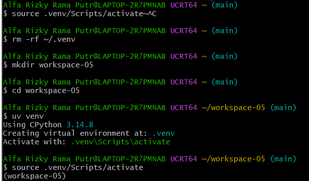

**Tujuan.** Menyiapkan folder kerja `workspace-05` dan environment Python yang terpisah (virtual environment) supaya library praktikum ini tidak bercampur dengan proyek lain. Modul menyarankan memakai pengelola environment seperti uv, Micromamba, atau Miniconda.

**Perintah yang dijalankan.**

```bash
mkdir workspace-05
cd workspace-05
uv venv
source .venv/Scripts/activate
```

**Hasil.**
- `uv venv` menampilkan `Using CPython 3.14.8` dan `Creating virtual environment at: .venv`. Artinya uv memilih Python 3.14.8 yang tersedia dan membuat environment di folder `.venv`.
- Setelah `source .venv/Scripts/activate`, di awal prompt muncul `(workspace-05)`. Tanda ini menunjukkan environment sudah aktif.
- Di bagian atas gambar ada perintah `rm -rf ~/.venv`. Perintah itu membersihkan `.venv` yang sempat terbuat di folder home karena salah tempat, sebelum environment dibuat ulang di dalam `workspace-05`.

**Penjelasan.**
- Di modul, langkah ini didahului `uv python list` untuk melihat versi Python yang tersedia dan `uv python pin` untuk mengunci versi. Di Windows, uv memilih versi Python secara otomatis sehingga dua perintah itu tidak wajib.
- Folder `.venv` berisi interpreter Python dan library khusus proyek. Di Windows, skrip aktivasinya berada di `.venv/Scripts/`, sedangkan di Linux berada di `.venv/bin/`.
- Versi Python lokal (3.14.8) berbeda dari contoh modul (3.14.4), tetapi tidak berpengaruh karena aplikasi di dalam container memakai `python:3.14.4-slim`.

---

## Gambar 2. Memasang Blacksheep dan blacksheep-cli

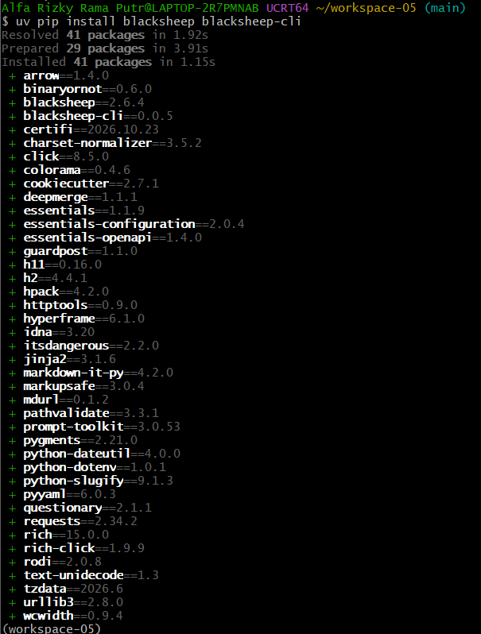

**Tujuan.** Memasang framework Blacksheep beserta alat command line (`blacksheep-cli`) yang dipakai untuk membuat kerangka proyek.

**Perintah yang dijalankan.**

```bash
uv pip install blacksheep blacksheep-cli
```

**Hasil.**
- uv melaporkan `Resolved 41 packages`, `Prepared 29 packages`, dan `Installed 41 packages` dalam waktu sekitar satu detik.
- Di antara paket yang terpasang ada `blacksheep==2.6.4`, `blacksheep-cli==0.0.5`, `essentials-configuration`, `httptools`, `h11`, `h2`, `cookiecutter`, `jinja2`, `rich`, dan `click`.

**Penjelasan.**
- Modul memasang dua paket ini dalam dua perintah terpisah (14 paket untuk `blacksheep`, lalu 27 paket tambahan untuk `blacksheep-cli`). Di sini keduanya dipasang sekaligus, dan jumlah totalnya sama: 14 + 27 = 41 paket.
- `blacksheep` adalah framework web asynchronous (ASGI) untuk Python. `httptools` dan `h11` dipakai untuk memproses HTTP.
- `blacksheep-cli` memakai `cookiecutter` (pembuat kerangka proyek dari template), `click` dan `questionary` (antarmuka perintah dan pertanyaan interaktif), serta `rich` (tampilan terminal berwarna).
- Nomor versi sedikit berbeda dari modul (misalnya Blacksheep 2.6.4, sedangkan modul 2.6.2) karena versi terbaru yang tersedia saat dipasang.

---

## Gambar 3. Membuat proyek dengan `blacksheep create`

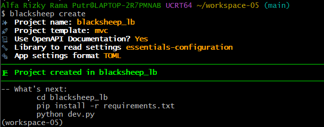

**Tujuan.** Membuat kerangka aplikasi web Blacksheep memakai CLI.

**Perintah yang dijalankan.**

```bash
blacksheep create
```

**Pilihan yang diisi pada pertanyaan interaktif.**

| Pertanyaan | Jawaban |
|---|---|
| Project name | `blacksheep_lb` |
| Project template | `mvc` |
| Use OpenAPI Documentation? | `Yes` |
| Library to read settings | `essentials-configuration` |
| App settings format | `TOML` |

**Hasil.** Muncul tulisan `Project created in blacksheep_lb` dan petunjuk langkah berikutnya: `cd blacksheep_lb`, `pip install -r requirements.txt`, dan `python dev.py`.

**Penjelasan.**
- Template `mvc` menghasilkan aplikasi lengkap dengan halaman contoh, jadi cukup untuk mendemonstrasikan load balancing tanpa menulis aplikasi sendiri.
- Pilihan OpenAPI menambahkan dokumentasi API otomatis (tombol "OPENAPI DOCS" di halaman).
- `essentials-configuration` dengan format TOML dipakai untuk membaca pengaturan dari `settings.toml`.
- Proyek yang terbentuk sudah mengandung `Dockerfile`, yang nanti dipakai untuk membuat container aplikasi.

---

## Gambar 4. Memasang dependensi aplikasi

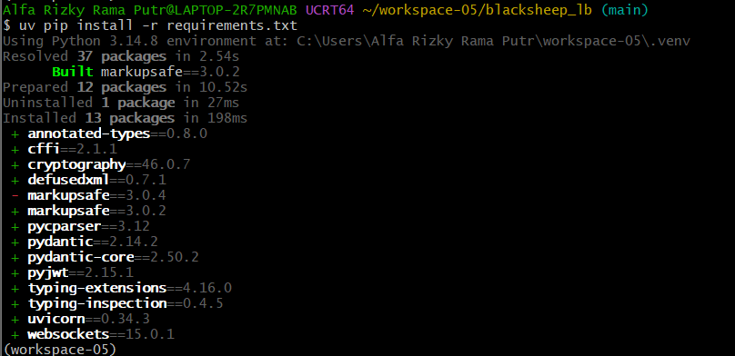

**Tujuan.** Memasang semua library yang dibutuhkan aplikasi, sesuai daftar di `requirements.txt`.

**Perintah yang dijalankan** (dari dalam folder `blacksheep_lb`).

```bash
cd blacksheep_lb
uv pip install -r requirements.txt
```

**Hasil.**
- uv memakai environment `workspace-05\.venv` (`Using Python 3.14.8 environment at: ...`).
- `Resolved 37 packages`, `Built markupsafe==3.0.2`, `Uninstalled 1 package`, dan `Installed 13 packages`.
- Paket baru yang terpasang antara lain `uvicorn==0.34.3`, `pydantic`, `pydantic-core`, `cryptography`, `pyjwt`, `websockets`, dan `typing-extensions`.
- Ada satu pasangan baris `- markupsafe==3.0.4` dan `+ markupsafe==3.0.2`.

**Penjelasan.**
- `uvicorn` adalah server ASGI yang menjalankan aplikasi Blacksheep. `pydantic` dipakai untuk validasi data, sedangkan `cryptography` dan `pyjwt` untuk fitur keamanan dan token.
- `markupsafe` diturunkan dari 3.0.4 ke 3.0.2 karena `requirements.txt` mengunci versi 3.0.2, dan uv menyesuaikan environment dengan file tersebut. Hal serupa terjadi di modul (3.0.3 menjadi 3.0.2).
- Jumlah paket baru di sini 13, sedangkan modul menampilkan 14. Selisih satu paket kemungkinan karena `uvloop` (pengganti event loop yang lebih cepat) tidak didukung di Windows, jadi tidak dipasang. Aplikasi tetap berjalan normal memakai event loop bawaan Python.
- File ini juga yang dipakai Dockerfile saat membangun container, jadi isinya harus lengkap.

---

## Gambar 5. Menjalankan aplikasi secara lokal

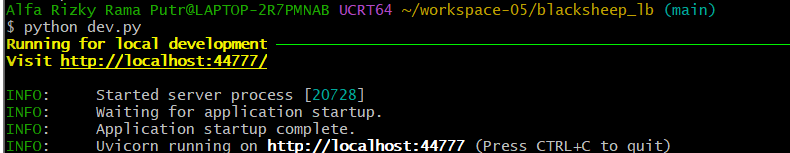

**Tujuan.** Memastikan aplikasi dapat berjalan sebelum dimasukkan ke Docker.

**Perintah yang dijalankan.**

```bash
python dev.py
```

**Hasil.**
- Muncul `Running for local development` dan `Visit http://localhost:44777/`.
- Log uvicorn menampilkan `Started server process [20728]`, `Waiting for application startup`, `Application startup complete`, dan `Uvicorn running on http://localhost:44777 (Press CTRL+C to quit)`.

**Penjelasan.**
- Aplikasi berjalan langsung di komputer pada **port 44777**. Port itu hanya untuk mode pengembangan lokal.
- Di dalam container (lewat `Dockerfile`), aplikasi berjalan di **port 80**. Karena itu, setelah memakai Docker Compose dan nginx, alamat aksesnya menjadi `http://localhost` (port 80), bukan lagi `http://localhost:44777`.
- Angka `20728` adalah ID proses server dan berbeda di setiap komputer atau setiap kali dijalankan.
- Untuk melengkapi bukti, buka `http://localhost:44777` di browser. Halaman **BLACKSHEEP** dengan gambar domba harus tampil, dan setiap permintaan akan tercatat di terminal sebagai `GET / HTTP/1.1 200 OK`.

---

## Gambar 6. Halaman aplikasi di browser (port 44777)

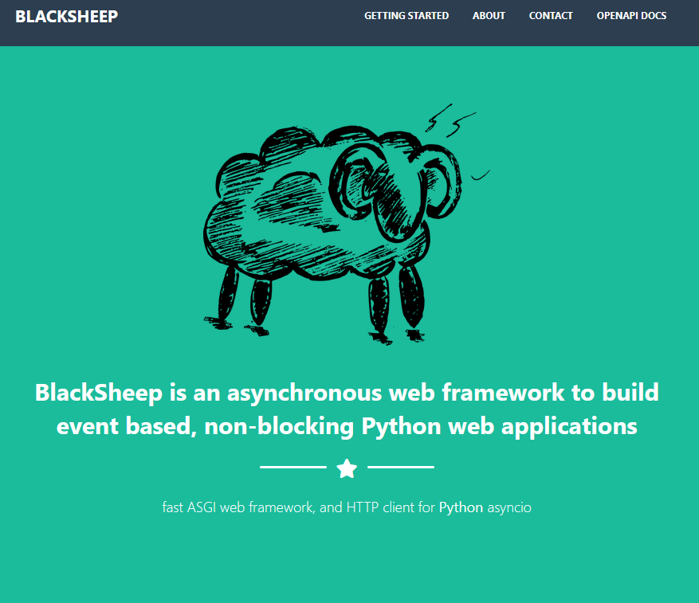

**Tujuan.** Memastikan aplikasi benar-benar dapat diakses dari browser.

**Langkah.** Dengan `python dev.py` berjalan, buka `http://localhost:44777`.

**Hasil.** Tampil halaman contoh **BLACKSHEEP**: gambar domba, menu *Getting Started*, *About*, *Contact*, dan *OpenAPI Docs*, serta tagline framework di bagian tengah halaman.

**Penjelasan.**
- Ini halaman contoh dari template `mvc`. Menu *OpenAPI Docs* ada karena kita memilih dokumentasi OpenAPI saat `blacksheep create`.
- Pada tahap ini aplikasi diakses **langsung** di port 44777, belum melewati load balancer.

---

## Gambar 7. Log server saat halaman diakses

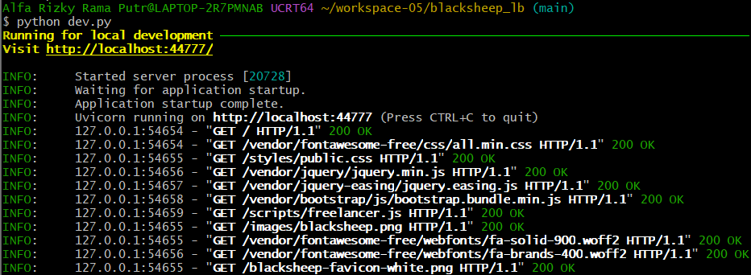

**Tujuan.** Melihat bukti bahwa server menerima dan menjawab permintaan dari browser.

**Hasil.** Setelah baris `Uvicorn running on http://localhost:44777`, muncul rangkaian log seperti `"GET / HTTP/1.1" 200 OK`, lalu permintaan untuk file pendukung: `all.min.css`, `public.css`, `jquery.min.js`, `bootstrap.bundle.min.js`, `freelancer.js`, `blacksheep.png`, font `fa-solid-900.woff2` dan `fa-brands-400.woff2`, serta `blacksheep-favicon-white.png`. Semuanya berstatus **200 OK**.

**Penjelasan.**
- Satu kali membuka halaman memicu banyak permintaan: browser meminta HTML lebih dulu (`GET /`), lalu mengambil CSS, JavaScript, gambar, dan font yang dirujuk halaman itu.
- Kode **200 OK** berarti permintaan berhasil dilayani.
- Alamat sumber permintaan adalah `127.0.0.1`, yaitu komputer sendiri (browser yang mengakses langsung). Bandingkan dengan Gambar 13, di mana alamat sumbernya `172.18.0.4` (container nginx).

---

## Gambar 8. Isi folder proyek `blacksheep_lb`

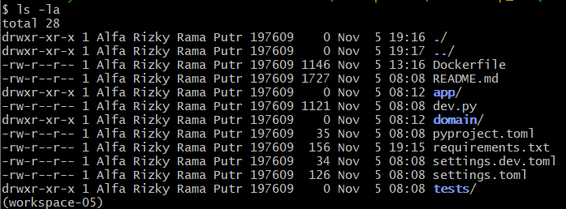

**Perintah yang dijalankan.**

```bash
cd ~/workspace-05/blacksheep_lb
ls -la
```

**Hasil.** Folder berisi `Dockerfile`, `README.md`, `dev.py`, `pyproject.toml`, `requirements.txt`, `settings.dev.toml`, `settings.toml`, serta folder `app/`, `domain/`, dan `tests/`.

**Penjelasan.**
- Yang terpenting: proyek hasil `blacksheep create` **sudah membawa `Dockerfile`**, sehingga dapat langsung dipakai untuk membuat container tanpa menulis dari nol.
- Dockerfile ini membuka **port 80** di dalam container, bukan 44777 seperti saat `python dev.py`. Hal ini penting karena `nginx.conf` mengarahkan `upstream` ke `bs_app:80`.
- Ukuran `Dockerfile` di sini 1146 byte, sedangkan contoh modul 1179 byte. Selisih 33 byte itu sama dengan panjang satu baris `    software-properties-common \`, yaitu paket yang kita hapus karena tidak tersedia di Debian *trixie*.
- Berkas lain: `dev.py` menjalankan mode pengembangan, `requirements.txt` berisi daftar library, `settings*.toml` berisi pengaturan aplikasi, `app/` berisi kode aplikasi, `domain/` berisi model data, dan `tests/` berisi pengujian.

---

# Bagian 2. Load balancing (4.1)

Ada dua komponen: aplikasi Blacksheep yang dijalankan dalam **2 instance**, dan **nginx** sebagai load balancer yang membagi permintaan ke kedua instance.

```
Browser → nginx (port 80) ─┬→ bs_app-1 (port 80 di container)
                           └→ bs_app-2 (port 80 di container)
```

## `blacksheep_lb/Dockerfile`

Dockerfile ini bawaan Blacksheep. Perubahan yang dilakukan hanya dua:
1. Versi Python menjadi `3.14.4-slim` (sesuai modul).
2. Paket `software-properties-common` dihapus karena tidak tersedia di Debian *trixie* yang dipakai image `python:3.14.4-slim`, sehingga build awalnya gagal dengan `E: Unable to locate package software-properties-common`.

```dockerfile
# Build the Server
FROM python:3.14.4-slim AS server_builder
WORKDIR /home
RUN echo "APT::Get::Assume-Yes \"true\";" > /etc/apt/apt.conf.d/90assumeyes
RUN apt-get update && apt-get install make \
    apt-utils \
    lsb-release \
    apt-transport-https \
    ca-certificates \
    gnupg \
    sqlite3 \
    build-essential \
    libssl-dev \
    zlib1g-dev \
    libbz2-dev \
    libsqlite3-dev \
    unixodbc-dev \
    libncurses5-dev \
    libgdbm-dev \
    libnss3-dev \
    libreadline-dev \
    libffi-dev \
    libjpeg-dev \
    zlib1g-dev \
    wget
COPY . /home
RUN python -m venv venv && . venv/bin/activate && pip install --upgrade pip && pip install -r requirements.txt

EXPOSE 80

FROM python:3.14.4-slim
WORKDIR /home
COPY --from=server_builder /home/ /home/

ENV APP_ENV=prod BG_COLOR="#1abc9c" APP_ROUTE_PREFIX=""
RUN echo "APT::Get::Assume-Yes \"true\";" > /etc/apt/apt.conf.d/90assumeyes
RUN apt-get update && apt-get install \
    ca-certificates \
    sqlite3 \
    libsqlite3-dev \
    libjpeg-dev \
    zlib1g-dev
CMD ["sh", "-c", ". venv/bin/activate && uvicorn \"app.main:app\" --host 0.0.0.0 --port 80 --log-level info"]
```

**Penjelasan.** Dockerfile memakai *multi-stage build*. Tahap pertama (`server_builder`) memasang alat kompilasi dan library Python. Tahap kedua memakai image bersih dan hanya menyalin hasil jadi dari tahap pertama, sehingga image akhir lebih kecil. Server dijalankan dengan `uvicorn` di port 80.

## `nginx/Dockerfile`

```dockerfile
FROM nginx

# Override the default nginx configuration file
RUN rm /etc/nginx/conf.d/default.conf
COPY nginx.conf /etc/nginx/nginx.conf
```

**Penjelasan.** Memakai image resmi nginx, menghapus konfigurasi bawaan, lalu menggantinya dengan `nginx.conf` buatan sendiri.

### Gambar 9. Pengecekan `nginx/Dockerfile`

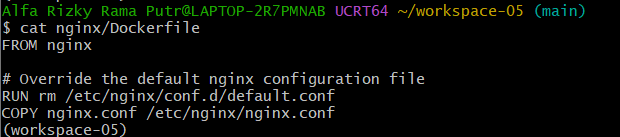

Perintah `cat nginx/Dockerfile` menampilkan tiga instruksi di atas: `FROM nginx`, `RUN rm /etc/nginx/conf.d/default.conf`, dan `COPY nginx.conf /etc/nginx/nginx.conf`. Isinya sama dengan yang diminta modul, dan file ini dipakai Docker Compose saat membangun service `nginx` (`build: ./nginx`).

## `nginx/nginx.conf`

```nginx
events {
  worker_connections 4096;
}

http {
  # Definisi grup, lihat di docker-compose.yml
  upstream backend {
    server bs_app:80;
  }
  server {
    listen 80;
      location / {
        # sesuaikan dengan nama upstream di atas
        proxy_pass http://backend;
      }
  }
}
```

**Penjelasan.**
- `upstream backend` mendefinisikan grup server di belakang nginx. Nama `bs_app` adalah nama service di Docker Compose. DNS internal Docker menerjemahkan nama itu ke alamat semua instance, sehingga nginx membagi permintaan secara bergantian (*round-robin*).
- `listen 80` membuat nginx menerima koneksi di port 80.
- `proxy_pass http://backend` meneruskan semua permintaan (`location /`) ke grup `backend`. Nama setelah `http://` harus sama dengan nama `upstream`.

## `docker-compose.yml`

```yaml
services:
  # aplikasi yang akan di-scale
  # ada pada direktori blacksheep_lb
  bs_app:
    build: ./blacksheep_lb
  # aktifkan nginx dengan menggunakan nginx/Dockerfile
  # lihat pada build
  nginx:
    container_name: nginx
    build: ./nginx
    ports:
      - 80:80
    depends_on:
      - bs_app
```

**Penjelasan.**
- `bs_app` sengaja **tidak** diberi `container_name` maupun `ports`, supaya dapat digandakan (*scale*) menjadi beberapa instance tanpa bentrok nama atau port.
- `nginx` membuka port 80 komputer ke port 80 container (`80:80`). Ini satu-satunya pintu masuk dari luar.
- `depends_on` memastikan `bs_app` dinyalakan lebih dulu daripada `nginx`.

## `env.sh` (alias perintah, versi Windows tanpa `sudo`)

```bash
alias dcu="docker compose up --build -d --scale bs_app=2"
alias dcd="docker compose down"
alias dps="docker ps --format '{{.Image}} {{.Names}}'"
alias dcln="docker logs nginx"
```

| Alias | Fungsi |
|---|---|
| `dcu` | Membangun image dan menjalankan semua service di latar belakang dengan 2 instance `bs_app` |
| `dcd` | Menghentikan dan menghapus semua container |
| `dps` | Menampilkan daftar container yang berjalan (image dan nama) |
| `dcln` | Menampilkan log container nginx |

Versi asli di modul memakai `sudo` karena dijalankan di Linux. Di Windows (Docker Desktop) `sudo` tidak diperlukan.

## Cara menjalankan dan membuktikan

```bash
source env.sh
dcu          # jalankan 2 instance bs_app + nginx
dps          # cek container yang berjalan
```

Buka `http://localhost` lalu muat ulang beberapa kali. Cek log kedua instance:

```bash
docker logs workspace-05-bs_app-1
docker logs workspace-05-bs_app-2
```

Kalau kedua log memuat baris `GET / HTTP/1.1 200 OK`, berarti nginx membagi permintaan ke kedua instance. Alamat `172.18.0.4` pada log adalah alamat container nginx di jaringan Docker. Setelah selesai:

```bash
dcd
```

Nama container berawalan `workspace-05-` karena mengikuti nama folder proyek (di modul berawalan `load-balancing-`).

---

## Gambar 10. Menjalankan Docker Compose (`dcu`)

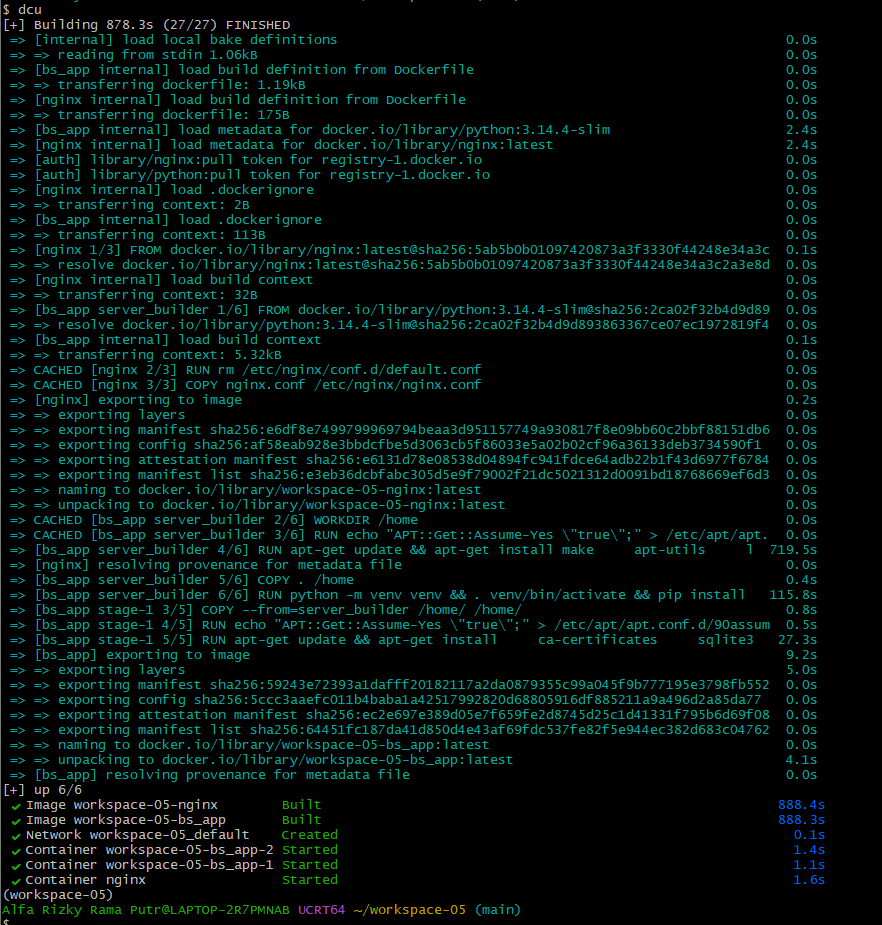

**Perintah yang dijalankan.**

```bash
source env.sh
dcu
```

`dcu` adalah alias untuk `docker compose up --build -d --scale bs_app=2`.

**Hasil.**
- Muncul `[+] Building 878.3s (27/27) FINISHED`.
- Tahap build `bs_app`: mengambil `python:3.14.4-slim`, `WORKDIR /home`, `apt-get install` (719.5 detik), `COPY . /home`, membuat venv dan `pip install` (115.8 detik), lalu tahap kedua (`COPY --from=server_builder`, `apt-get install` selama 27.3 detik).
- Tahap build `nginx`: mengambil `nginx:latest`, `rm default.conf`, dan `COPY nginx.conf` (ditandai `CACHED`).
- Bagian akhir `up 6/6`: `Image workspace-05-nginx Built`, `Image workspace-05-bs_app Built`, `Network workspace-05_default Created`, dan tiga container `Started`: `workspace-05-bs_app-2`, `workspace-05-bs_app-1`, serta `nginx`.

**Penjelasan.**
- Terbentuk **dua instance** `bs_app` karena opsi `--scale bs_app=2`, ditambah satu container `nginx`.
- Waktu build jauh lebih lama daripada contoh modul karena langkah `apt-get install` mengunduh banyak paket lewat internet. Itu sebabnya waktunya bergantung pada kecepatan koneksi.
- Tanda `CACHED` berarti Docker memakai ulang lapisan dari percobaan build sebelumnya (yang sempat gagal karena paket `software-properties-common` tidak ditemukan), sehingga tidak dikerjakan ulang.
- Nama container berawalan `workspace-05-` karena mengikuti nama folder proyek. Di modul, awalannya `load-balancing-`.
- `bs_app` dinyalakan lebih dulu daripada `nginx` karena pengaturan `depends_on`.

---

## Gambar 11. Mengakses aplikasi lewat nginx

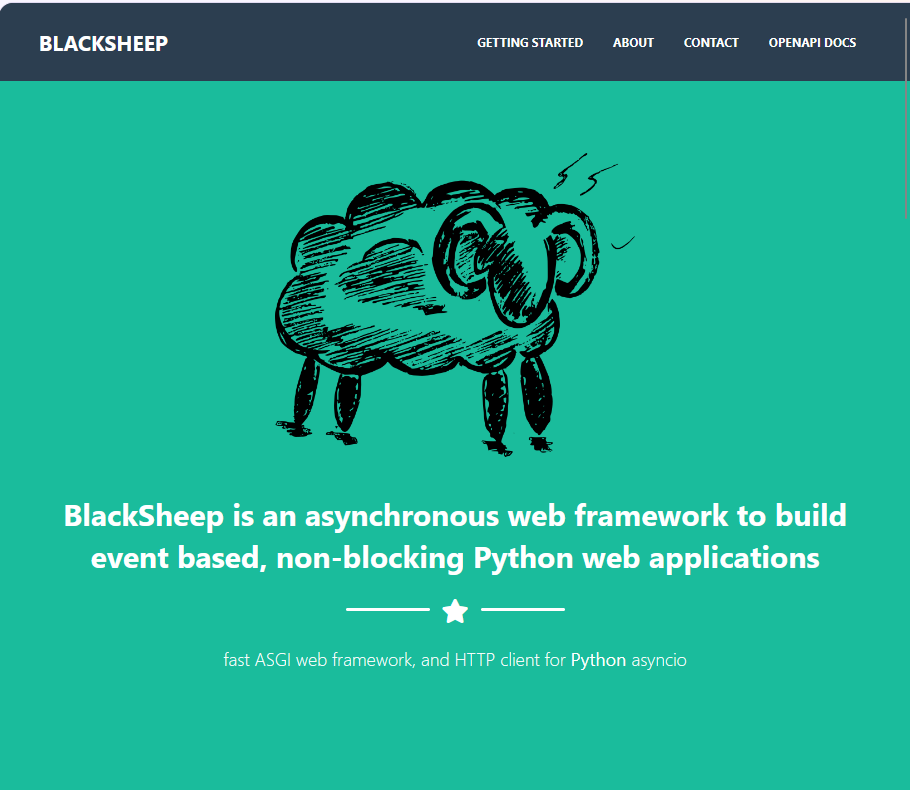

**Langkah.** Buka `http://localhost` di browser, tanpa menyebut port.

**Hasil.** Halaman **BLACKSHEEP** tampil sama seperti Gambar 6.

**Penjelasan.**
- Tanpa menyebut port, browser memakai port bawaan HTTP, yaitu **80**. Port ini dibuka nginx (`80:80` di `docker-compose.yml`), bukan lagi port 44777 milik `python dev.py`.
- Tampilan sama persis karena aplikasinya sama. Perbedaannya ada di jalurnya: permintaan masuk ke nginx lebih dulu, lalu diteruskan ke salah satu instance `bs_app`.

---

## Gambar 12. Daftar container yang berjalan (`dps`)

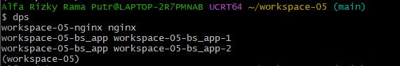

**Perintah yang dijalankan.**

```bash
dps
```

**Hasil.** Tiga baris: `workspace-05-nginx nginx`, `workspace-05-bs_app workspace-05-bs_app-1`, dan `workspace-05-bs_app workspace-05-bs_app-2`.

**Penjelasan.** Format keluarannya adalah *nama image* diikuti *nama container*. Ada dua instance `bs_app` (`-1` dan `-2`), sesuai `--scale bs_app=2`, dan satu container `nginx` sebagai load balancer. Hasil ini sama dengan contoh di modul, hanya awalan namanya berbeda.

---

## Gambar 13. Bukti load balancing: log kedua instance

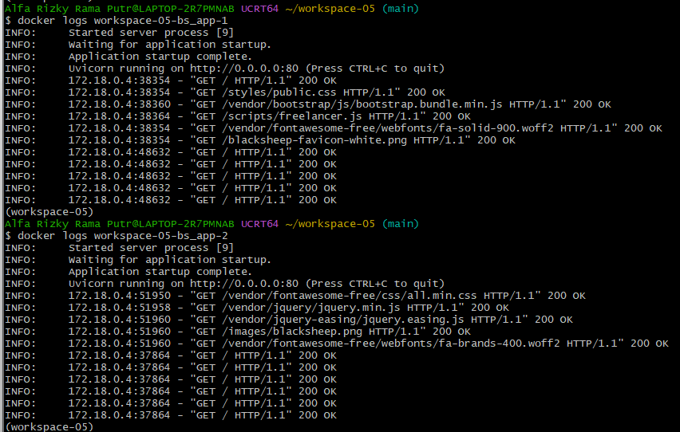

**Perintah yang dijalankan.**

```bash
docker logs workspace-05-bs_app-1
docker logs workspace-05-bs_app-2
```

**Hasil.**

| Instance | Permintaan yang diterima |
|---|---|
| `bs_app-1` | `GET /` (total 6 kali), `public.css`, `bootstrap.bundle.min.js`, `freelancer.js`, `fa-solid-900.woff2`, favicon |
| `bs_app-2` | `GET /` (total 6 kali), `all.min.css`, `jquery.min.js`, `jquery.easing.js`, `blacksheep.png`, `fa-brands-400.woff2` |

Semua berstatus **200 OK**.

**Penjelasan.**
- **Kedua instance menerima permintaan**, sehingga terbukti nginx membagi beban. Dalam pengujian ini, permintaan `GET /` terbagi sama rata: masing-masing 6 kali dari 12 pemuatan halaman.
- File pendukung halaman (CSS, JavaScript, gambar, font) juga tersebar ke dua instance, bukan hanya ke satu.
- Alamat sumber `172.18.0.4` adalah alamat container nginx di jaringan Docker. Berbeda dari Gambar 7 (`127.0.0.1`), karena sekarang permintaan datang dari nginx, bukan langsung dari browser.
- `Uvicorn running on http://0.0.0.0:80` menunjukkan aplikasi di dalam container berjalan di **port 80**.
- Pembagian bergantian ini disebut *round-robin*, yaitu metode bawaan nginx bila tidak ditentukan lain.

---

## Gambar 14. Mematikan semua container (`dcd`)

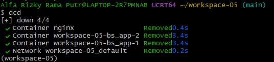

**Perintah yang dijalankan.**

```bash
dcd
```

**Hasil.** `down 4/4`: container `nginx`, `workspace-05-bs_app-2`, dan `workspace-05-bs_app-1` berstatus `Removed`, begitu juga network `workspace-05_default`.

**Penjelasan.** `docker compose down` menghentikan dan menghapus container serta network yang dibuat `dcu`. Image yang sudah dibangun tetap tersimpan, jadi `dcu` berikutnya jauh lebih cepat.

---

# Bagian 3. Failure detection (4.2)

Instal library yang dibutuhkan (di dalam venv):

```bash
uv pip install requests tenacity pybreaker
```

Setiap script dijalankan pada **dua kondisi**: aplikasi Blacksheep **mati** dan **hidup** (`python dev.py` di terminal lain, port 44777).

## `heartbeat/check-server.py`

```python
"""Heartbeat sederhana: cek apakah server TCP di host:port masih merespons.

Pemakaian: python check-server.py <host> <port>
Contoh   : python check-server.py localhost 44777
"""
import socket
import sys


def check_server(host: str, port: int, timeout: float = 3.0) -> bool:
    try:
        with socket.create_connection((host, port), timeout=timeout):
            return True
    except OSError:
        return False


if __name__ == "__main__":
    if len(sys.argv) != 3:
        print("Pemakaian: python check-server.py <host> <port>")
        sys.exit(2)

    host, port = sys.argv[1], int(sys.argv[2])
    if check_server(host, port):
        print("Server up")
    else:
        print("Server down")
        sys.exit(1)
```

| Kondisi | Perintah | Hasil |
|---|---|---|
| Blacksheep mati | `python check-server.py localhost 44777` | `Server down` |
| Blacksheep hidup | `python check-server.py localhost 44777` | `Server up` |
| Port 80 tanpa server (Docker mati) | `python check-server.py localhost 80` | `Server down` |

**Penjelasan.** Protokol heartbeat memantau aktivitas suatu komponen. Script mencoba membuka koneksi TCP ke `host:port`. Jika berhasil, komponen dianggap hidup (`Server up`). Jika ditolak atau tidak menjawab dalam 3 detik, komponen dianggap gagal (`Server down`). Perbedaan kedua kondisi hanya ada atau tidaknya server yang mendengarkan di port tersebut.

### Gambar 15. Menyalakan Blacksheep untuk kondisi "hidup"

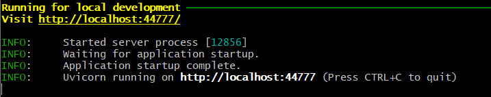

Aplikasi dijalankan lagi dengan `python dev.py` (dari folder `blacksheep_lb`). Log menampilkan `Started server process [12856]`, `Application startup complete`, dan `Uvicorn running on http://localhost:44777`. Server inilah yang menjadi target pengecekan pada kondisi hidup. Angka `12856` adalah ID proses dan berbeda setiap kali server dijalankan.

### Gambar 16. Hasil heartbeat

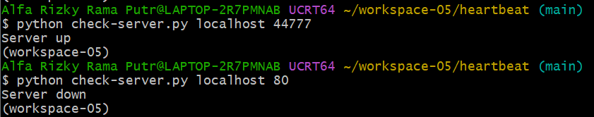

```bash
cd ~/workspace-05/heartbeat
python check-server.py localhost 44777
python check-server.py localhost 80
```

**Hasil.**
- `localhost 44777` → **`Server up`**, karena Blacksheep sedang berjalan di port itu.
- `localhost 80` → **`Server down`**, karena tidak ada program yang mendengarkan di port 80 (container Docker sudah dimatikan dengan `dcd`).

**Penjelasan.** Kedua kondisi (hidup dan mati) ditunjukkan dalam satu sesi: port yang ada servernya menghasilkan `Server up`, port yang kosong menghasilkan `Server down`. Dengan begitu terlihat bahwa heartbeat menyimpulkan keadaan komponen dari ada tidaknya respons.

## `failure-detection/check-retry.py`

```python
"""Retry dengan tenacity: coba akses URL beberapa kali sebelum menyerah."""
import requests
from tenacity import RetryError, retry, retry_if_exception_type, stop_after_attempt, wait_fixed

URL = "http://localhost:44777"


@retry(
    stop=stop_after_attempt(5),          # maksimal 5 percobaan
    wait=wait_fixed(1),                  # jeda 1 detik antar percobaan
    retry=retry_if_exception_type(requests.exceptions.ConnectionError),
)
def access_url():
    print(f"Attempting to access {URL}...")
    response = requests.get(URL, timeout=3)
    response.raise_for_status()
    print(f"Successfully accessed {URL}")


if __name__ == "__main__":
    try:
        access_url()
    except RetryError as e:
        print(f"Failed to access URL after multiple retries: {e}")
```

| Kondisi | Hasil |
|---|---|
| Blacksheep hidup | Satu kali `Attempting...`, lalu `Successfully accessed http://localhost:44777` |
| Blacksheep mati | Lima kali `Attempting...` (jeda 1 detik), lalu `Failed to access URL after multiple retries: RetryError[...ConnectionError]` |

**Penjelasan.** Library `tenacity` mengulang pemanggilan fungsi saat terjadi kegagalan koneksi. Dekorator `@retry` mengatur maksimal 5 percobaan (`stop_after_attempt(5)`), jeda 1 detik (`wait_fixed(1)`), dan hanya mengulang untuk `ConnectionError`. Jika semua percobaan gagal, tenacity melempar `RetryError` yang ditangkap lalu dicetak. Pola ini cocok untuk kegagalan sementara, karena selalu ada kemungkinan koneksi ke komponen di luar aplikasi gagal.

### Gambar 17. Retry, kondisi hidup

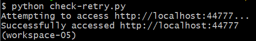

```bash
python check-retry.py
```

**Hasil.** Hanya satu baris `Attempting to access http://localhost:44777...`, lalu `Successfully accessed http://localhost:44777`.

**Penjelasan.** Percobaan pertama langsung berhasil karena server hidup, jadi tidak ada pengulangan sama sekali.

### Gambar 18. Retry, kondisi mati

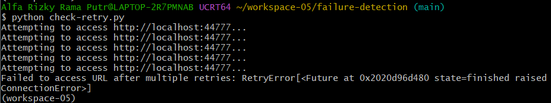

**Hasil.** Baris `Attempting to access http://localhost:44777...` muncul **5 kali**, lalu:

```
Failed to access URL after multiple retries: RetryError[<Future at 0x... state=finished raised ConnectionError>]
```

**Penjelasan.**
- Lima kali percobaan sesuai `stop_after_attempt(5)`, dengan jeda 1 detik di antaranya (`wait_fixed(1)`).
- Setiap percobaan gagal dengan `ConnectionError` karena tidak ada server di port 44777. Setelah percobaan kelima, tenacity berhenti dan melempar `RetryError`, yang ditangkap dan dicetak oleh script.
- Alamat memori di `Future at 0x...` berbeda di setiap komputer dan setiap eksekusi.

## `failure-detection/check-circuit-breaker.py`

```python
"""Circuit breaker dengan pybreaker: closed -> open -> half-open -> closed."""
import time

import pybreaker
import requests

URL = "http://localhost:44777"

# Setelah 3 kegagalan beruntun, sirkuit OPEN selama 10 detik.
breaker = pybreaker.CircuitBreaker(fail_max=3, reset_timeout=10)


@breaker
def access_url():
    print(f"Attempting to access {URL}...")
    response = requests.get(URL, timeout=3)
    response.raise_for_status()
    print(f"Successfully accessed {URL}")


if __name__ == "__main__":
    for i in range(1, 8):
        print(f"--- Percobaan {i} | state: {breaker.current_state}")
        try:
            access_url()
        except pybreaker.CircuitBreakerError:
            print("Circuit OPEN: permintaan ditolak langsung tanpa menghubungi server")
        except requests.exceptions.RequestException as e:
            print(f"Gagal: {type(e).__name__}")
        time.sleep(2)
```

| Kondisi | Hasil |
|---|---|
| Blacksheep hidup | Tujuh percobaan semuanya `Successfully accessed`, state tetap `closed` |
| Blacksheep mati | Percobaan 1-2 `Gagal: ConnectionError` (state `closed`); percobaan 3 sirkuit terbuka dan permintaan ditolak; percobaan 4-7 state `open`, permintaan ditolak tanpa menghubungi server |

**Cara kerja.**
1. `CircuitBreaker(fail_max=3, reset_timeout=10)` membuat pemutus sirkuit: terbuka setelah 3 kegagalan beruntun, lalu menunggu 10 detik sebelum menguji lagi.
2. `@breaker` membungkus `access_url()`, sehingga setiap pemanggilan dipantau.
3. **Closed**: permintaan diizinkan dan kegagalan dihitung.
4. **Open**: setelah ambang kegagalan tercapai, permintaan langsung ditolak (`CircuitBreakerError`). Ini mencegah kegagalan berantai dan memberi layanan waktu untuk pulih. Pada kondisi ini tulisan `Attempting to access...` tidak muncul lagi karena server tidak dihubungi.
5. **Half-open**: setelah 10 detik, sejumlah terbatas permintaan uji diizinkan. Jika berhasil, sirkuit kembali **closed**; jika gagal, kembali **open**.

### Gambar 19. Circuit breaker, kondisi hidup

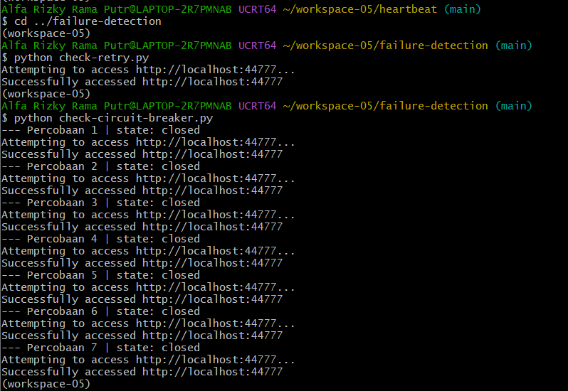

```bash
cd ../failure-detection
python check-circuit-breaker.py
```

**Hasil.** Tujuh percobaan, dan pada setiap percobaan muncul `Attempting to access...` diikuti `Successfully accessed http://localhost:44777`. Status yang ditampilkan selalu `state: closed`.

**Penjelasan.** Server hidup, jadi tidak ada kegagalan yang dihitung dan sirkuit tetap **closed** (aliran permintaan normal). Tangkapan layar ini juga memuat hasil `check-retry.py` kondisi hidup di bagian atas.

### Gambar 20. Circuit breaker, kondisi mati

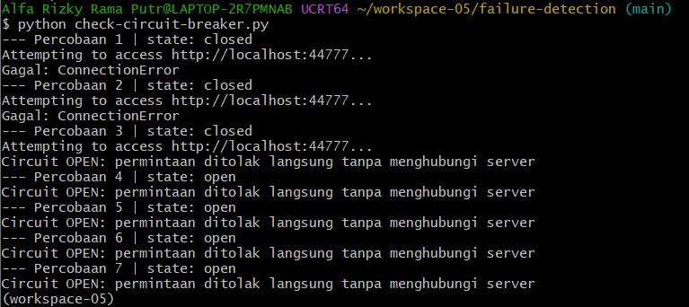

**Hasil.**

| Percobaan | State saat percobaan | Keluaran |
|---|---|---|
| 1 | closed | `Attempting...` lalu `Gagal: ConnectionError` |
| 2 | closed | `Attempting...` lalu `Gagal: ConnectionError` |
| 3 | closed | `Attempting...` lalu `Circuit OPEN: permintaan ditolak langsung tanpa menghubungi server` |
| 4-7 | **open** | Langsung `Circuit OPEN: permintaan ditolak...`, tanpa tulisan `Attempting...` |

**Penjelasan.**
- Dua kegagalan pertama dihitung (2 dari batas `fail_max=3`) dan status masih `closed`.
- Pada percobaan ke-3, kegagalan ketiga mencapai ambang, sehingga sirkuit berpindah ke **open** dan `pybreaker` melempar `CircuitBreakerError`. Karena itu status yang tampil pada percobaan 4 dan seterusnya sudah `open`.
- Selama **open**, permintaan **ditolak seketika** dan server **tidak dihubungi sama sekali**, terlihat dari hilangnya baris `Attempting to access...`. Ini yang membedakannya dari retry, yang terus mencoba ke server yang mati.
- Setelah `reset_timeout=10` detik, sirkuit akan masuk ke **half-open** untuk menguji apakah layanan sudah pulih. Pada pengujian ini program selesai (sekitar 14 detik) sebelum fase tersebut teramati.

## Perbandingan

| | Heartbeat | Retry | Circuit breaker |
|---|---|---|---|
| Pertanyaan yang dijawab | Apakah komponen hidup? | Coba lagi, siapa tahu berhasil? | Perlu berhenti memanggil dulu? |
| Bereaksi terhadap kegagalan | Tidak, hanya melaporkan | Ya, mengulang | Ya, berhenti sementara |
| Kelemahan | Hanya memberi informasi | Dapat membebani server yang sedang bermasalah | Perlu pengaturan ambang yang tepat |

Retry terus mencoba ke server yang mati (5 kali), sedangkan circuit breaker berhenti mencoba setelah 3 kegagalan untuk melindungi sistem.

## Kesimpulan 📚 

1. **Load balancing** dengan nginx membagi permintaan ke dua instance aplikasi, terbukti dari log kedua instance yang sama-sama menerima permintaan (6 dari 12 pemuatan halaman masing-masing).
2. **Heartbeat** mendeteksi kegagalan dari ada atau tidaknya respons: `Server up` bila server menjawab dan `Server down` bila tidak.
3. **Retry** mengulang akses ke komponen yang gagal beberapa kali sebelum menyerah. Cocok untuk gangguan sementara.
4. **Circuit breaker** berhenti memanggil komponen yang terus gagal (status open) untuk mencegah kegagalan berantai, lalu mengujinya lagi setelah waktu tunggu (half-open).