# 📚Modul 06 - Instalasi dan Konfigurasi Hadoop pada WSL 📚

## Pembahasan Modul 6

### Gambar 1 - Instalasi Ubuntu pada WSL

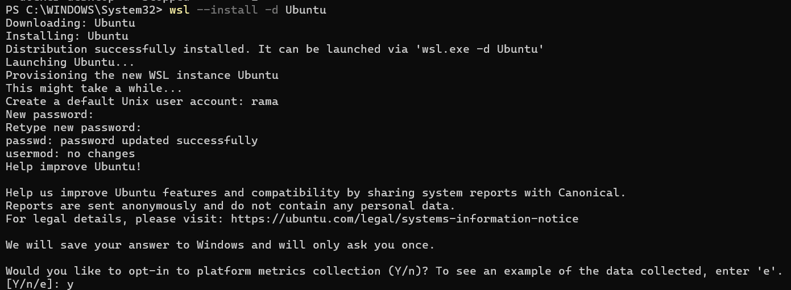

Pada gambar 1 dilakukan instalasi distribusi Ubuntu menggunakan perintah `wsl --install -d Ubuntu` melalui PowerShell. Setelah proses pengunduhan dan instalasi selesai, Ubuntu melakukan provisioning instance WSL baru. Pengguna kemudian membuat akun Unix `rama`, mengatur password, dan memilih untuk mengaktifkan pengiriman laporan sistem secara anonim. Tahap ini menyiapkan lingkungan Linux yang akan digunakan untuk menjalankan Hadoop di Windows.

### Gambar 2 - Instalasi OpenJDK 17

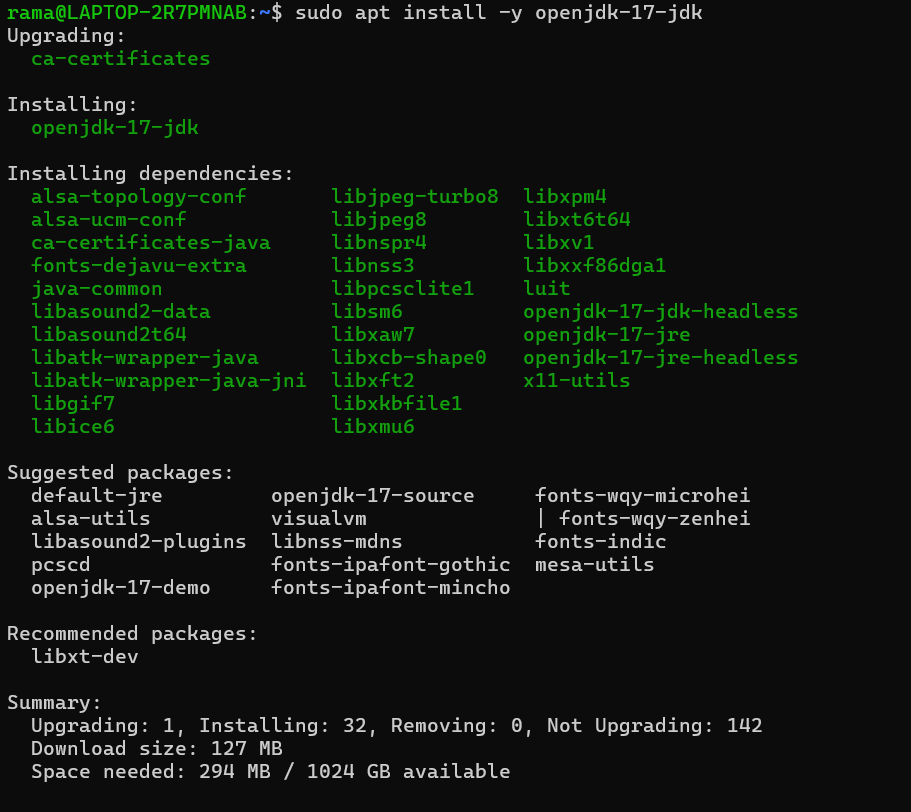

Gambar 2 menunjukkan instalasi OpenJDK 17 dengan perintah `sudo apt install -y openjdk-17-jdk`. Java diperlukan karena Apache Hadoop dibangun dan dijalankan di atas Java Virtual Machine (JVM). Output instalasi juga memperlihatkan beberapa dependensi Java dan pustaka sistem yang ikut dipasang. Dengan demikian, lingkungan Ubuntu sudah memiliki Java Development Kit yang sesuai untuk menjalankan Hadoop.

### Gambar 3 - Mengunduh dan Menyiapkan Hadoop

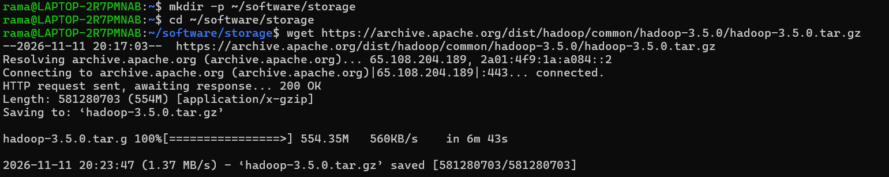
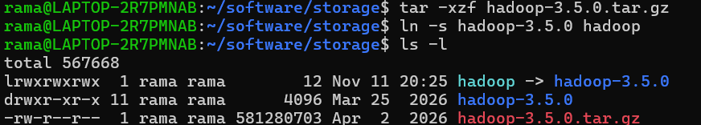

Gambar 3a memperlihatkan proses pembuatan direktori `~/software/storage`, kemudian arsip Hadoop 3.5.0 diunduh dari Apache Archive menggunakan `wget`. Ukuran berkas yang besar dan persentase 100% pada output menunjukkan bahwa proses unduhan selesai dengan sukses.

Pada gambar 3b, arsip `hadoop-3.5.0.tar.gz` diekstrak. Perintah `ln -s hadoop-3.5.0 hadoop` membuat symbolic link bernama `hadoop`, sehingga konfigurasi dan perintah berikutnya dapat menggunakan nama direktori yang lebih sederhana. Perintah `ls -l` kemudian digunakan untuk memverifikasi bahwa direktori hasil ekstraksi dan symbolic link telah tersedia.

### Gambar 4 - Konfigurasi Environment Variable Hadoop

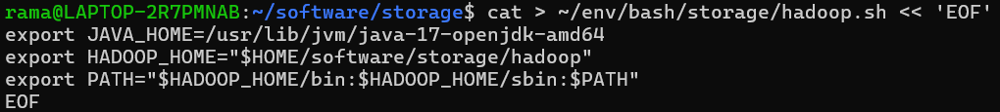

Gambar 4 menunjukkan pembuatan berkas `hadoop.sh` pada direktori konfigurasi bash. Berkas tersebut menetapkan `JAVA_HOME` ke lokasi OpenJDK 17, `HADOOP_HOME` ke direktori instalasi Hadoop, serta menambahkan folder `bin` dan `sbin` Hadoop ke dalam `PATH`.

Konfigurasi ini penting agar perintah seperti `hadoop`, `hdfs`, dan perintah daemon Hadoop dapat dipanggil dari terminal mana pun tanpa menuliskan lokasi lengkapnya. `JAVA_HOME` juga memastikan Hadoop menggunakan versi Java yang telah dipasang sebelumnya.

### Gambar 5 - Verifikasi Perintah Hadoop

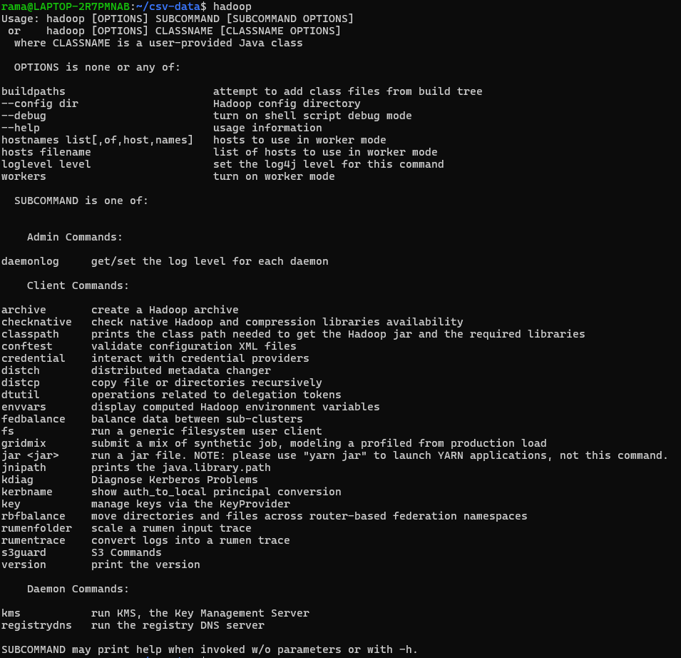

Pada gambar 5 dijalankan perintah `hadoop` tanpa subperintah. Hadoop menampilkan halaman bantuan yang berisi format penggunaan, pilihan umum, serta daftar subperintah client dan daemon. Tampilan bantuan ini menjadi bukti bahwa executable Hadoop sudah ditemukan oleh sistem dan environment variable telah berhasil diterapkan.

Selain itu, daftar subperintah seperti `archive`, `checknative`, `classpath`, `fs`, dan `version` menunjukkan fungsi-fungsi utama yang tersedia pada Hadoop. Pada tahap ini, instalasi Hadoop telah dapat diakses melalui terminal.

### Gambar 6 - Instalasi dan Pengujian SSH

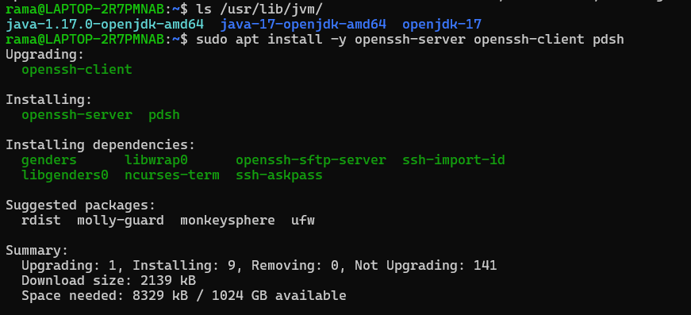
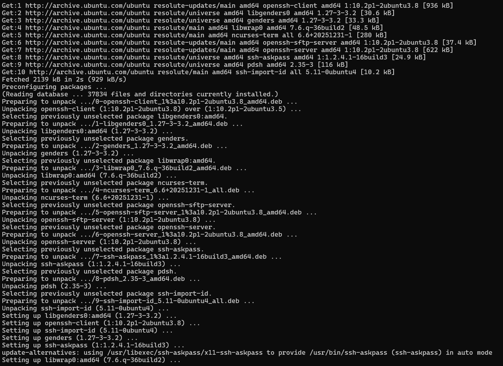
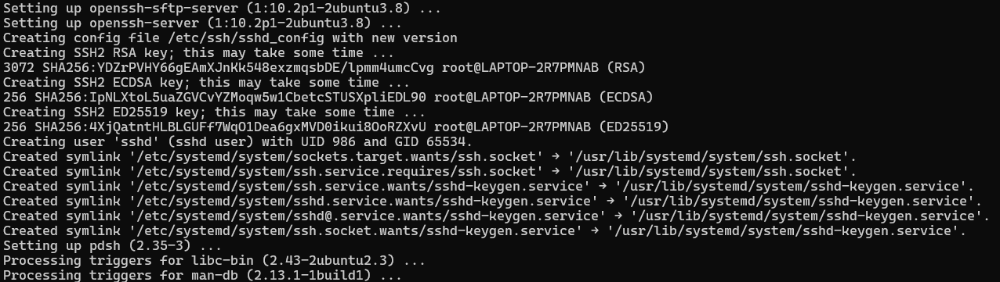
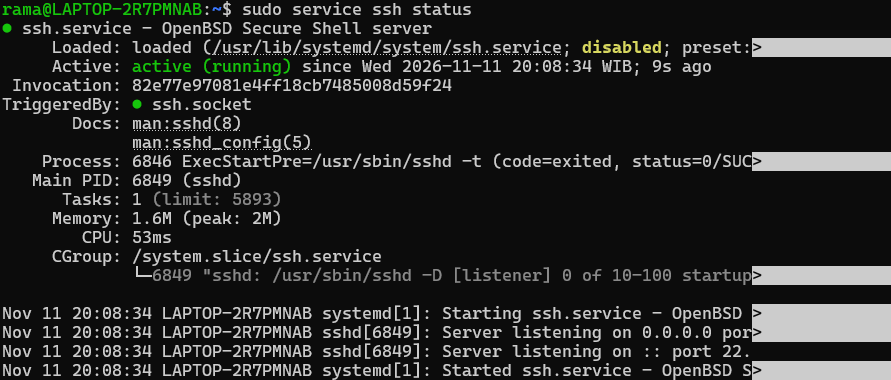

Gambar 6 terdiri dari beberapa tahap konfigurasi SSH yang dibutuhkan Hadoop pada mode pseudo-distributed.

Pada gambar 6a dipasang paket `openssh-server`, `openssh-client`, dan `pdsh` menggunakan `apt`. SSH digunakan Hadoop untuk menjalankan dan mengelola proses daemon, sedangkan `pdsh` membantu menjalankan perintah pada node.

Gambar 6b menunjukkan proses konfigurasi paket SSH, termasuk pembuatan host key dan pengaktifan layanan SSH. Selanjutnya, gambar 6c memperlihatkan hasil `sudo service ssh status` yang menunjukkan bahwa layanan `ssh.service` berstatus `active (running)` dan sedang mendengarkan pada port 22.

Pada gambar 6d dilakukan pengujian konfigurasi `pdsh` dengan `pdsh -q -w localhost`. Output tersebut menunjukkan bahwa `localhost` telah dikenali sebagai target node dan menggunakan metode koneksi SSH. Konfigurasi ini memungkinkan Hadoop mengakses host lokal melalui SSH tanpa perlu membuat koneksi ke mesin lain.

### Gambar 7 - Pembuatan Kunci SSH dan Login Lokal

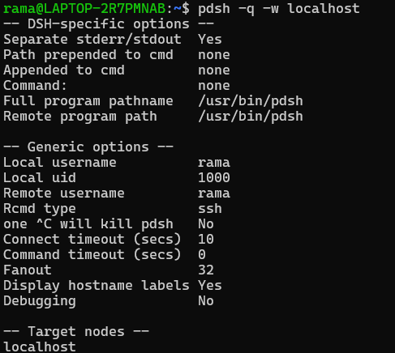

Gambar 7 menunjukkan pembuatan pasangan kunci SSH RSA menggunakan `ssh-keygen`. Kunci publik kemudian ditambahkan ke berkas `~/.ssh/authorized_keys`, dan hak akses berkas tersebut dibatasi menggunakan `chmod 0600`. Pembatasan permission diperlukan agar SSH menerima berkas tersebut sebagai konfigurasi autentikasi yang aman.

Setelah itu dilakukan pengujian dengan perintah `ssh localhost`. Pada koneksi pertama, sistem meminta konfirmasi fingerprint host; setelah dikonfirmasi, login berhasil dan terminal menampilkan informasi sistem Ubuntu. Keberhasilan login tanpa meminta password menunjukkan bahwa autentikasi berbasis kunci SSH untuk koneksi lokal telah berjalan.

### Gambar 8 - Konfigurasi Replikasi HDFS

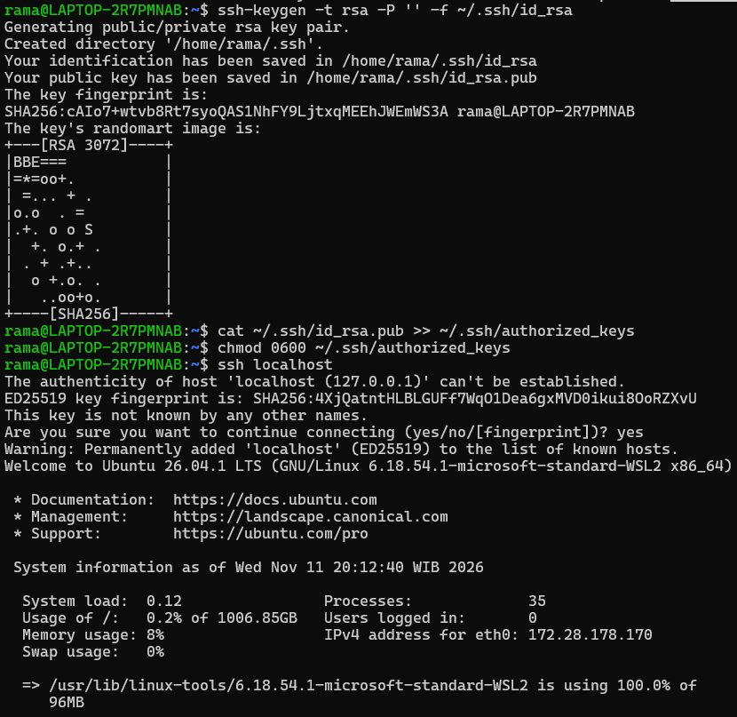

Pada gambar 8 dibuat berkas `hdfs-site.xml` pada direktori konfigurasi Hadoop. Properti `dfs.replication` diatur ke nilai `1`, yang berarti setiap blok data hanya memiliki satu salinan. Pengaturan ini sesuai untuk lingkungan single-node atau pseudo-distributed karena hanya terdapat satu DataNode.

### Gambar 9 - Konfigurasi Core Hadoop dan YARN

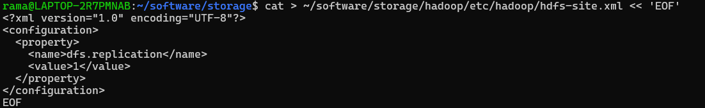
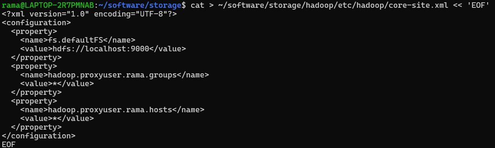
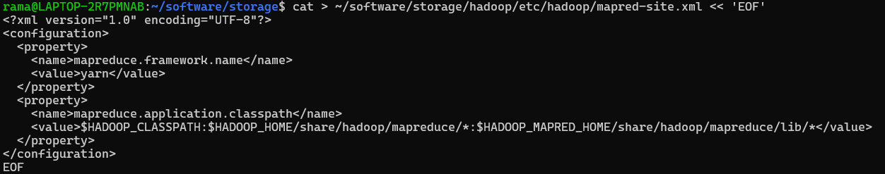
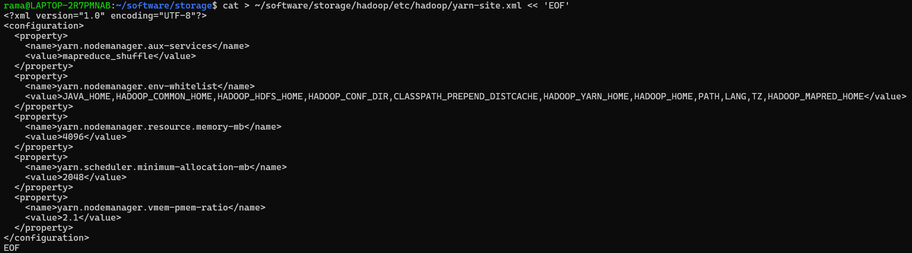

Gambar 9a menunjukkan konfigurasi `hdfs-site.xml` dengan replikasi HDFS sebanyak satu. Gambar 9b memperlihatkan `core-site.xml` dengan `fs.defaultFS` yang diarahkan ke `hdfs://localhost:9000`. Properti proxyuser juga diatur agar pengguna `rama` dapat digunakan oleh layanan Hadoop dalam lingkungan lokal.

Pada gambar 9c, `mapred-site.xml` dikonfigurasi agar framework MapReduce menggunakan YARN. Classpath MapReduce juga ditambahkan supaya library yang diperlukan dapat ditemukan ketika job dijalankan. Gambar 9d memperlihatkan `yarn-site.xml`, yaitu konfigurasi layanan shuffle MapReduce, environment variable YARN, kapasitas memori ResourceManager sebesar 4096 MB, dan alokasi minimum container sebesar 2048 MB.

### Gambar 10 - Format NameNode dan Menjalankan HDFS

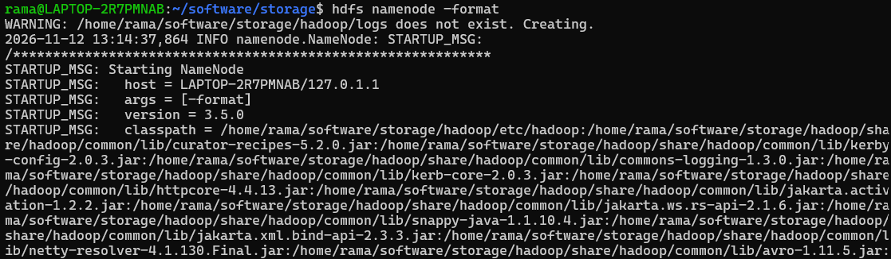
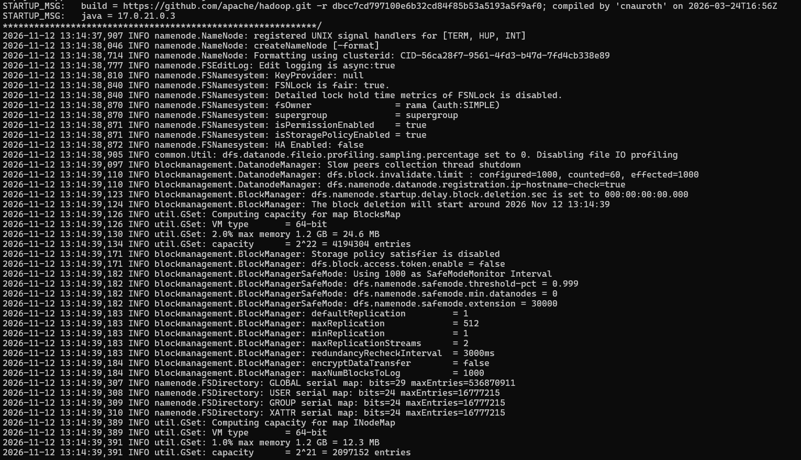
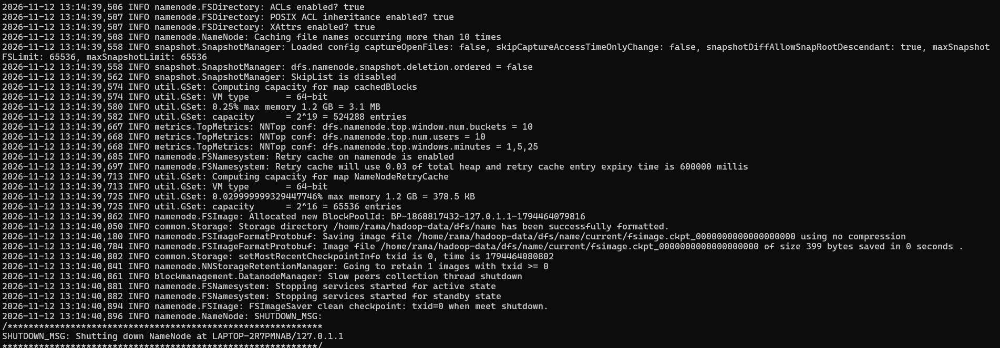

Gambar 10a dan 10b menunjukkan pelaksanaan perintah `hdfs namenode -format`. Perintah ini menginisialisasi metadata NameNode dan membuat struktur penyimpanan filesystem HDFS pada direktori `hadoop-data`. Output yang menampilkan cluster ID dan pesan bahwa storage directory berhasil diformat menunjukkan proses selesai dengan sukses.

Format NameNode dilakukan saat inisialisasi awal filesystem. Setelah format selesai, NameNode berhenti secara normal. Pada gambar 10c dijalankan `start-dfs.sh` untuk memulai NameNode, DataNode, dan SecondaryNameNode pada host lokal.

### Gambar 11 - Memeriksa Dashboard NameNode

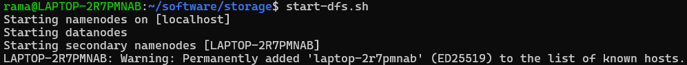

Gambar 11 menampilkan dashboard Hadoop pada alamat `localhost:9000` dengan status `active`. Dashboard menampilkan versi Hadoop 3.5.0, kapasitas filesystem, jumlah DataNode aktif, serta penggunaan blok HDFS. Satu DataNode yang berstatus hidup menunjukkan bahwa layanan HDFS telah berhasil dijalankan.

### Gambar 12 - Membuat Direktori pada HDFS

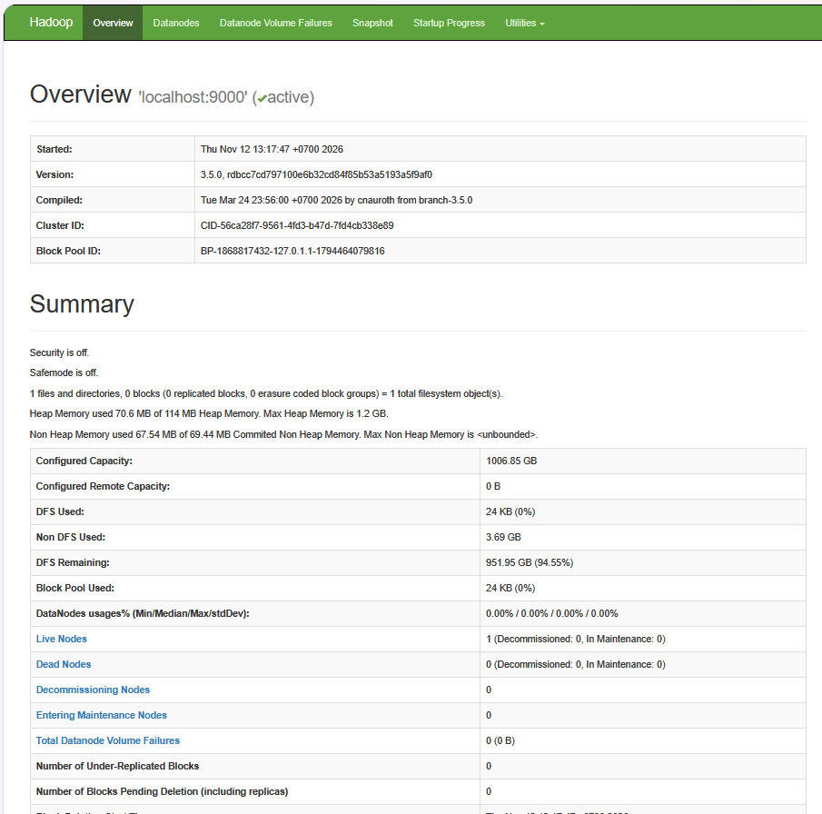

Pada gambar 12 dibuat direktori `/user/rama/datasets` menggunakan perintah `hdfs dfs -mkdir -p`. Opsi `-p` memungkinkan struktur direktori yang belum tersedia dibuat sekaligus. Perintah `hdfs dfs -ls /user/rama` kemudian memverifikasi bahwa direktori `datasets` telah berhasil dibuat.

### Gambar 13 - Menghentikan Layanan HDFS

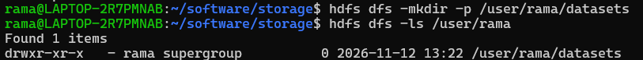

Gambar 13 memperlihatkan penghentian layanan HDFS menggunakan script `stop-dfs.sh`. Output menunjukkan NameNode, DataNode, dan SecondaryNameNode dihentikan dengan benar sehingga proses Hadoop tidak tetap berjalan ketika tidak digunakan.

### Gambar 14 - Verifikasi Penghentian Daemon

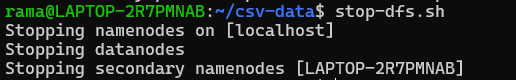

Gambar 14 memperlihatkan hasil akhir proses penghentian daemon HDFS. Pesan penghentian pada node lokal menunjukkan bahwa seluruh layanan DFS telah dimatikan secara teratur. Siklus dasar pengelolaan HDFS, mulai dari menjalankan layanan, mengakses filesystem, hingga menghentikannya, telah berhasil dilakukan.

## Pembahasan Tugas

### Tugas A - Memeriksa Versi Hadoop

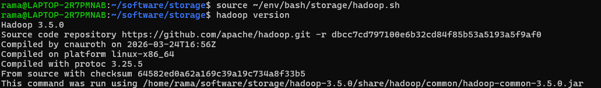

Pada tugas A, environment Hadoop diaktifkan menggunakan perintah `source ~/env/bash/storage/hadoop.sh`, kemudian dijalankan perintah `hadoop version`. Output menampilkan Hadoop versi 3.5.0, sistem operasi Linux x86_64, versi Java yang digunakan, serta lokasi library Hadoop. Informasi tersebut membuktikan bahwa environment variable telah terbaca dan instalasi Hadoop dapat dijalankan dengan benar.

### Tugas B - Mengunduh Dataset

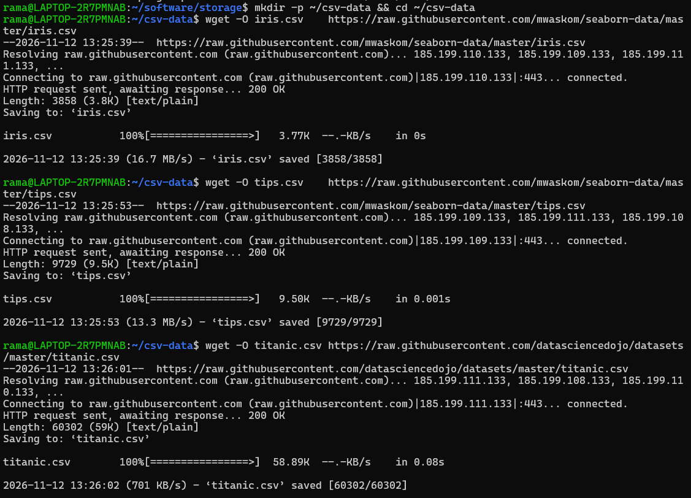

Pada tugas B dibuat direktori `~/csv-data` sebagai tempat penyimpanan dataset. Tiga dataset, yaitu `iris.csv`, `tips.csv`, dan `titanic.csv`, diunduh menggunakan `wget` dari repository GitHub. Setiap proses unduhan menghasilkan status `200 OK` dan pesan `saved`, sehingga seluruh file berhasil disimpan secara lokal.

Perintah `ls -lh` digunakan untuk memeriksa file yang telah diunduh. Ukuran file yang tampil menunjukkan bahwa dataset tersedia dan siap dipindahkan ke HDFS untuk diproses oleh Hadoop.

### Tugas C - Memasukkan dan Membaca Dataset di HDFS

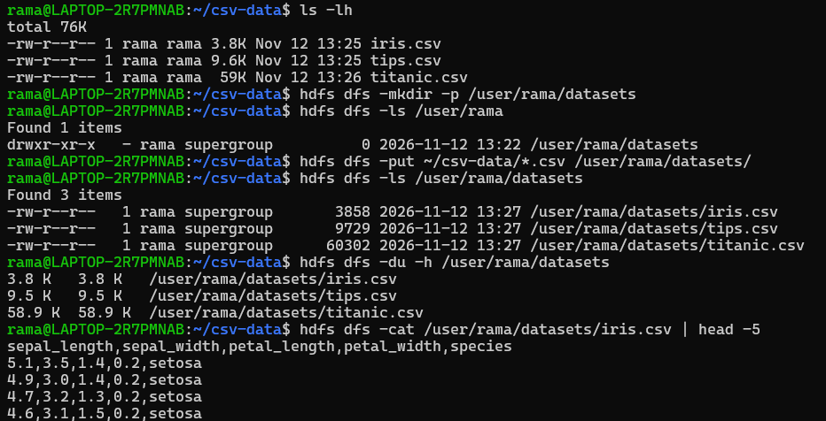

Pada tugas C dibuat direktori HDFS `/user/rama/datasets` menggunakan `hdfs dfs -mkdir -p`. Seluruh file CSV kemudian dipindahkan ke HDFS dengan perintah `hdfs dfs -put csv-data/* /user/rama/datasets/`. Perintah `hdfs dfs -ls` menunjukkan bahwa ketiga dataset telah tersimpan di HDFS beserta ukuran masing-masing file.

Perintah `hdfs dfs -du -h` digunakan untuk melihat penggunaan ruang penyimpanan dataset dalam format yang mudah dibaca. Selanjutnya, perintah `hdfs dfs -cat /user/rama/datasets/iris.csv | head -5` menampilkan header dan beberapa baris awal file `iris.csv`. Hasil ini membuktikan bahwa file tidak hanya berhasil diunggah, tetapi juga dapat dibaca langsung dari filesystem HDFS.

## 📚 Kesimpulan 📚

Berdasarkan seluruh tahapan pada gambar 1 sampai 14 dan ketiga tugas, instalasi serta konfigurasi Apache Hadoop 3.5.0 pada Ubuntu melalui WSL telah berhasil dilakukan. Java 17 digunakan sebagai lingkungan runtime, sedangkan SSH dan `pdsh` dikonfigurasi agar Hadoop dapat menjalankan komunikasi antarkomponen pada mode pseudo-distributed.

Konfigurasi `hdfs-site.xml`, `core-site.xml`, `mapred-site.xml`, dan `yarn-site.xml` berhasil diterapkan untuk mengatur replikasi HDFS, alamat NameNode, framework MapReduce, serta pengelolaan resource YARN. NameNode berhasil diformat, layanan HDFS dapat dijalankan, DataNode terdeteksi aktif, dan dashboard Hadoop dapat digunakan untuk memantau kondisi filesystem.

Selain itu, operasi dasar HDFS juga berhasil dilakukan, yaitu membuat direktori, mengunggah dataset `iris.csv`, `tips.csv`, dan `titanic.csv`, melihat penggunaan ruang penyimpanan, serta membaca isi file secara langsung dari HDFS. Layanan HDFS kemudian dapat dihentikan dengan benar menggunakan `stop-dfs.sh`. Dengan demikian, seluruh proses mulai dari persiapan lingkungan, instalasi, konfigurasi, pengujian, pengelolaan dataset, hingga penghentian layanan Hadoop telah berjalan sesuai tujuan praktikum.
