# Modul 07 — Cloud Computing

## Tugas 0: Cloud Computing (XaaS)

## 1. Contoh Vendor SaaS, PaaS, dan IaaS

| Kategori | Singkatan | Contoh Vendor | Keterangan |
|---|---|---|---|
| SaaS | Software as a Service | Google Workspace | Aplikasi jadi (Gmail, Docs, Drive) yang diakses lewat browser |
| PaaS | Platform as a Service | Heroku | Platform untuk menjalankan aplikasi tanpa mengelola server |
| IaaS | Infrastructure as a Service | Amazon Web Services (AWS EC2) | Server virtual, storage, dan jaringan yang disewa sesuai kebutuhan |

## 2. Service yang Disediakan Tiap Vendor

### SaaS: Google Workspace
Google menyediakan aplikasi yang siap pakai dan langsung dijalankan di browser:
- **Gmail**: layanan email
- **Google Docs, Sheets, Slides**: aplikasi perkantoran kolaboratif
- **Google Drive**: penyimpanan file dan berbagi dokumen
- **Google Meet dan Calendar**: rapat daring dan penjadwalan

Pengguna tidak perlu memasang, memelihara, atau memperbarui perangkat lunaknya. Seluruh server, sistem operasi, dan aplikasi dikelola Google. Pengguna hanya memakai aplikasinya dan mengatur datanya.

### PaaS: Heroku
Heroku menyediakan platform tempat developer menjalankan aplikasi:
- **Runtime** untuk berbagai bahasa pemrograman (Python, Node.js, Ruby, dan lainnya)
- **Deploy** aplikasi lewat git atau container
- **Add-on** seperti database (PostgreSQL), cache, dan monitoring
- **Scaling** otomatis atau manual dengan menambah atau mengurangi dyno

Developer cukup mengurus kode dan data aplikasi. Server, sistem operasi, dan runtime dikelola oleh Heroku.

### IaaS: AWS EC2
Amazon Web Services menyediakan infrastruktur komputasi dasar:
- **EC2**: virtual machine dengan pilihan CPU, RAM, dan sistem operasi
- **EBS dan S3**: penyimpanan blok dan penyimpanan objek
- **VPC**: jaringan virtual, firewall, dan load balancer

Pengguna mengelola sistem operasi, middleware, runtime, aplikasi, dan data sendiri. Vendor mengelola perangkat keras fisik dan virtualisasi.

## 3. Arsitektur Umum XaaS

Tabel berikut menunjukkan siapa yang mengelola tiap lapisan pada model on-premise, IaaS, PaaS, dan SaaS.

| Lapisan | On-premise | IaaS | PaaS | SaaS |
|---|---|---|---|---|
| Aplikasi | Pengguna | Pengguna | Pengguna | **Vendor** |
| Data | Pengguna | Pengguna | Pengguna | **Vendor** |
| Runtime | Pengguna | Pengguna | **Vendor** | **Vendor** |
| Middleware | Pengguna | Pengguna | **Vendor** | **Vendor** |
| Sistem Operasi | Pengguna | Pengguna | **Vendor** | **Vendor** |
| Virtualisasi | Pengguna | **Vendor** | **Vendor** | **Vendor** |
| Server | Pengguna | **Vendor** | **Vendor** | **Vendor** |
| Storage | Pengguna | **Vendor** | **Vendor** | **Vendor** |
| Jaringan | Pengguna | **Vendor** | **Vendor** | **Vendor** |

Diagram bertingkat:

```
 SaaS  -> Aplikasi siap pakai            (contoh: Google Workspace)
   ^
 PaaS  -> Platform untuk deploy aplikasi (contoh: Heroku)
   ^
 IaaS  -> Server, storage, jaringan      (contoh: AWS EC2)
   ^
 Perangkat keras fisik di data center vendor
```

**Penjelasan singkat:**
- Pada **IaaS**, vendor menyediakan sampai lapisan virtualisasi. Pengguna mengelola dari sistem operasi ke atas.
- Pada **PaaS**, vendor menyediakan sampai runtime. Pengguna hanya mengelola aplikasi dan data.
- Pada **SaaS**, vendor mengelola seluruh lapisan. Pengguna hanya memakai aplikasinya.

Semakin tinggi tingkat layanannya (IaaS ke PaaS ke SaaS), semakin sedikit yang harus dikelola pengguna, tetapi semakin sedikit juga kontrol yang dimiliki.

## 4. Kaitan dengan Praktikum

Pada praktikum ini, aplikasi blog Flask dikemas menjadi *Containerized App* (CA) dengan Docker dan Podman. Container image yang sama dapat dijalankan di atas IaaS (misalnya di VM EC2) maupun PaaS (misalnya Heroku yang mendukung deploy container). Karena itu, container menjadi salah satu teknologi dasar yang membentuk layanan-layanan XaaS.

## Pembahasan

### Foto 1 — Mengambil source code aplikasi

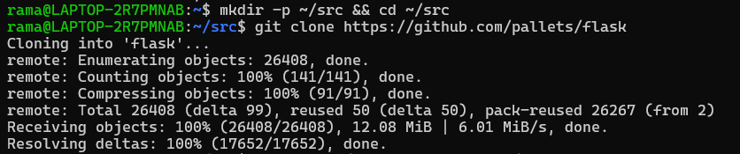

Pada foto pertama terlihat proses menjalankan perintah `git clone` untuk
mengunduh repository aplikasi Flaskr dari GitHub. Perintah tersebut menyalin
source code ke komputer lokal sehingga aplikasi dapat dipelajari, dijalankan,
dan dikemas menjadi container. Setelah proses selesai, repository tersimpan
pada direktori `flask-app`.

### Foto 2 — Menyiapkan dan menjalankan aplikasi Flask

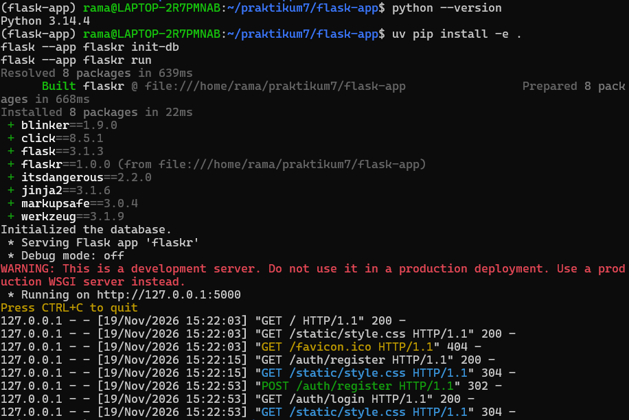

Pada foto kedua terlihat proses pembuatan virtual environment bernama
`flask-app`, pemasangan aplikasi dalam mode editable menggunakan `uv pip install
-e .`, dan inisialisasi database menggunakan `flask --app flaskr init-db`.
Selanjutnya, aplikasi dijalankan menggunakan Flask development server pada alamat
`127.0.0.1:5000`. Berdasarkan log request, halaman utama, halaman registrasi,
dan aset CSS berhasil diakses.

### Foto 3 — Pengujian halaman registrasi secara lokal

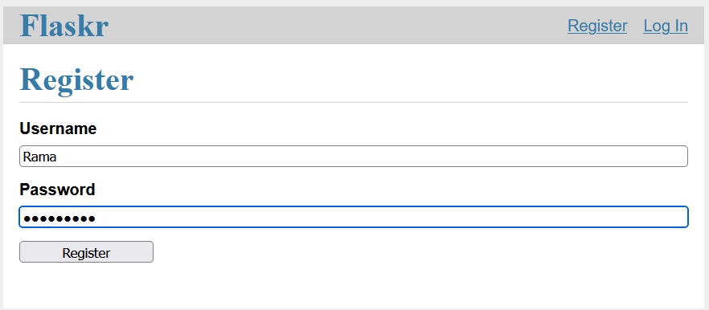

Pada foto ini halaman registrasi Flaskr berhasil dibuka melalui browser. Form
tersebut menyediakan kolom username dan password. Pengujian ini memastikan
bahwa aplikasi dapat berjalan secara lokal sebelum dimasukkan ke dalam
container. Password yang dimasukkan ditampilkan sebagai karakter tersembunyi
sesuai dengan fungsi input password pada HTML.

### Foto 4 — Membuat Dockerfile

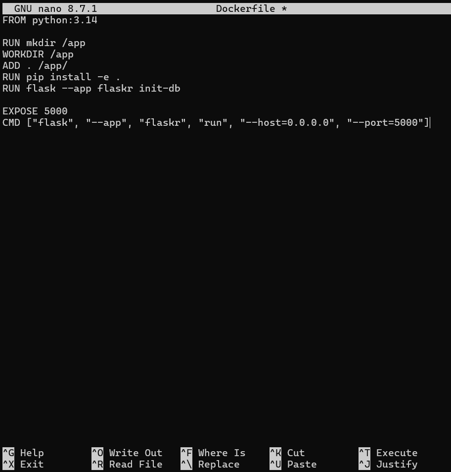

Pada foto keempat terlihat isi `Dockerfile` yang digunakan untuk mendefinisikan
lingkungan aplikasi. Image dasar yang digunakan adalah Python 3.14. Perintah
`WORKDIR /app` menetapkan direktori kerja container, sedangkan `ADD . /app/`
menyalin source code aplikasi ke dalamnya. Dependensi dipasang menggunakan
`pip install -e .`, kemudian database diinisialisasi pada saat image dibangun.
Instruksi `EXPOSE 5000` mendokumentasikan port aplikasi, sedangkan `CMD`
menjalankan Flask pada alamat `0.0.0.0` agar dapat diakses dari luar container.

### Foto 5 — Membangun dan menjalankan container dengan Docker

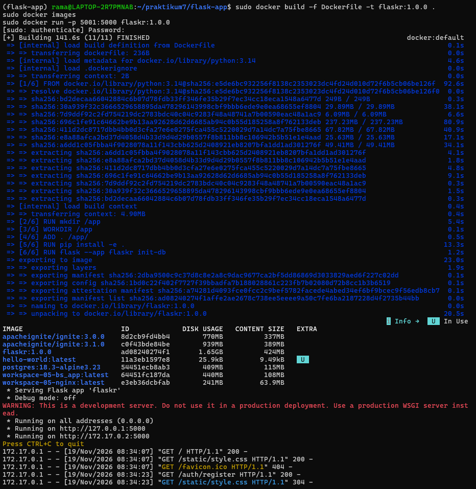

Pada foto kelima terlihat penggunaan perintah `docker build` untuk membuat image
bernama `flaskr:1.0.0`. Docker menjalankan setiap instruksi pada Dockerfile
sebagai layer, mulai dari mengambil image Python, menyalin source code,
memasang dependensi, hingga menginisialisasi database. Setelah image terbentuk,
Container kemudian dijalankan menggunakan `docker run -p 5001:5000 flaskr:1.0.0`.
Perintah tersebut memetakan port 5000 di dalam container ke port 5001 pada
host. Berdasarkan log yang ditampilkan, aplikasi berhasil berjalan dan
menerima request HTTP.

### Foto 6 — Pengujian halaman registrasi setelah menjalankan Docker

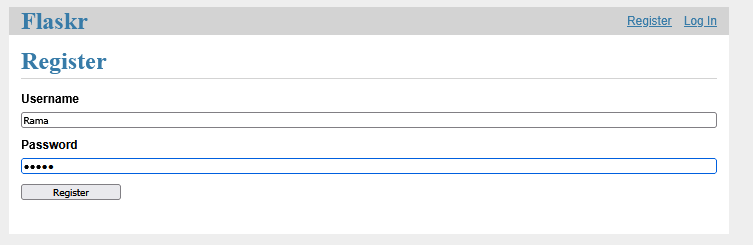

Pada foto keenam terlihat halaman registrasi Flaskr yang diakses setelah
container dijalankan menggunakan Docker. Form registrasi menampilkan kolom
username dan password serta tombol **Register**. Tampilan ini menunjukkan bahwa
aplikasi berhasil diakses melalui port yang telah dipetakan dari container ke
host.

### Foto 7 — Mematikan docker dekstop

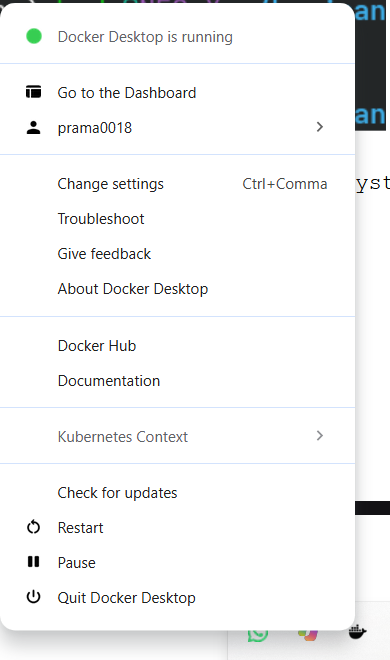

Pada foto ketujuh terlihat menu Docker Desktop dengan status **Docker Desktop
is running**. Status tersebut menunjukkan bahwa Docker Desktop masih aktif jadi
kita perlu mengklik bagian paling bawah yaitu quick docker dekstop untuk mematikan 
docker nya.

### Foto 8 — Memasang Podman

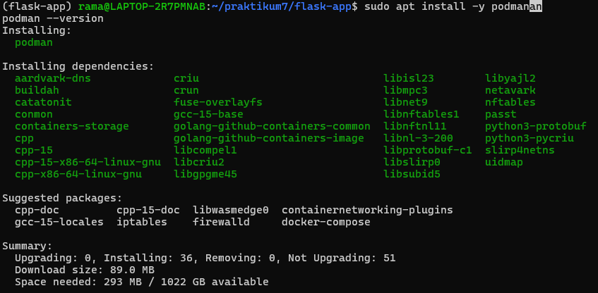

Pada foto kedelapan terlihat proses pemasangan Podman menggunakan perintah
`sudo apt install -y podman`. Podman merupakan engine container alternatif yang
dapat digunakan untuk membangun image dan menjalankan container. Proses ini
juga memasang berbagai dependensi yang diperlukan oleh Podman.

### Foto 9 — Memulai proses build menggunakan Podman

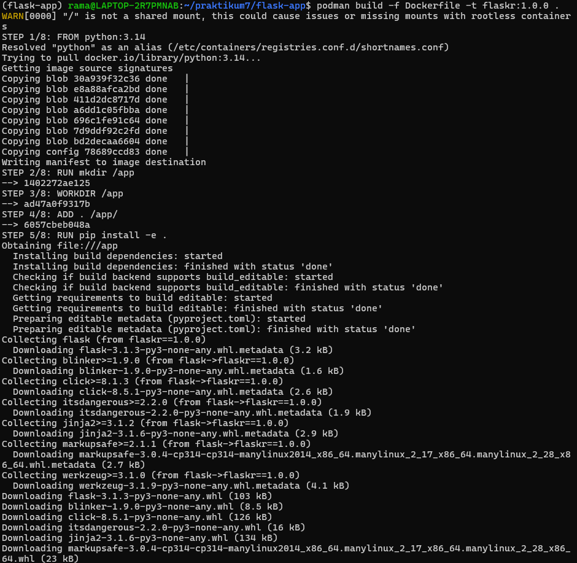

Pada foto kesembilan terlihat tahap awal proses `podman build -f Dockerfile -t
flaskr:1.0.0 .`. Podman mulai membaca Dockerfile dan mengambil image dasar
Python 3.14. Beberapa layer image berhasil disalin dan diproses sebagai bagian
dari tahapan pembangunan image container.

### Foto 10 — Menyelesaikan pembangunan image Podman

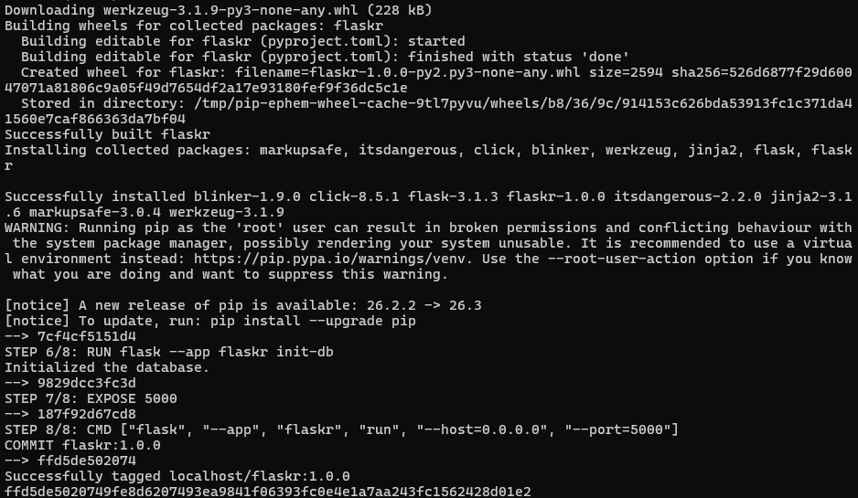

Pada foto kesepuluh terlihat kelanjutan proses build Podman hingga selesai.
Dependensi aplikasi berhasil dipasang, database berhasil diinisialisasi, dan
image diberi tag `localhost/flaskr:1.0.0`. Hasil tersebut menunjukkan bahwa
image aplikasi berhasil dibuat menggunakan Podman berdasarkan Dockerfile yang
sama.

### Foto 11 — Menjalankan image menggunakan Podman

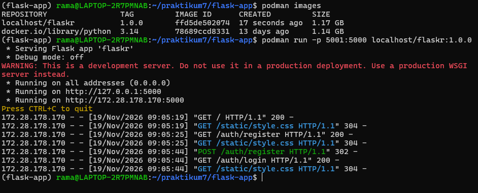

Pada foto kesebelas terlihat hasil perintah `podman images` yang menampilkan
image `localhost/flaskr` dengan tag `1.0.0`. Selanjutnya digunakan perintah
`podman run -p 5001:5000 localhost/flaskr:1.0.0` untuk menjalankan aplikasi.
Log menunjukkan Flask berjalan pada port 5000 dan menerima request dari
browser.

### Foto 12 — Pengujian registrasi pada container Podman

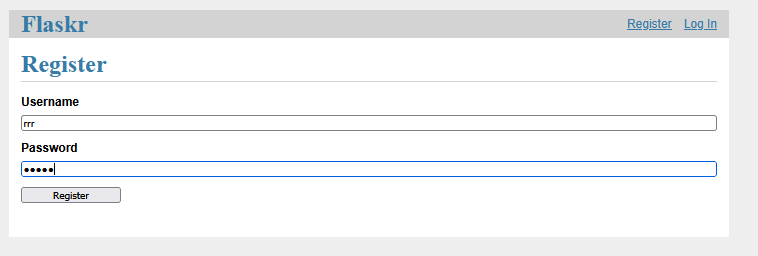

Pada foto kedua belas terlihat halaman registrasi Flaskr yang telah diakses
ketika aplikasi berjalan di dalam container Podman. Username dan password
diisikan pada form, kemudian proses registrasi dapat dilanjutkan melalui tombol
**Register**. Pengujian ini menjadi verifikasi bahwa aplikasi dapat diakses
dan digunakan setelah dijalankan menggunakan Podman.

## Kesimpulan

Berdasarkan rangkaian praktikum tersebut, alur containerisasi aplikasi Flask
dapat dipahami mulai dari pengambilan source code, pengujian lokal, pembuatan
Dockerfile, pembangunan image, hingga menjalankan dan
menguji aplikasi menggunakan Docker dan Podman. Docker dan Podman dapat
menggunakan Dockerfile yang sama sehingga proses deployment
aplikasi menjadi lebih portabel. Pemetaan port memungkinkan aplikasi yang
berjalan di dalam container diakses melalui browser pada host.