# Laporan Praktikum Modul 8: Arsitektur Microservices untuk Sistem Terdistribusi

**Mata kuliah:** Praktikum Sistem Terdistribusi dan Terdesentralisasi
**Topik:** REST API dengan FastAPI dan SQLModel, dengan database SQLite
**Lingkungan:** Windows (PowerShell), Python 3.14.4, uv, SQLite 3.54.1


## 1. Tujuan

1. Menyiapkan lingkungan Python dengan `uv` dan paket FastAPI serta SQLModel.
2. Memahami cara membuat database SQLite dan menyimpan data di dalamnya.
3. Membuat layanan (service) REST API sederhana yang membaca data dari database.
4. Menguji layanan tersebut dengan browser dan `curl`.

## 2. Dasar Teori Singkat

**Microservices** adalah arsitektur di mana aplikasi dipecah menjadi layanan-layanan kecil. Frontend (UI/UX) meminta layanan dari backend yang berupa service. Service dapat dibuat dengan REST API, GraphQL, atau gRPC. Praktikum ini memakai **REST API**.

| Komponen | Fungsi |
|---|---|
| **uv** | Pengelola versi Python, virtual environment, dan paket |
| **FastAPI** | Pustaka untuk membuat REST API |
| **SQLModel** | ORM (pemetaan objek ke tabel) yang menggabungkan SQLAlchemy dan Pydantic |
| **SQLite** | Database ringan yang tersimpan dalam satu file |
| **Uvicorn** | Server yang menjalankan aplikasi FastAPI |
| **curl** | Alat baris perintah untuk mengirim permintaan HTTP |

---

## 3. Persiapan (Prasyarat)

### 3.1 Membuat folder kerja

Folder kerja `praktikum-08` dibuat di dalam `Documents`, bukan di `C:\WINDOWS\System32`, karena folder sistem tidak cocok untuk menyimpan file tugas.

```powershell
cd $HOME\Documents
mkdir praktikum-08
cd praktikum-08
```

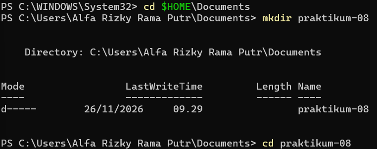

**Pembahasan:** `mkdir` membuat folder baru, dan `cd` masuk ke dalamnya. Output tabel (`Mode`, `LastWriteTime`, `Name`) menunjukkan folder `praktikum-08` berhasil dibuat pada 26/11/2026.

### 3.2 Menginstal Python 3.14.4 dengan uv dan membuat virtual environment

```powershell
uv python install 3.14.4
uv python pin 3.14.4
uv venv
.venv\Scripts\Activate.ps1
```

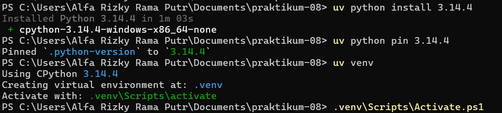

**Pembahasan:**

| Perintah | Fungsi | Hasil pada gambar |
|---|---|---|
| `uv python install 3.14.4` | Mengunduh Python 3.14.4 | `Installed Python 3.14.4 in 1m 03s` |
| `uv python pin 3.14.4` | Mengunci versi Python proyek | File `.python-version` dibuat |
| `uv venv` | Membuat virtual environment | Folder `.venv` dibuat dengan CPython 3.14.4 |
| `.venv\Scripts\Activate.ps1` | Mengaktifkan venv di PowerShell | Prompt berawalan `(praktikum-08)` |

Di Windows, aktivasi memakai `.venv\Scripts\Activate.ps1`. Di Linux (seperti pada modul) memakai `source .venv/bin/activate`.

### 3.3 Menginstal FastAPI dan SQLModel

```powershell
uv pip install "fastapi[standard]" sqlmodel
```

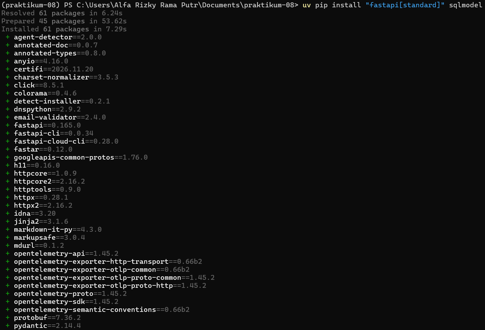
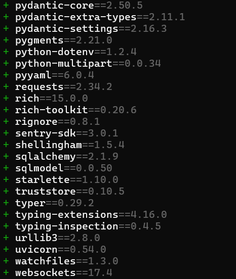

**Pembahasan:** uv menyelesaikan dependensi (`Resolved 61 packages in 6.24s`), mengunduh 45 paket (`Prepared 45 packages in 53.62s`), lalu memasang 61 paket (`Installed 61 packages in 7.29s`). Paket-paket utamanya:

| Paket | Versi |
|---|---|
| fastapi | 0.165.0 |
| sqlmodel | 0.0.50 |
| uvicorn | 0.54.0 |
| sqlalchemy | 2.1.9 |
| pydantic | 2.14.4 |
| starlette | 1.10.0 |

Jumlah dan versi paket berbeda dari screenshot di modul (45 paket) karena modul dibuat pada waktu yang berbeda dan versi terbaru berubah. Fungsinya sama.

### 3.4 Menginstal SQLite

SQLite diunduh dari halaman resmi `sqlite.org/download.html`.

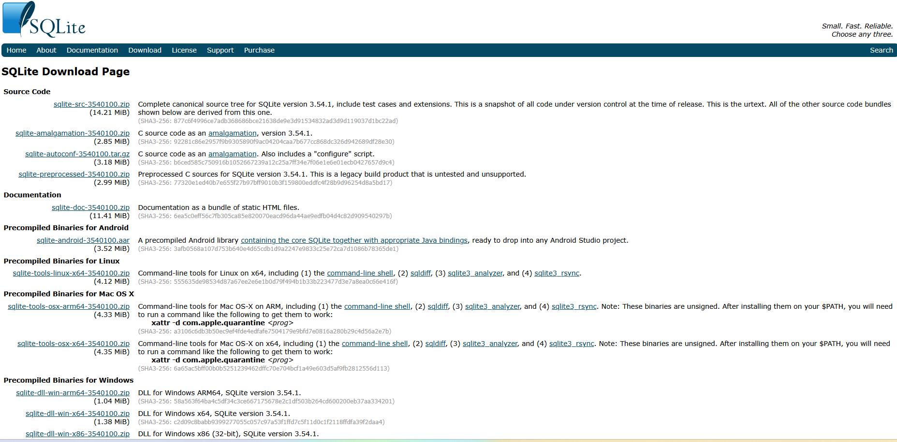

**Pembahasan:** Halaman unduhan menampilkan SQLite versi 3.54.1. Untuk Windows, yang dibutuhkan adalah paket **`sqlite-tools-win-x64`**, yang berisi program `sqlite3.exe`. Paket `sqlite-dll-win-...` hanya berisi library, bukan program yang bisa dijalankan di terminal.

Pada praktikum ini pemasangan dilakukan dengan `winget`, yang mengunduh `sqlite-tools-win-x64-3540100.zip` dan menambahkan alias `sqlite3` ke PATH:

```powershell
winget install SQLite.SQLite
sqlite3 --version
```

Terminal harus dibuka ulang setelah pemasangan agar PATH yang baru terbaca.

### 3.5 Membuat database di shell SQLite

Database `departemen-sdm.db` dibuat langsung di shell `sqlite3`, mengikuti contoh modul.

```powershell
sqlite3 departemen-sdm.db
```

```sql
.mode box
.headers on
CREATE TABLE sdm (id INTEGER PRIMARY KEY, npp CHAR(6), nama VARCHAR(50));
INSERT INTO sdm (npp, nama) VALUES('112233', 'Karyawan 1');
INSERT INTO sdm (npp, nama) VALUES('223344', 'Karyawan 2');
INSERT INTO sdm (npp, nama) VALUES('334455', 'Karyawan 3');
SELECT * FROM sdm;
.quit
```

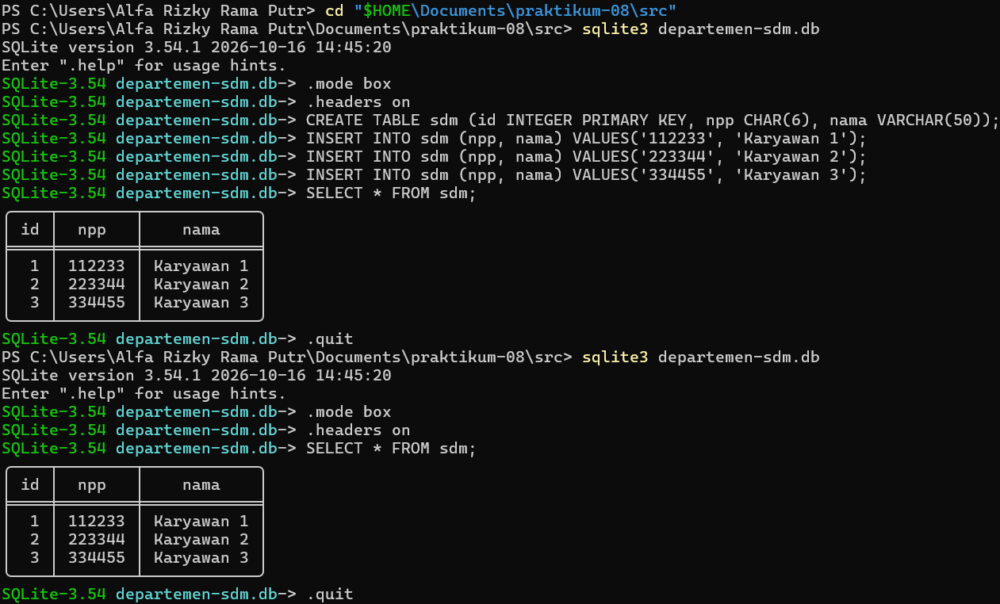

**Pembahasan:**

- `sqlite3 departemen-sdm.db` membuka database, dan membuat file baru kalau belum ada.
- `.mode box` dan `.headers on` mengatur tampilan hasil menjadi tabel berbingkai dengan judul kolom.
- `CREATE TABLE sdm (...)` membuat tabel dengan tiga kolom: `id` (primary key), `npp` (CHAR 6), dan `nama` (VARCHAR 50).
- Tiga `INSERT` memasukkan tiga data karyawan.
- `SELECT * FROM sdm;` menampilkan seluruh isi tabel.

Sesi kedua pada gambar membuka kembali database yang sama dan menjalankan `SELECT` tanpa membuat tabel atau data ulang. Ketiga data masih tampil, **membuktikan bahwa data tersimpan permanen di file `.db`**, tidak hilang saat shell ditutup.

---

## 4. Source Code Contoh Modul

File `service.py` untuk tabel `sdm`:

```python
from typing import List, Optional
from fastapi import Depends, FastAPI, HTTPException
from sqlmodel import Field, Session, SQLModel, create_engine, select


class Sdm(SQLModel, table=True):
    id: int | None = Field(default=None, primary_key=True)
    npp: str
    nama: str


engine = create_engine("sqlite:///departemen-sdm.db")


def get_session():
    with Session(engine) as session:
        yield session


app = FastAPI()

@app.get("/sdm/", response_model=List[Sdm])
def read_sdm(session: Session = Depends(get_session)):
    # SQLModel select statement
    statement = select(Sdm)
    results = session.exec(statement).all()
    return results
```

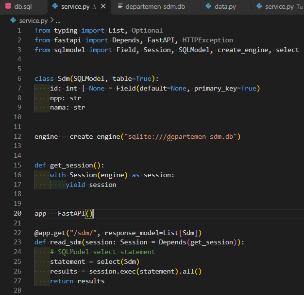

**Pembahasan per bagian:**

| Bagian kode | Penjelasan |
|---|---|
| `class Sdm(SQLModel, table=True)` | Model yang mewakili tabel `sdm`, dengan kolom `id`, `npp`, `nama`. `id` adalah primary key dan boleh `None` karena dibuat otomatis oleh database. |
| `create_engine("sqlite:///departemen-sdm.db")` | Menghubungkan aplikasi ke file database SQLite. |
| `get_session()` | Membuka session database untuk setiap permintaan dan menutupnya otomatis setelah selesai (memakai `yield`). |
| `app = FastAPI()` | Membuat aplikasi FastAPI. |
| `@app.get("/sdm/", response_model=List[Sdm])` | Mendaftarkan endpoint **GET** di alamat `/sdm/` yang mengembalikan daftar objek `Sdm`. |
| `Depends(get_session)` | Dependency injection: FastAPI menyediakan session ke fungsi secara otomatis. |
| `select(Sdm)` dan `.all()` | Membentuk query `SELECT` pada tabel `sdm` dan mengambil semua barisnya. |

Pada editor tampak garis bawah kuning pada `fastapi` dan `sqlmodel`. Itu peringatan karena VS Code belum memakai interpreter dari `.venv`, bukan error program. `Optional` dan `HTTPException` tampak pudar karena diimpor tetapi belum dipakai di contoh ini.

---

## 5. Menjalankan dan Menguji Contoh Modul

Server dijalankan dengan:

```powershell
uvicorn service:app --reload
```

Opsi `--reload` membuat server otomatis dimuat ulang saat kode berubah. Setelah muncul `Application startup complete.`, layanan dapat diuji.

### 5.1 Melalui browser

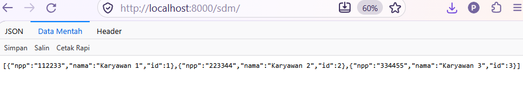

**Pembahasan:** Mengakses `http://localhost:8000/sdm/` menampilkan tiga data dalam format JSON. Browser (Firefox) menampilkannya pada tab **Data Mentah**, yaitu teks JSON apa adanya, sama seperti contoh pada modul.

### 5.2 Melalui curl

```powershell
curl.exe http://localhost:8000/sdm/
```

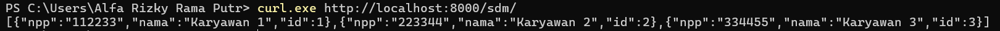

**Pembahasan:** Hasilnya identik dengan tampilan browser. Di PowerShell perlu menulis `curl.exe`, karena `curl` saja adalah alias untuk `Invoke-WebRequest` dengan keluaran yang berbeda.

---


# 6. Tugas

Tugas meminta membuat tabel baru yang berbeda dari contoh, mengisi 5 data lewat script Python, membuat endpoint REST API untuk menampilkan seluruh data, dan menampilkannya dengan curl. Tabel yang dibuat adalah **`produk`** pada database `toko.db`.

### 6.0 Struktur folder

File tugas dikumpulkan dalam folder `src\Tugas`. Folder `src` dibuat dan dibuka di VS Code.

```powershell
mkdir src
cd src
code .
```

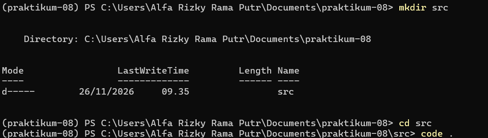

Sebelum memulai, database lama dihapus agar data tidak terisi dua kali:

```powershell
cd "$HOME\Documents\praktikum-08"
.venv\Scripts\Activate.ps1
cd src\Tugas
dir
Remove-Item toko.db
```

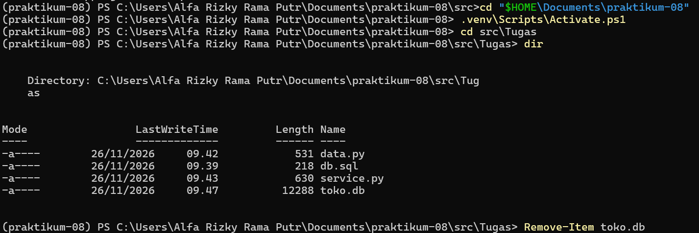

**Pembahasan:** `dir` menampilkan isi folder `Tugas` (`data.py`, `db.sql`, `service.py`, `toko.db`). `Remove-Item toko.db` menghapus database dari percobaan sebelumnya, sehingga tabel dan data dibuat bersih dari awal.

### 6.1 Tugas 1: Membuat tabel

File `db.sql`:

```sql
CREATE TABLE IF NOT EXISTS produk (
    id INTEGER PRIMARY KEY AUTOINCREMENT,
    stok INT NOT NULL,
    kode CHAR(5) NOT NULL,
    nama VARCHAR(100) NOT NULL,
    tersedia BOOLEAN NOT NULL,
    harga FLOAT NOT NULL
);
```

Dijalankan dengan:

```powershell
python -c "import sqlite3;c=sqlite3.connect('toko.db');c.executescript(open('db.sql').read());c.close()"
sqlite3 toko.db ".schema"
```

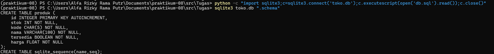

**Pembahasan:** Perintah `python -c` membaca `db.sql` dan menjalankannya pada `toko.db`. Operator `<` tidak dipakai karena tidak didukung PowerShell. `.schema` menampilkan struktur tabel yang terbentuk. Tabel memenuhi syarat tugas:

| Syarat | Kolom |
|---|---|
| 1 primary key | `id` |
| INT | `stok` |
| CHAR | `kode` CHAR(5) |
| VARCHAR | `nama` VARCHAR(100) |
| BOOLEAN | `tersedia` |
| FLOAT | `harga` |

Pada hasil `.schema` juga muncul tabel `sqlite_sequence`. Tabel ini dibuat otomatis oleh SQLite karena kolom `id` memakai `AUTOINCREMENT`, dan dipakai untuk mencatat nomor `id` terakhir.

### 6.2 Tugas 2: Mengisi 5 data dengan script Python

File `data.py`:

```python
import sqlite3

conn = sqlite3.connect("toko.db")
cur = conn.cursor()

data = [
    (50, "BRG01", "Keyboard Mekanik", True, 450000.50),
    (20, "BRG02", "Mouse Wireless", True, 175000.0),
    (0,  "BRG03", "Monitor 24 Inch", False, 1850000.75),
    (35, "BRG04", "Headset Gaming", True, 320000.0),
    (10, "BRG05", "Webcam Full HD", True, 275500.25),
]
cur.executemany(
    "INSERT INTO produk (stok, kode, nama, tersedia, harga) VALUES (?, ?, ?, ?, ?)",
    data,
)
conn.commit()
conn.close()
print("5 data berhasil dimasukkan")
```

```powershell
python data.py
sqlite3 toko.db ".mode box" ".headers on" "SELECT * FROM produk;"
```

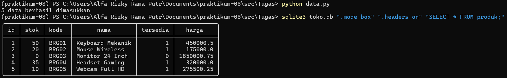

**Pembahasan:** Script membuka koneksi ke `toko.db`, memasukkan lima baris sekaligus dengan `executemany`, menyimpan perubahan dengan `commit()`, lalu menutup koneksi. Tanda tanya `?` pada query adalah *parameterized query*, yang lebih aman dan rapi daripada menyusun string SQL secara manual. Pesan `5 data berhasil dimasukkan` muncul, dan `SELECT` menampilkan kelima baris.

Kolom `tersedia` tampil sebagai `1` dan `0` karena SQLite tidak punya tipe boolean asli. Nilai `True` disimpan sebagai `1` dan `False` sebagai `0`.

### 6.3 Tugas 3: Membuat endpoint REST API

File `service.py` (tabel `produk`):

```python
from typing import List
from fastapi import Depends, FastAPI
from sqlmodel import Field, Session, SQLModel, create_engine, select


class Produk(SQLModel, table=True):
    id: int | None = Field(default=None, primary_key=True)
    stok: int
    kode: str
    nama: str
    tersedia: bool
    harga: float


engine = create_engine("sqlite:///toko.db")


def get_session():
    with Session(engine) as session:
        yield session


app = FastAPI()


@app.get("/produk/", response_model=List[Produk])
def read_produk(session: Session = Depends(get_session)):
    statement = select(Produk)
    return session.exec(statement).all()
```

Server dijalankan dari folder `src\Tugas`, tempat `toko.db` berada:

```powershell
uvicorn service:app --reload
```

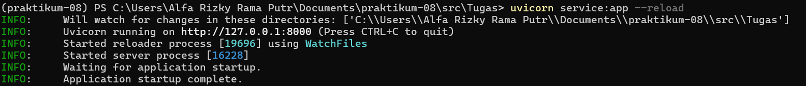

**Pembahasan:** Strukturnya sama dengan contoh modul, hanya model, nama database, dan alamat endpoint yang berbeda (`Produk`, `toko.db`, `/produk/`). Log menunjukkan server berjalan di `http://127.0.0.1:8000` dan aplikasi siap (`Application startup complete.`). Nomor di dalam `[...]` adalah nomor proses (PID) yang ditentukan sistem operasi, jadi berbeda pada setiap komputer dan setiap kali dijalankan.

Pemetaan tipe data dari tabel ke model:

| Kolom SQLite | Tipe pada model |
|---|---|
| INT | `int` |
| CHAR, VARCHAR | `str` |
| BOOLEAN | `bool` |
| FLOAT | `float` |

Pemetaan ini membuat nilai `1`/`0` di SQLite tampil sebagai `true`/`false` di JSON.

Pada percobaan awal, log server juga mencatat permintaan yang berhasil:

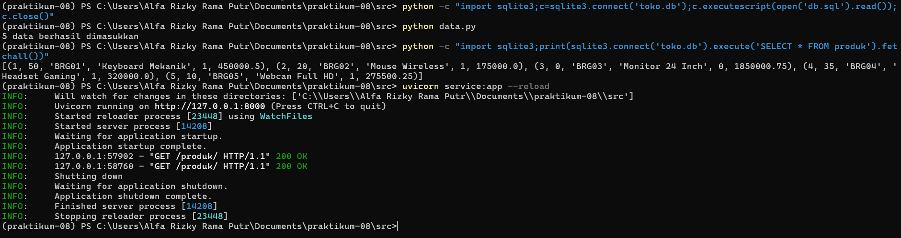

**Pembahasan:** Baris `"GET /produk/ HTTP/1.1" 200 OK` berarti permintaan ke endpoint `/produk/` berhasil dijawab server. Pada bagian bawah, server dihentikan dengan `Ctrl+C`, ditandai `Shutting down` dan `Application shutdown complete`.

### 6.4 Tugas 4: Menampilkan hasil dengan curl

```powershell
curl.exe http://localhost:8000/produk/
```

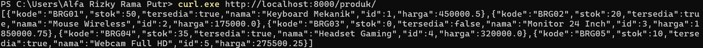

Agar JSON lebih mudah dibaca, keluaran dapat diteruskan ke `json.tool`:

```powershell
curl.exe -s http://127.0.0.1:8000/produk/ | python -m json.tool
```

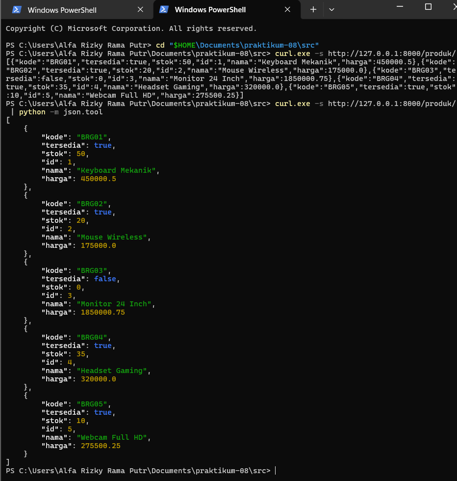

**Pembahasan:** Endpoint mengembalikan lima data produk dalam format JSON. Opsi `-s` pada curl menyembunyikan indikator progres, dan `| python -m json.tool` memformat JSON bertingkat agar mudah dibaca. Tipe data pada hasil sesuai tabel: `stok` dan `id` berupa bilangan bulat, `kode` dan `nama` berupa teks, `tersedia` berupa `true`/`false`, dan `harga` berupa bilangan desimal.

Endpoint juga dapat dibuka lewat browser:

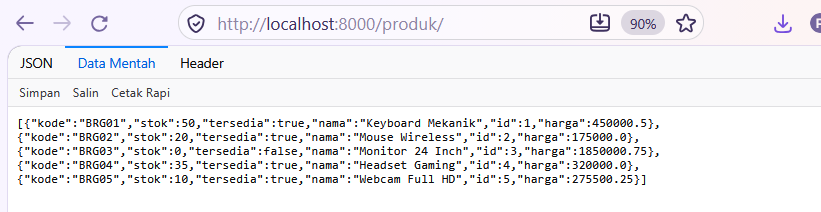

**Pembahasan:** Tampilan pada tab **Data Mentah** berisi data yang sama dengan hasil curl. Dengan begitu layanan dapat diakses oleh klien apa pun yang bisa mengirim permintaan HTTP, baik curl maupun browser.

---

## 7. Perbandingan Contoh Modul dan Tugas

| Aspek | Contoh modul | Tugas |
|---|---|---|
| Database | `departemen-sdm.db` | `toko.db` |
| Tabel | `sdm` (3 kolom) | `produk` (6 kolom) |
| Pembuatan tabel | Langsung di shell `sqlite3` | File `db.sql` |
| Pengisian data | `INSERT` di shell (3 data) | Script `data.py` (5 data) |
| Endpoint | `GET /sdm/` | `GET /produk/` |
| Tipe data | INTEGER, CHAR, VARCHAR | INT, CHAR, VARCHAR, BOOLEAN, FLOAT |

## 8. Kendala yang Ditemui dan Solusinya

| Kendala | Penyebab | Solusi |
|---|---|---|
| `&&` tidak dikenali di PowerShell | Windows PowerShell 5.1 tidak mendukung `&&` | Jalankan perintah satu per satu |
| `FileNotFoundError: 'buat_db.sql'` | Nama file tidak sesuai dengan yang ada di folder | Menyesuaikan nama file pada perintah |
| `curl` memberi hasil berbeda | Di PowerShell `curl` adalah alias `Invoke-WebRequest` | Memakai `curl.exe` |
| `curl: (7) Failed to connect` | Server `uvicorn` tidak sedang berjalan | Menjalankan `uvicorn` di terminal terpisah |
| Garis kuning pada `fastapi` dan `sqlmodel` di VS Code | VS Code belum memakai interpreter `.venv` | Memilih interpreter `praktikum-08 (3.14.4)` |
| Log `GET /favicon.ico ... 404` | Browser otomatis mencari ikon situs yang tidak disediakan aplikasi | Diabaikan, tidak memengaruhi endpoint |

## 9. Kesimpulan

1. Lingkungan Python berhasil disiapkan dengan `uv`, termasuk virtual environment dan paket FastAPI serta SQLModel.
2. Database SQLite menyimpan data dalam satu file dan datanya tetap ada setelah shell ditutup.
3. REST API sederhana berhasil dibuat dengan FastAPI dan SQLModel. Satu fungsi dengan dekorator `@app.get(...)` cukup untuk menyediakan endpoint yang membaca data dari database.
4. Layanan dapat diuji dengan browser dan `curl`, dan hasilnya berupa JSON yang dapat diakses oleh klien mana pun melalui HTTP. Ini menjadi dasar arsitektur microservices, di mana frontend meminta layanan dari backend lewat API.
5. Seluruh tugas (tabel baru dengan tipe INT, CHAR, VARCHAR, BOOLEAN, FLOAT; 5 data lewat script Python; endpoint `/produk/`; dan pengujian dengan curl) berhasil dikerjakan.